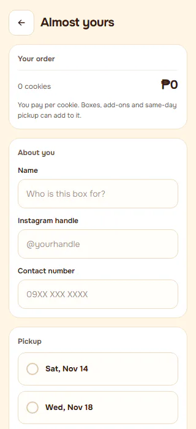
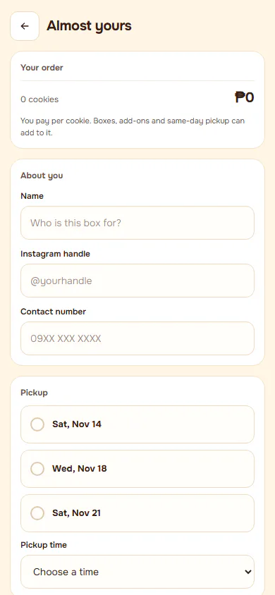
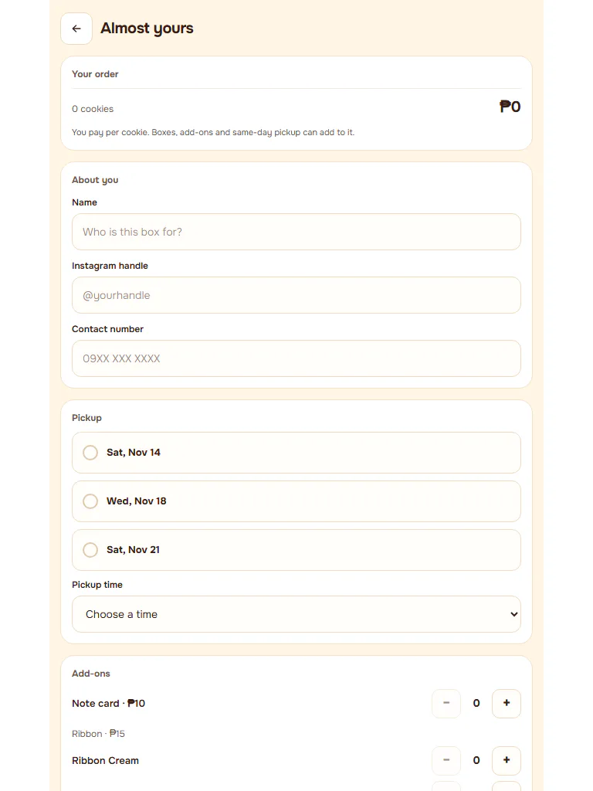
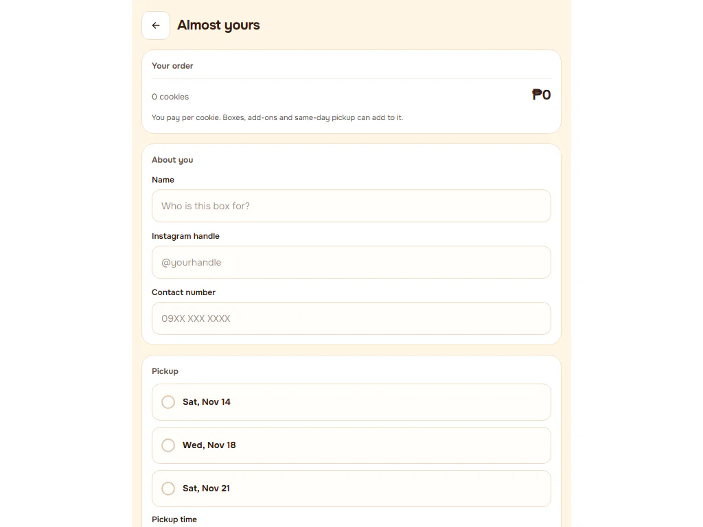
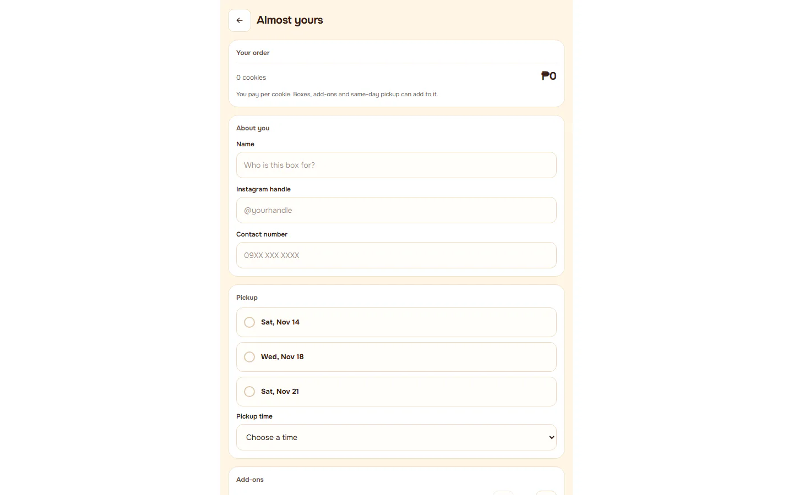
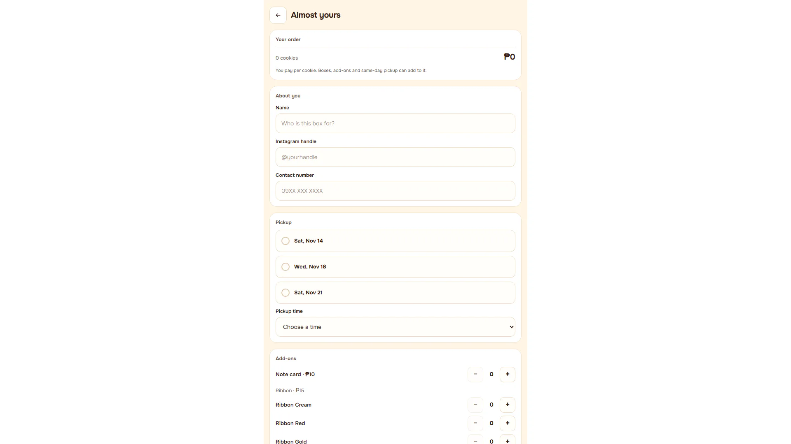
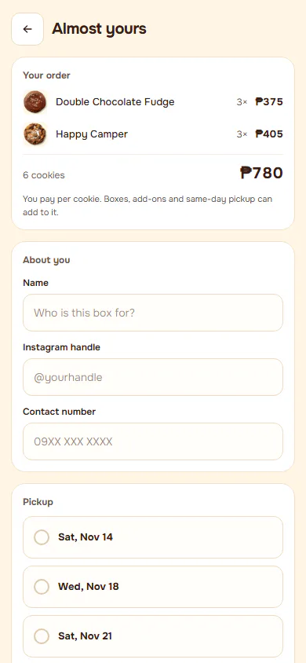
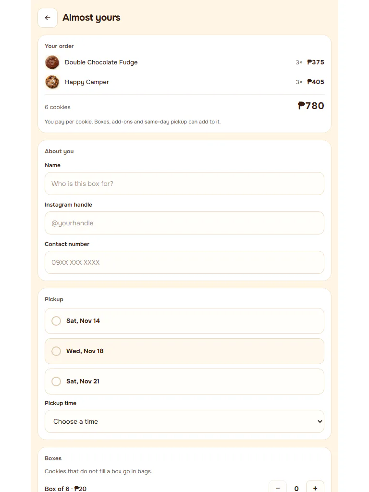
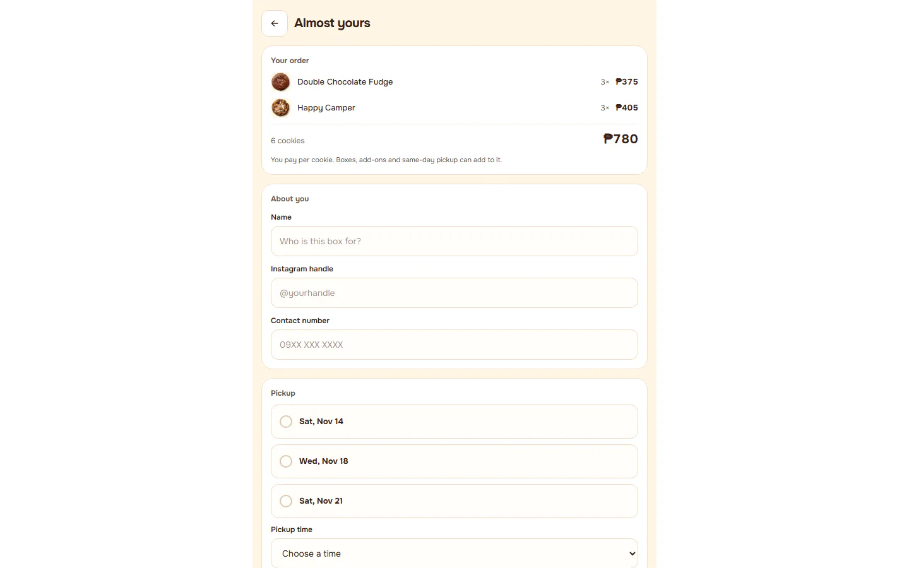

# Customer checkout

**ACTUAL application.** [Back to shop](README.md)

- Manifest id: `shop/customer-checkout`
- Source: `src/components/screens/checkout.tsx`
- Role: public
- Reference views: customer-checkout
- Drawn by an old ported screen, not the refined live interface.

## direct-address

Opened by address, with no box chosen. Group: data. Fixture: `signed-out`. How it was reached: ui-driven.

**p320** 320×700

**p390** 390×844

**t768** 768×1024

**l1024** 1024×768

**d1440** 1440×900

**w1920** 1920×1080

## from-shop

Group: interaction. Fixture: `signed-out`. How it was reached: ui-driven.

**p390** 390×844

**t768** 768×1024

**d1440** 1440×900

