# Customer shop

**ACTUAL application.** [Back to shop](README.md)

- Manifest id: `shop/customer-shop`
- Source: `src/components/screens/shop.tsx`
- Role: public
- Reference views: customer-shop
- Drawn by an old ported screen, not the refined live interface.

## populated

Group: data. Fixture: `signed-out`. How it was reached: ui-driven.

**p320** 320×700

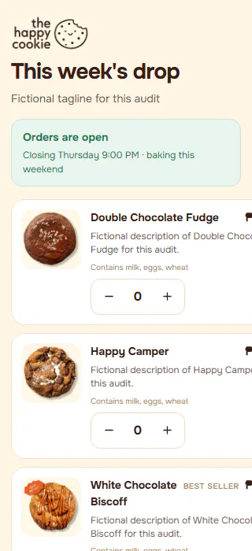

**p390** 390×844

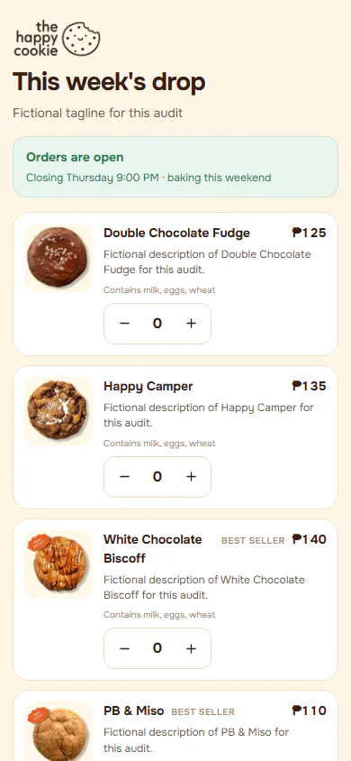

**t768** 768×1024

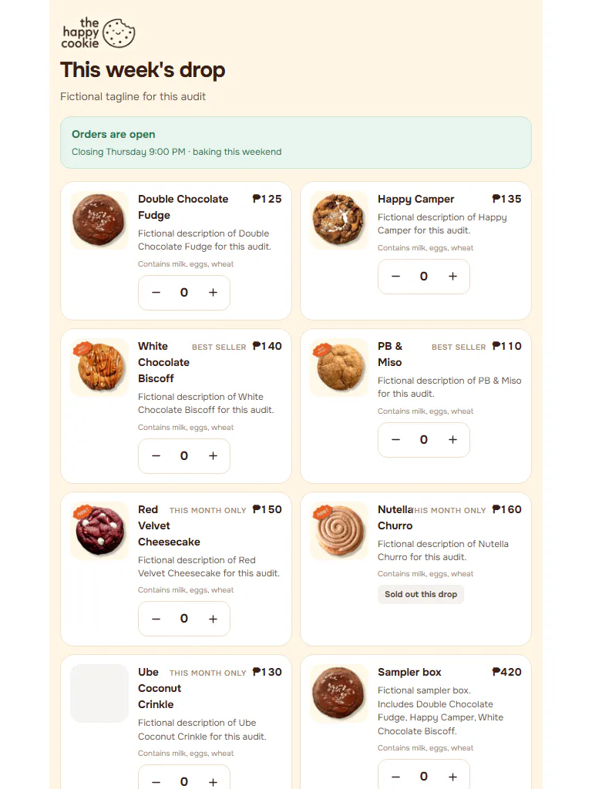

**l1024** 1024×768

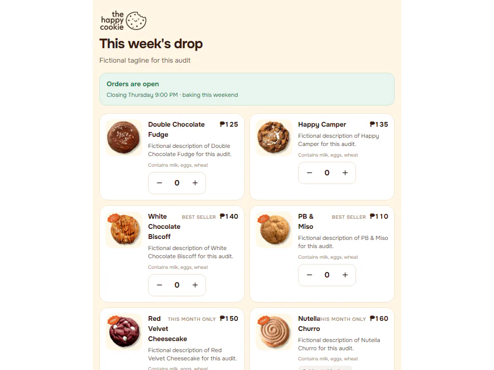

**d1440** 1440×900

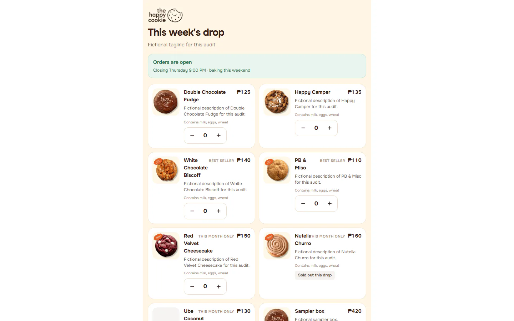

**w1920** 1920×1080

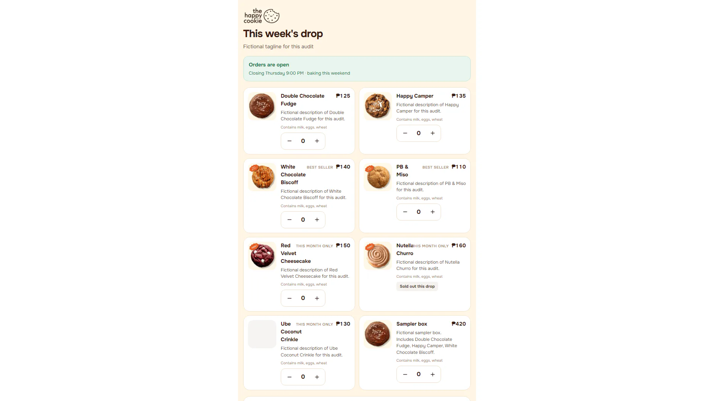

## empty-menu

Group: data. Fixture: `data:empty;signed-out`. How it was reached: rpc-fixture.

**p390** 390×844

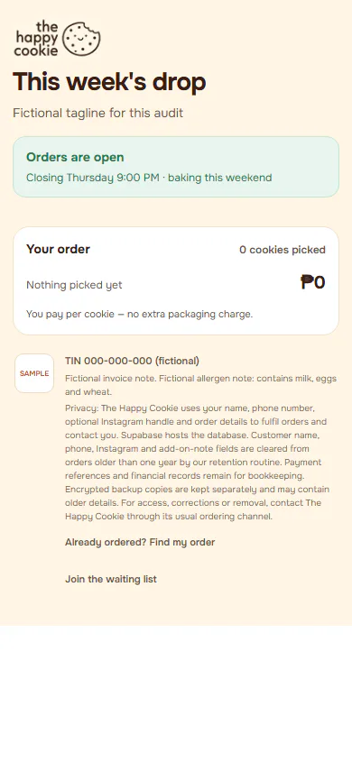

**d1440** 1440×900

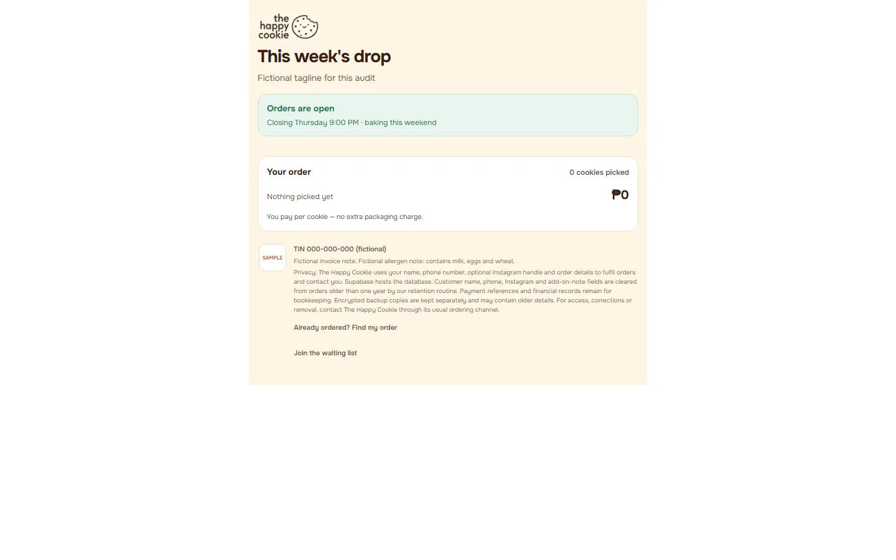

## long-text

Group: data. Fixture: `data:long;signed-out`. How it was reached: rpc-fixture.

**p390** 390×844

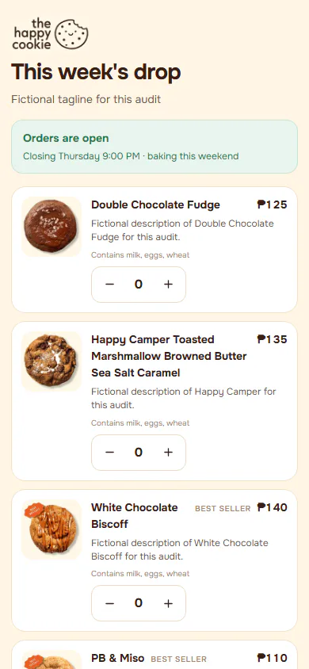

**d1440** 1440×900

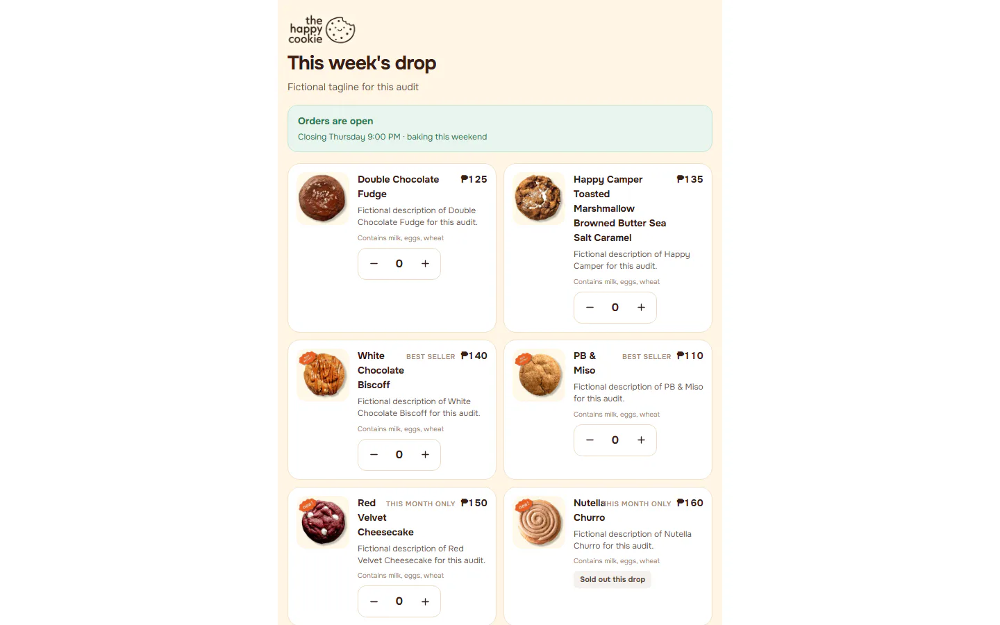

## quantities-added

Group: interaction. Fixture: `signed-out`. How it was reached: ui-driven.

**p390** 390×844

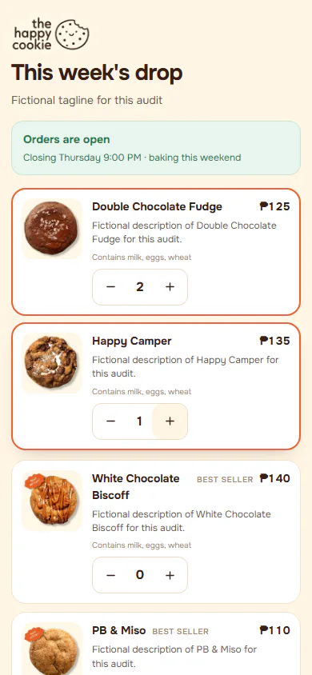

**t768** 768×1024

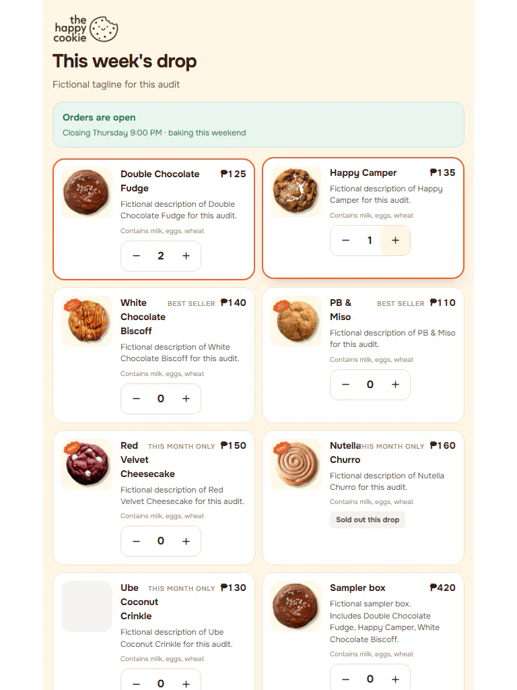

**d1440** 1440×900

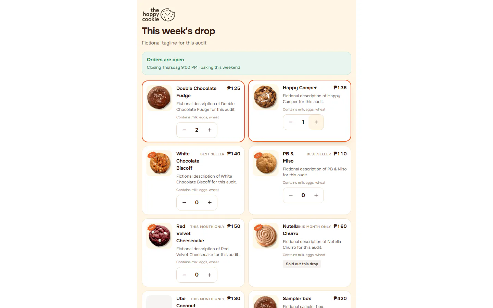

## shop-closed

Group: business. Fixture: `shop:closed;signed-out`. How it was reached: ui-driven.

**p390** 390×844

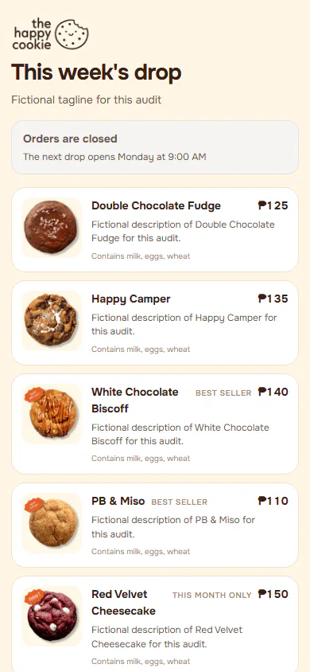

**d1440** 1440×900

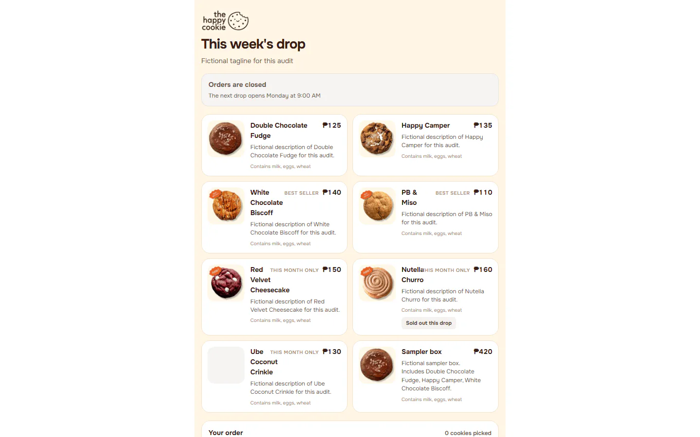

## read-failure

Group: failure. Fixture: `signed-out;fail:shop_products=down,get_shop_status=down`. How it was reached: rpc-fixture.

**p390** 390×844 (pixel-identical to `shop/customer-shop/empty-menu@p390`)

**d1440** 1440×900 (pixel-identical to `shop/customer-shop/empty-menu@d1440`)

## waiting-list

Group: interaction. Fixture: `signed-out`. How it was reached: ui-driven.

**p390** 390×844

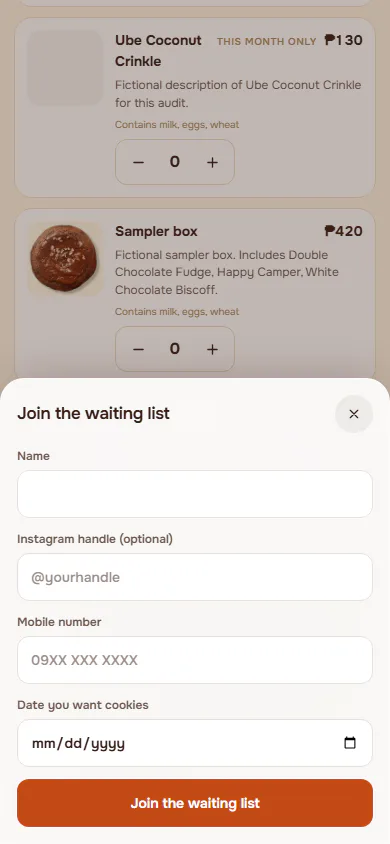

**d1440** 1440×900

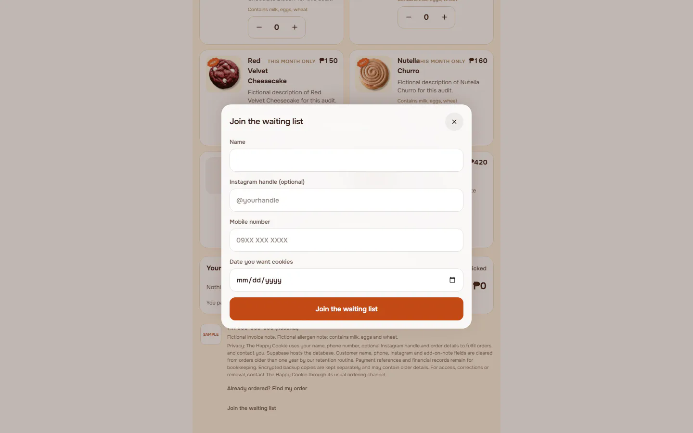
