# Customer order status

**ACTUAL application.** [Back to shop](README.md)

- Manifest id: `shop/customer-status`
- Source: `src/components/screens/order-status.tsx`
- Role: public
- Reference views: customer-status
- Drawn by an old ported screen, not the refined live interface.

## awaiting-payment-claimed

Group: business. Fixture: `signed-out`. How it was reached: ui-driven.

**p390** 390×844

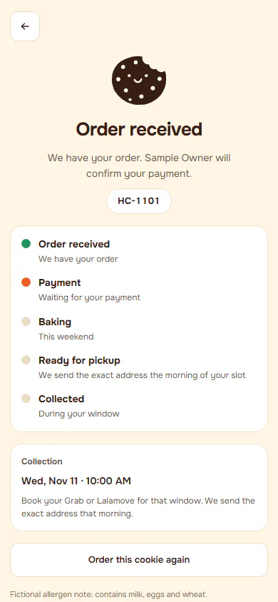

**d1440** 1440×900

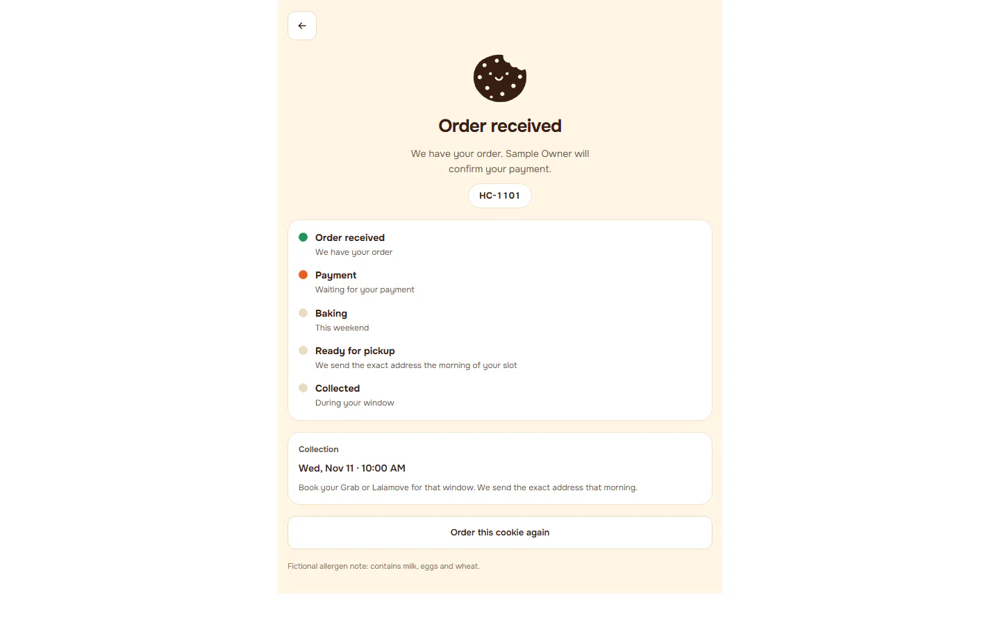

## awaiting-payment-unpaid

Group: business. Fixture: `signed-out`. How it was reached: ui-driven.

**p390** 390×844

**d1440** 1440×900

## confirmed

Group: business. Fixture: `signed-out`. How it was reached: ui-driven.

**p390** 390×844

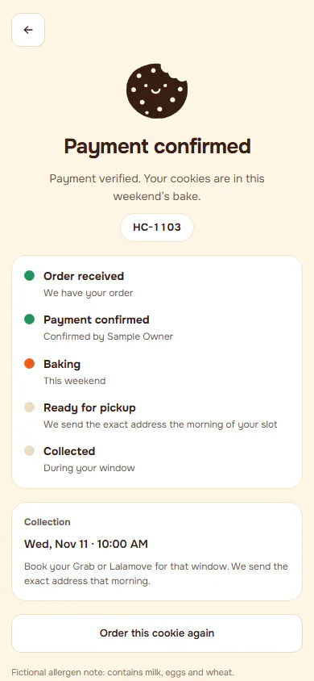

**d1440** 1440×900

## preparing

Group: business. Fixture: `signed-out`. How it was reached: ui-driven.

**p390** 390×844

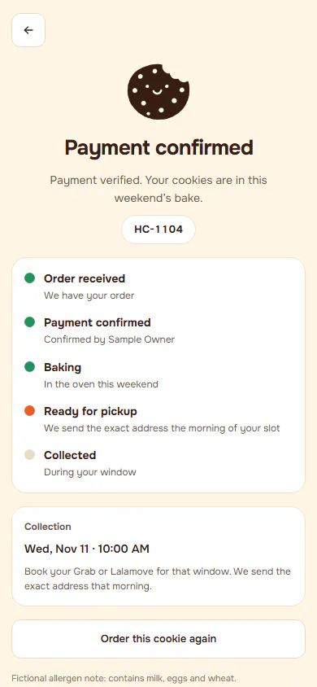

**d1440** 1440×900

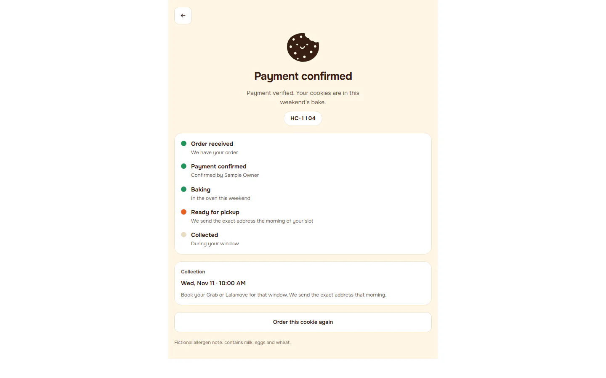

## ready

Group: business. Fixture: `signed-out`. How it was reached: ui-driven.

**p320** 320×700

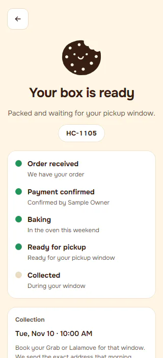

**p390** 390×844

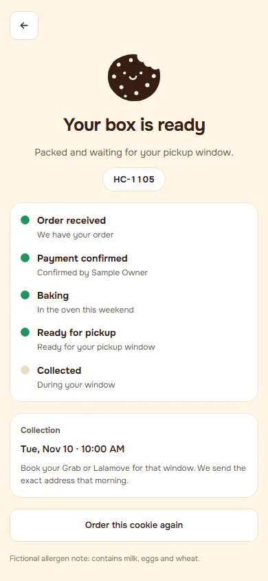

**t768** 768×1024

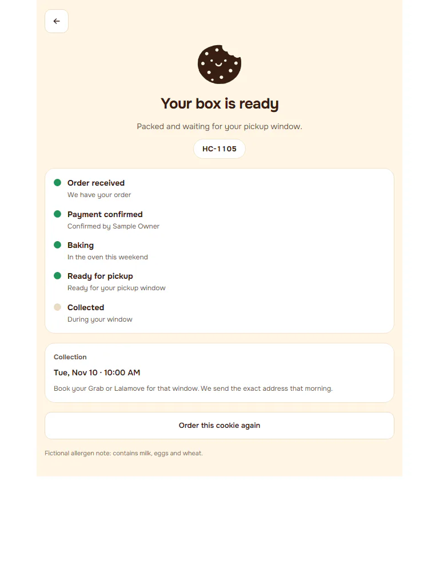

**l1024** 1024×768

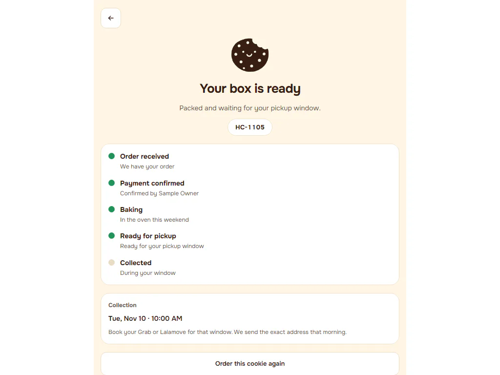

**d1440** 1440×900

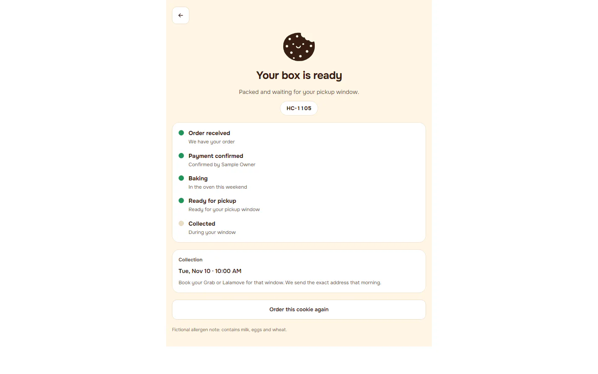

**w1920** 1920×1080

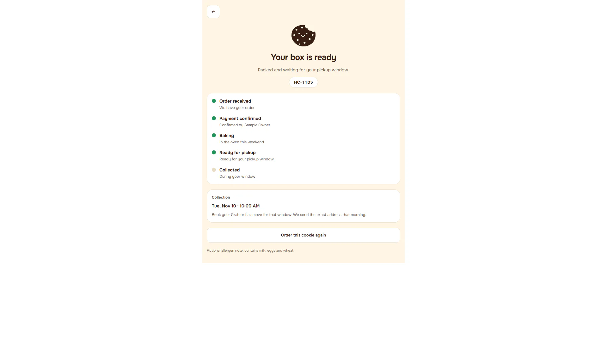

## completed

Group: business. Fixture: `signed-out`. How it was reached: ui-driven.

**p390** 390×844

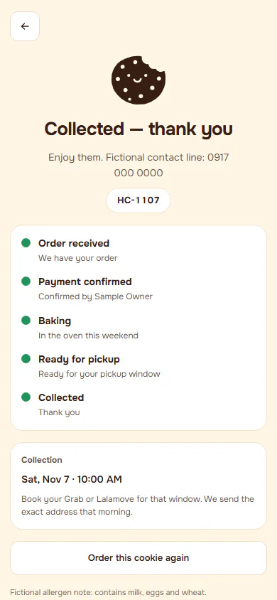

**d1440** 1440×900

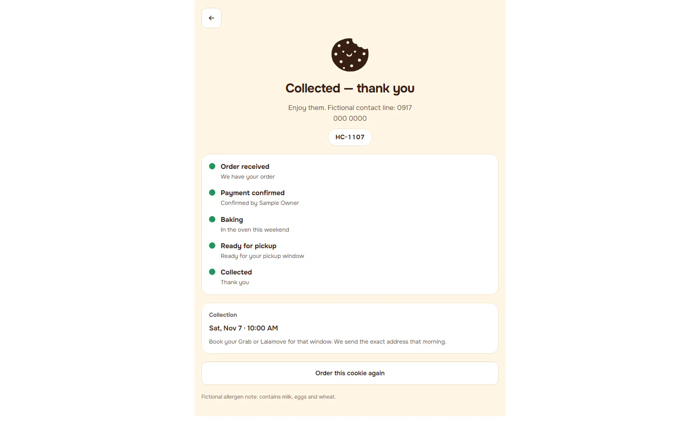

## cancelled

Group: business. Fixture: `signed-out`. How it was reached: ui-driven.

**p390** 390×844

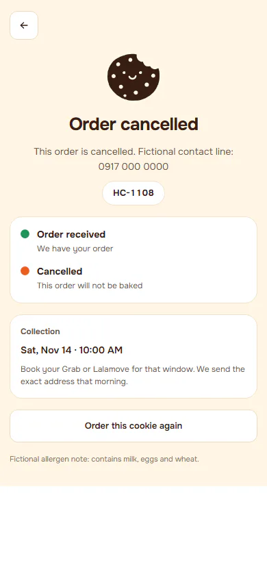

**d1440** 1440×900

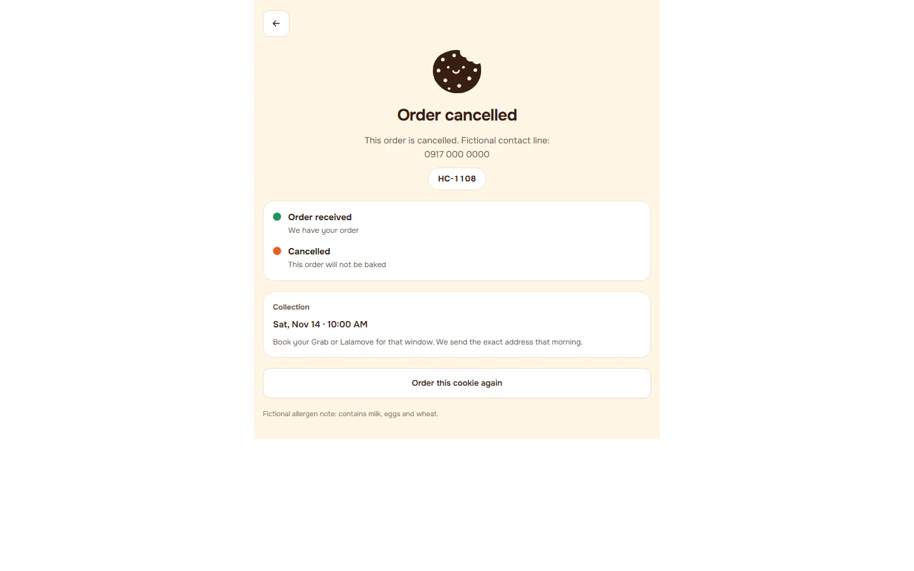

## no-show

Group: business. Fixture: `signed-out`. How it was reached: ui-driven.

**p390** 390×844

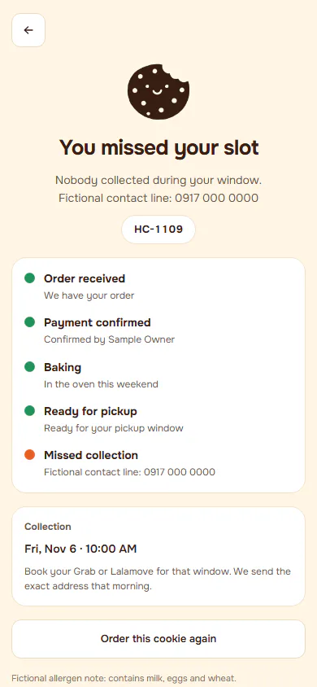

**d1440** 1440×900

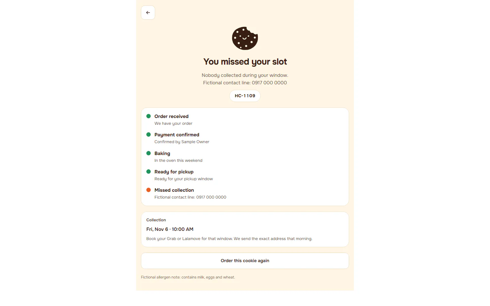

## unknown-link

Group: failure. Fixture: `signed-out`. How it was reached: ui-driven.

**p390** 390×844

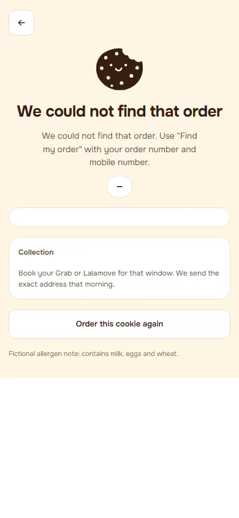

**d1440** 1440×900

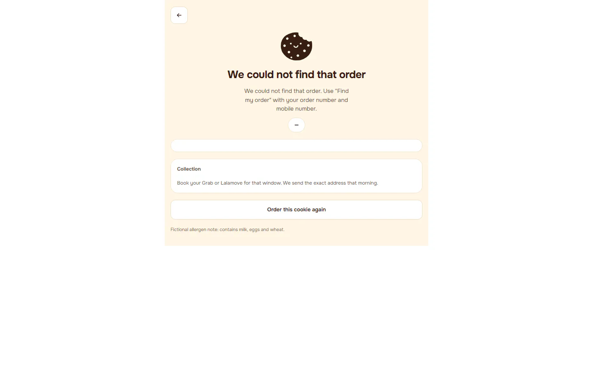

## no-link

Group: failure. Fixture: `signed-out`. How it was reached: ui-driven.

**p390** 390×844 (pixel-identical to `shop/customer-status/unknown-link@p390`)

**d1440** 1440×900 (pixel-identical to `shop/customer-status/unknown-link@d1440`)

## read-failure

Group: failure. Fixture: `signed-out;fail:order_status=down`. How it was reached: rpc-fixture.

**p390** 390×844

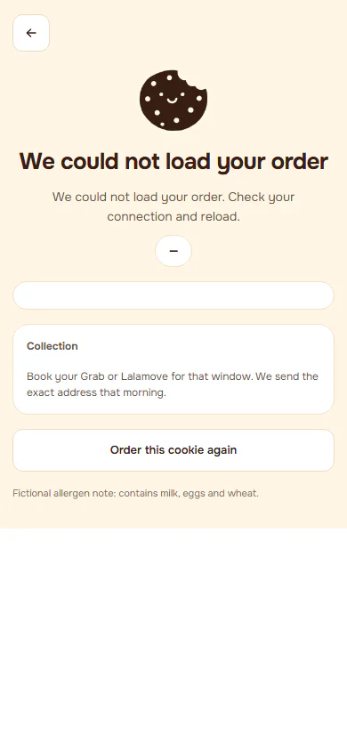

**d1440** 1440×900

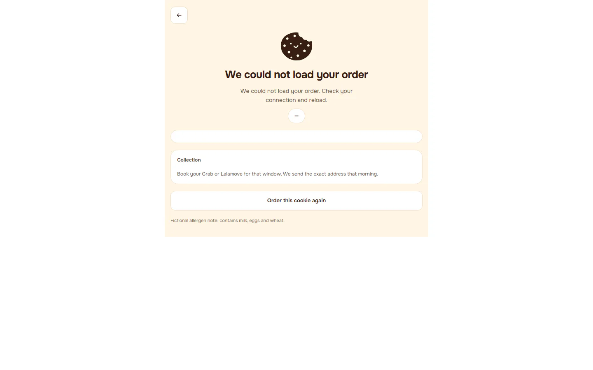
