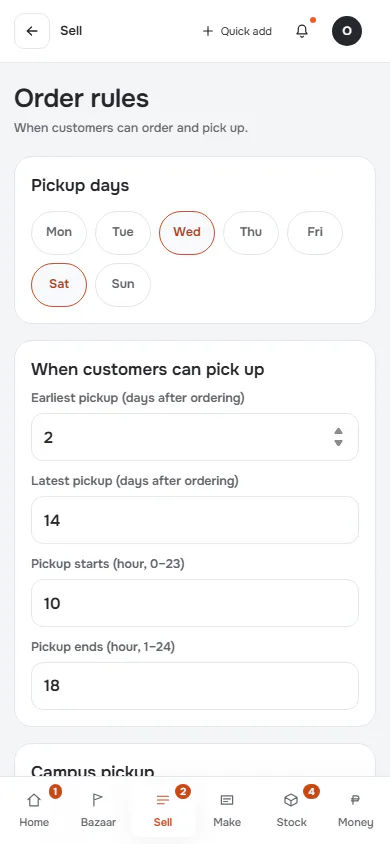
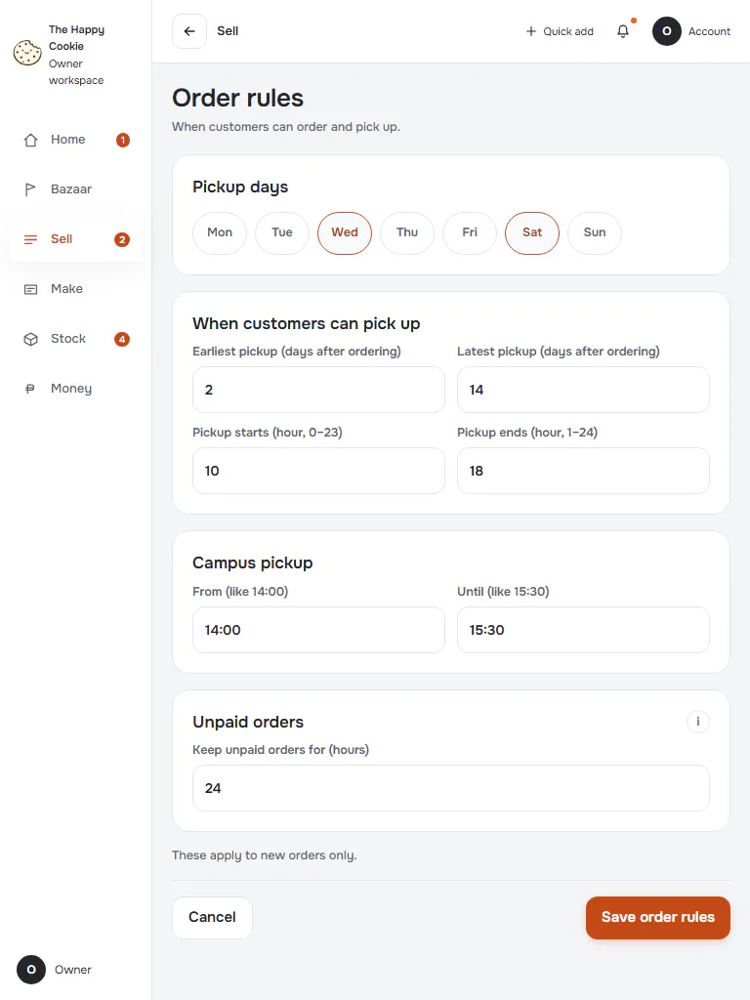
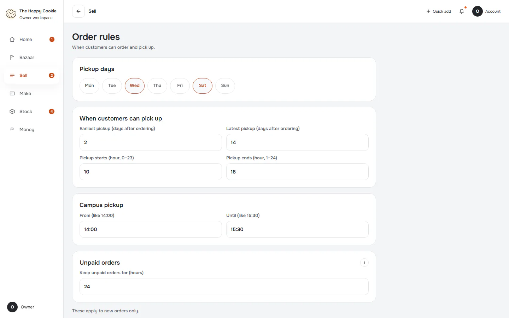
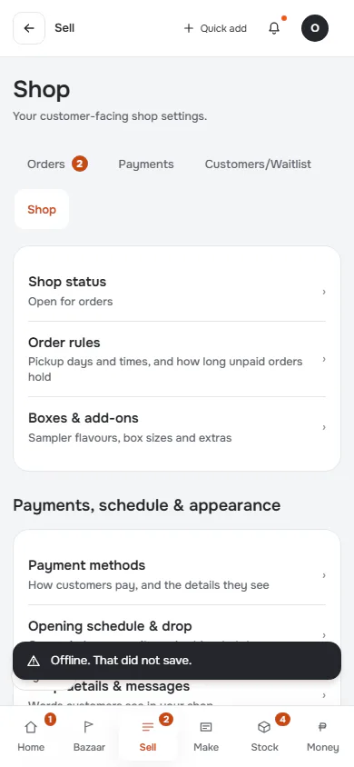
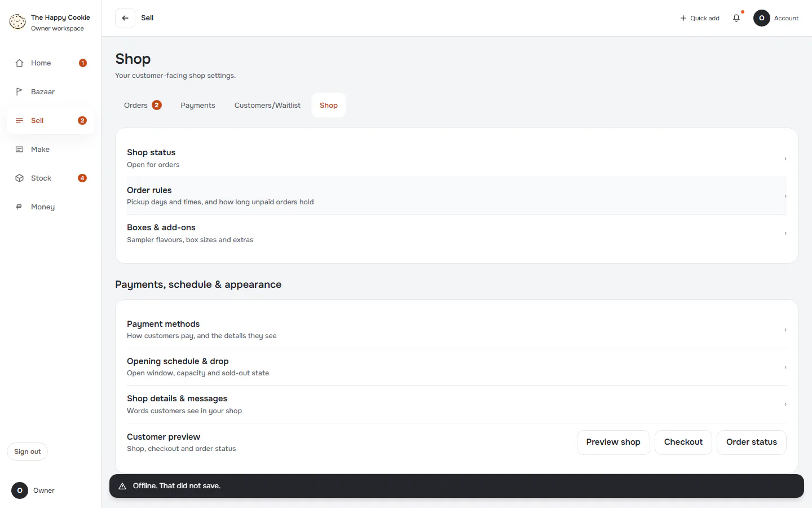
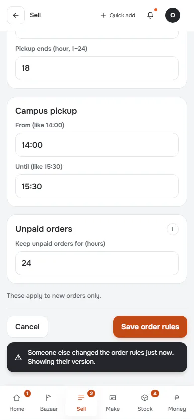
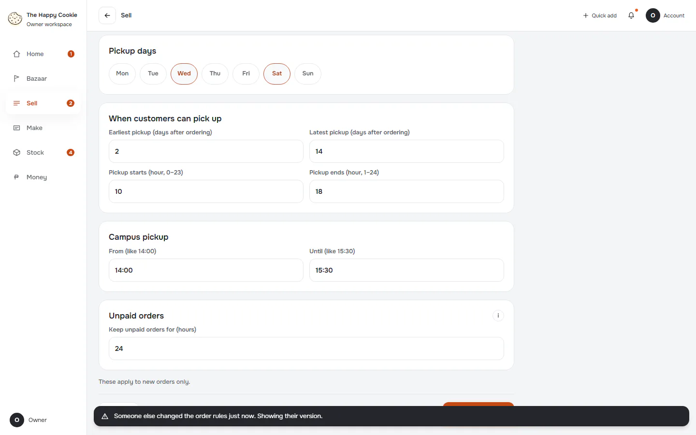

# Order rules

**ACTUAL application.** [Back to shop](README.md)

- Manifest id: `shop/order-rules`
- Source: `src/components/live/order-rules-form.tsx`
- Role: owner
- Reference views: order-rules

## default

Group: interaction. Fixture: `default`. How it was reached: ui-driven.

**p390** 390×844 · [full page](../../screenshots/shop/order-rules/default/p390.full.webp)

**t768** 768×1024

**d1440** 1440×900 · [full page](../../screenshots/shop/order-rules/default/d1440.full.webp)

## read-failure

The form does not open: the page falls back to the Shop hub, with no message on the page. Group: failure. Fixture: `fail:get_order_rules=down`. How it was reached: rpc-fixture.

**p390** 390×844 · [full page](../../screenshots/shop/order-rules/read-failure/p390.full.webp)

**d1440** 1440×900

## save-conflict

Group: failure. Fixture: `default`. How it was reached: ui-driven.

**p390** 390×844 · [full page](../../screenshots/shop/order-rules/save-conflict/p390.full.webp)

**d1440** 1440×900 · [full page](../../screenshots/shop/order-rules/save-conflict/d1440.full.webp)

