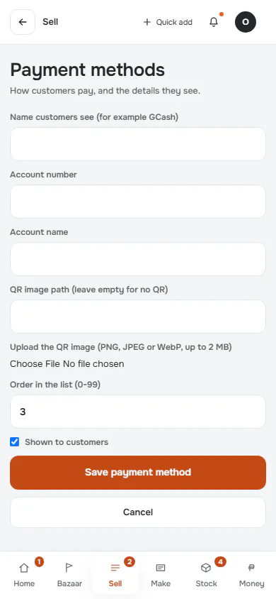
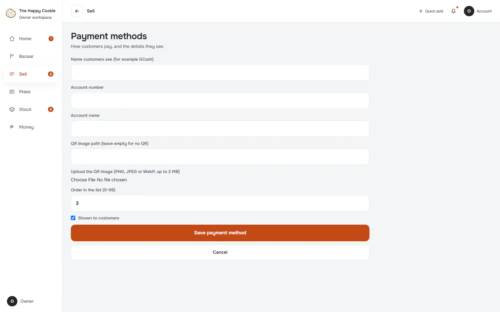
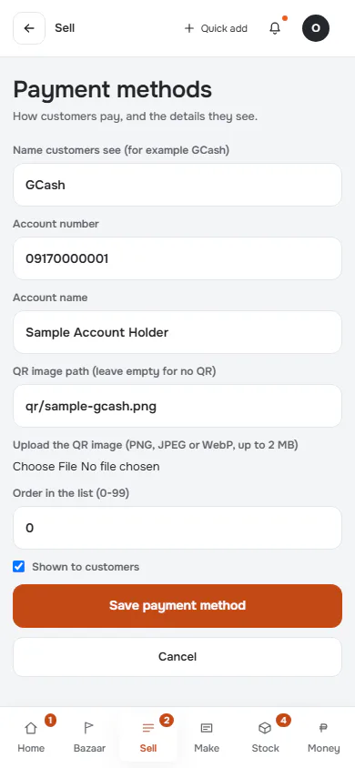
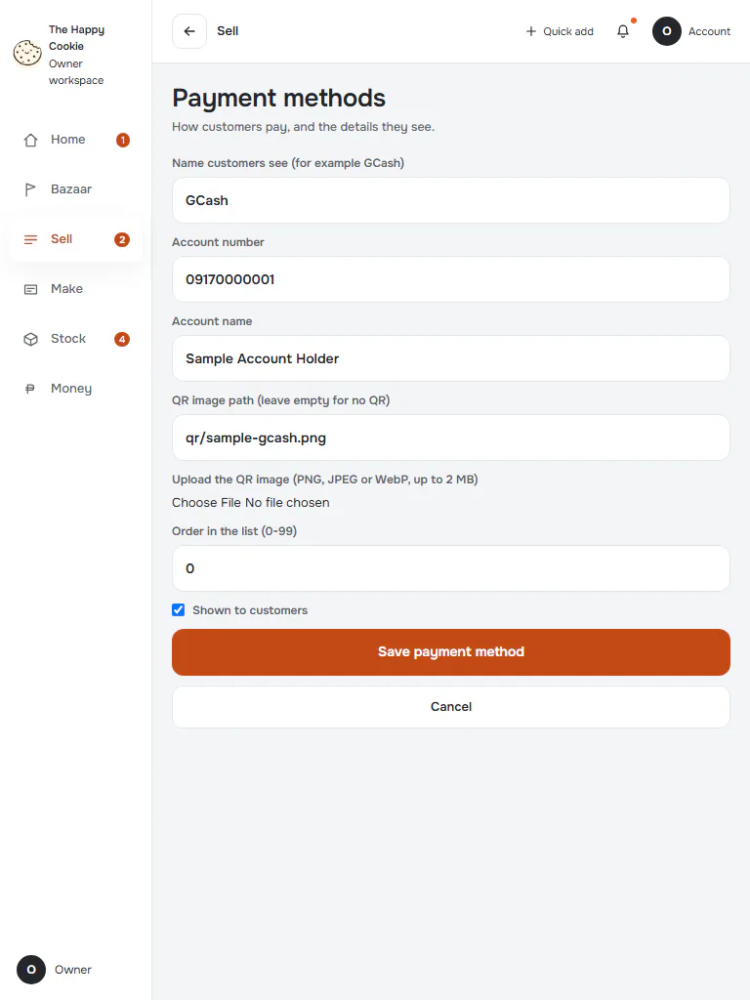
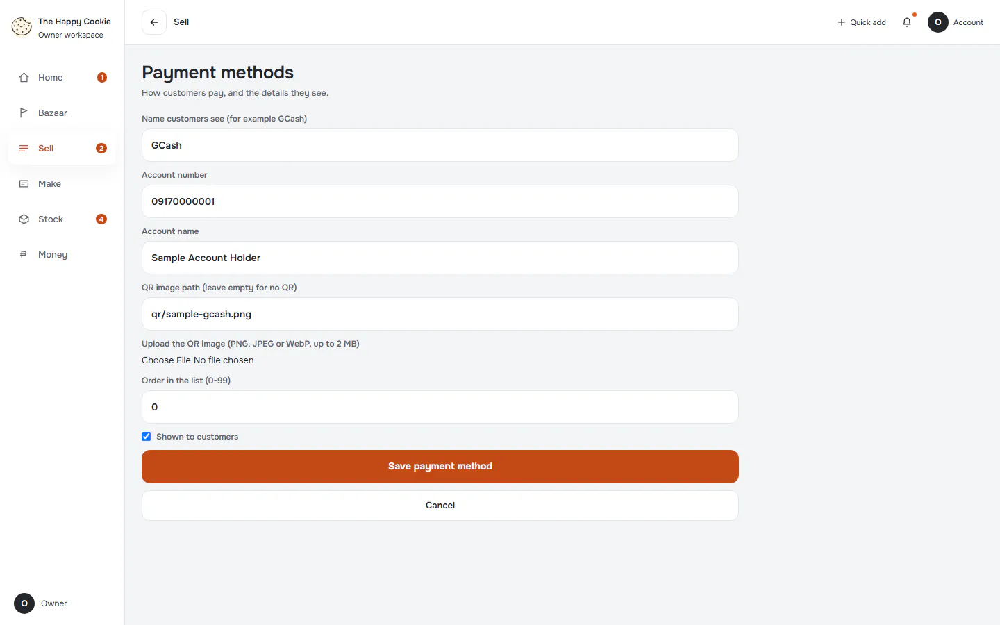
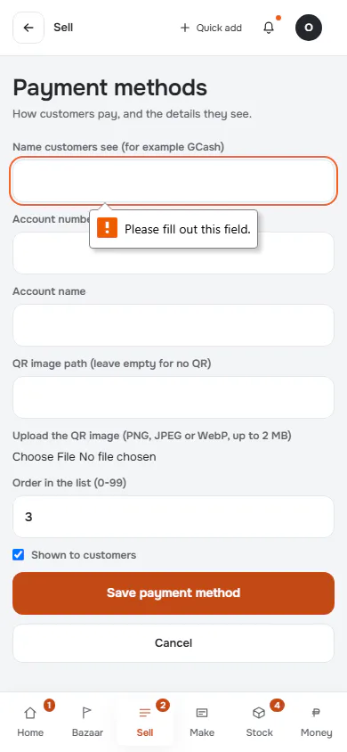

# Add or edit a payment method

**ACTUAL application.** [Back to shop](README.md)

- Manifest id: `shop/payment-method-edit`
- Source: `src/components/live/payment-forms.tsx`
- Role: owner
- Reference views: payment-method-edit

## add-new

Group: interaction. Fixture: `default`. How it was reached: ui-driven.

**p390** 390×844 · [full page](../../screenshots/shop/payment-method-edit/add-new/p390.full.webp)

**t768** 768×1024

**d1440** 1440×900

## edit-existing

Group: interaction. Fixture: `default`. How it was reached: ui-driven.

**p390** 390×844 · [full page](../../screenshots/shop/payment-method-edit/edit-existing/p390.full.webp)

**t768** 768×1024

**d1440** 1440×900

## invalid

Group: interaction. Fixture: `default`. How it was reached: ui-driven.

**p390** 390×844 · [full page](../../screenshots/shop/payment-method-edit/invalid/p390.full.webp)

**d1440** 1440×900

