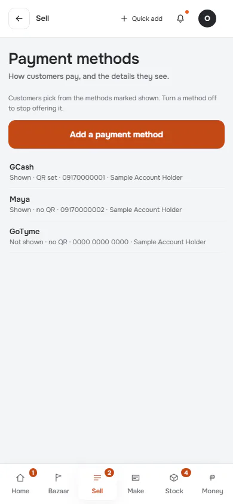
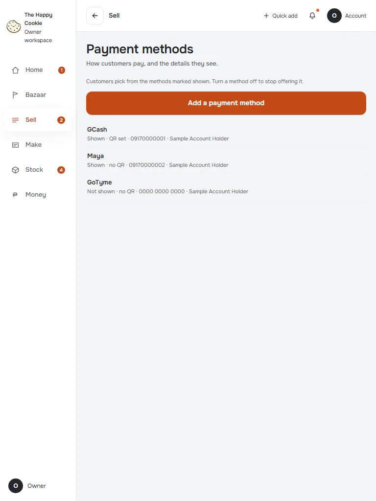
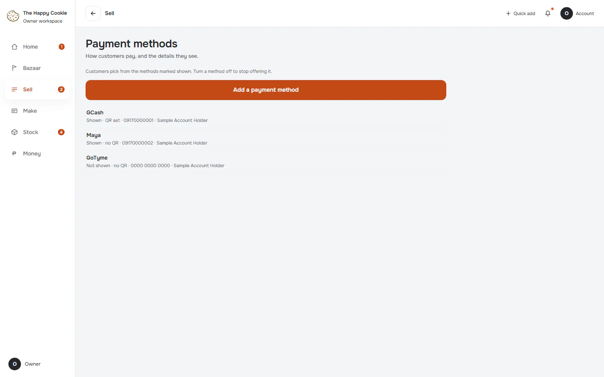
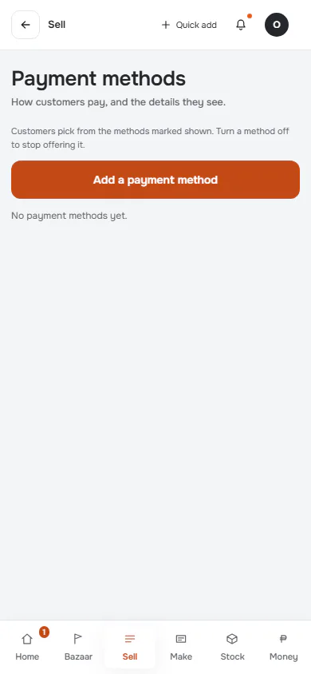
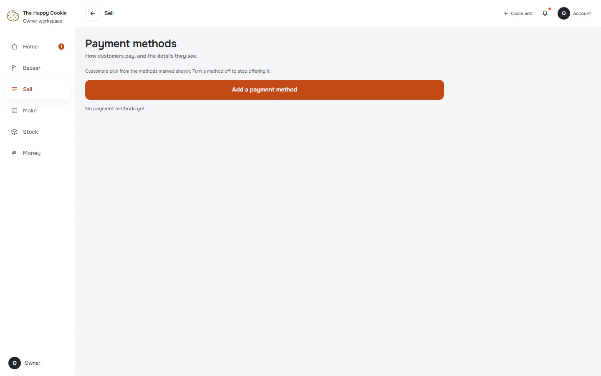

# Payment methods

**ACTUAL application.** [Back to shop](README.md)

- Manifest id: `shop/payment-methods`
- Source: `src/components/live/payment-forms.tsx`
- Role: owner
- Reference views: payment-methods

## default

Group: interaction. Fixture: `default`. How it was reached: ui-driven.

**p390** 390×844

**t768** 768×1024

**d1440** 1440×900

## empty

Group: data. Fixture: `data:empty`. How it was reached: rpc-fixture.

**p390** 390×844

**d1440** 1440×900

