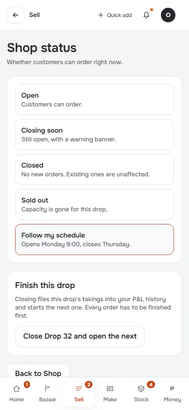
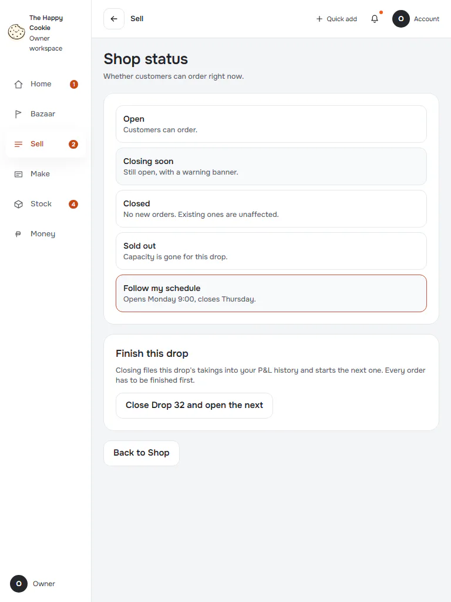
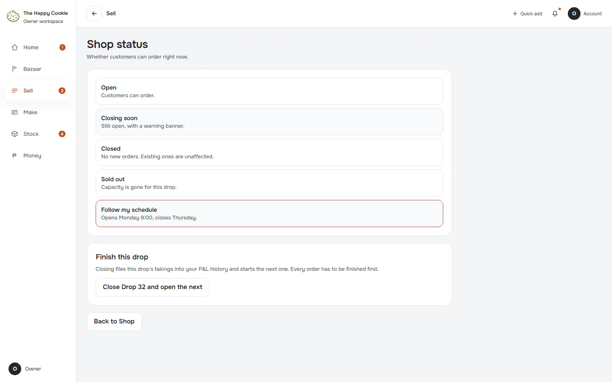
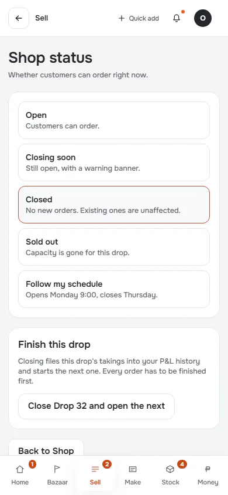
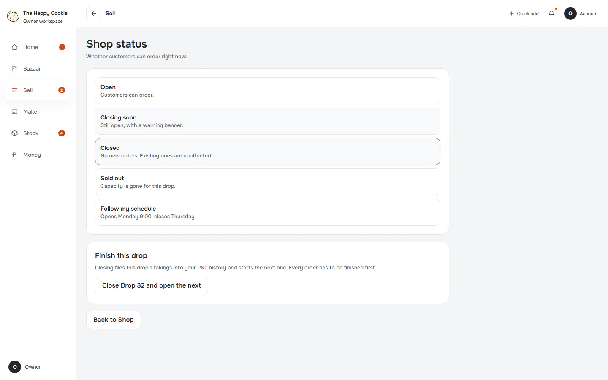

# Shop status

**ACTUAL application.** [Back to shop](README.md)

- Manifest id: `shop/shop-status`
- Source: `src/components/live/sell/shop-live.tsx`
- Role: owner
- Reference views: shop-status

## default

Group: interaction. Fixture: `default`. How it was reached: ui-driven.

**p390** 390×844 · [full page](../../screenshots/shop/shop-status/default/p390.full.webp)

**t768** 768×1024

**d1440** 1440×900

## forced-closed

Group: business. Fixture: `shop:closed`. How it was reached: ui-driven.

**p390** 390×844 · [full page](../../screenshots/shop/shop-status/forced-closed/p390.full.webp)

**d1440** 1440×900

