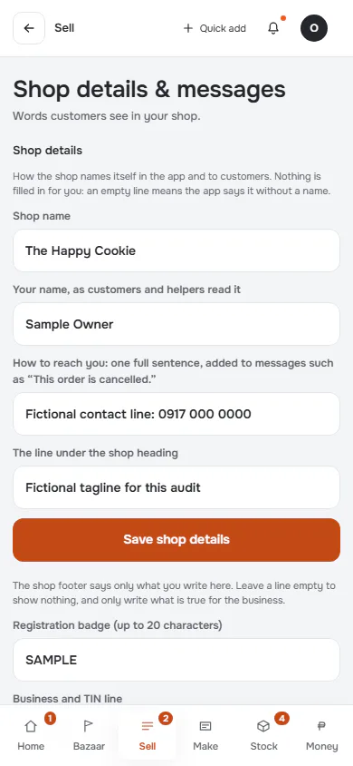
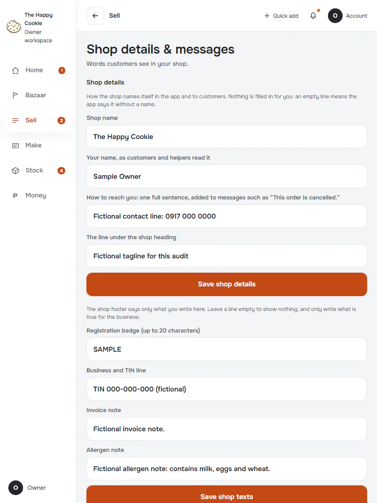
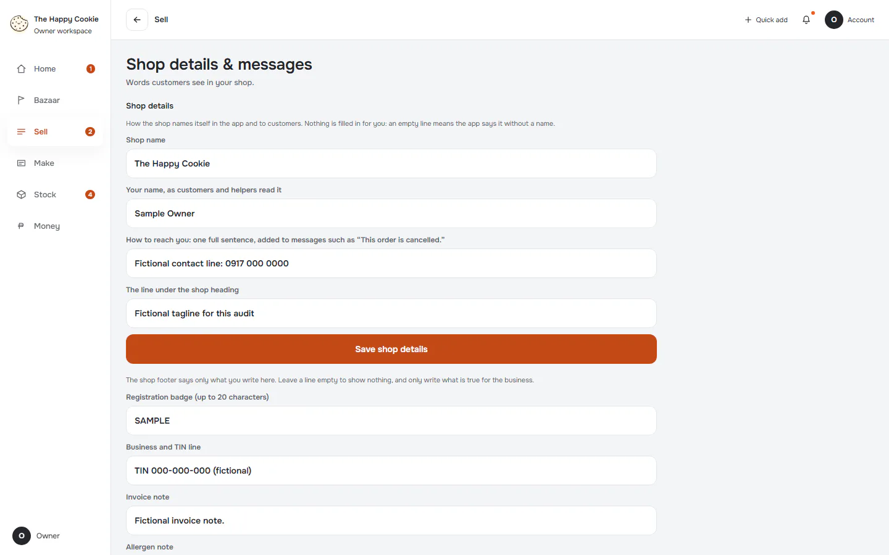

# Shop details & messages

**ACTUAL application.** [Back to shop](README.md)

- Manifest id: `shop/shop-text`
- Source: `src/components/live/payment-forms.tsx`
- Role: owner
- Reference views: shop-text

## default

Group: interaction. Fixture: `default`. How it was reached: ui-driven.

**p390** 390×844 · [full page](../../screenshots/shop/shop-text/default/p390.full.webp)

**t768** 768×1024 · [full page](../../screenshots/shop/shop-text/default/t768.full.webp)

**d1440** 1440×900 · [full page](../../screenshots/shop/shop-text/default/d1440.full.webp)

