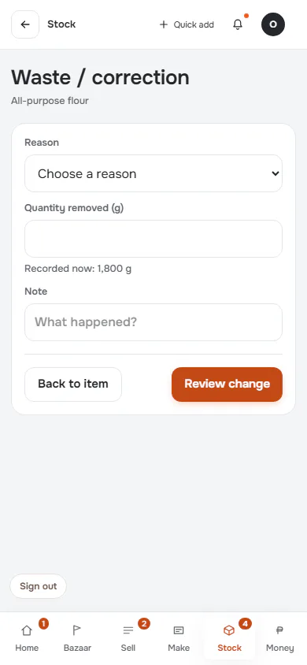
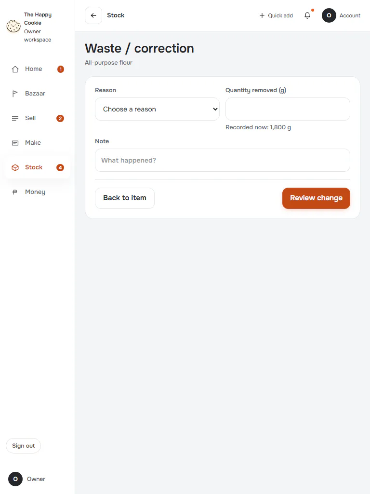
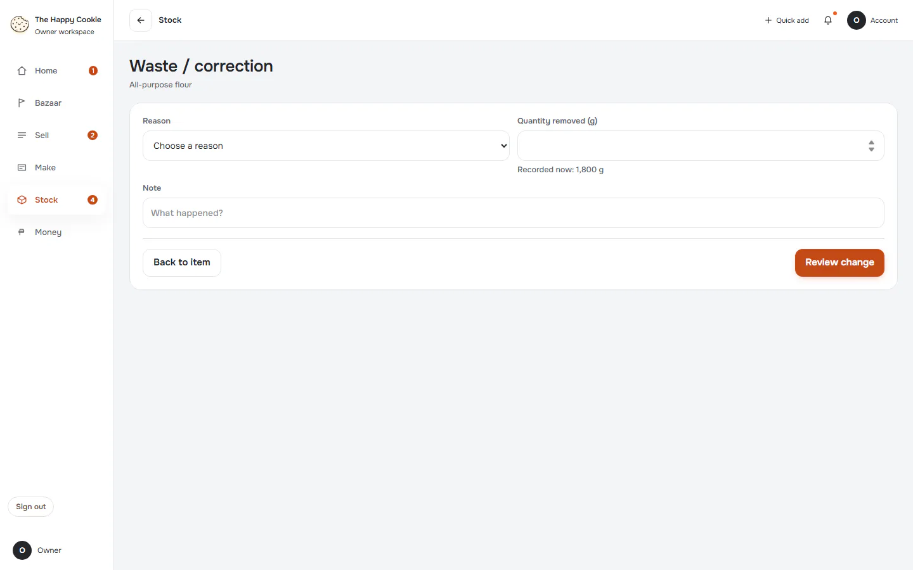
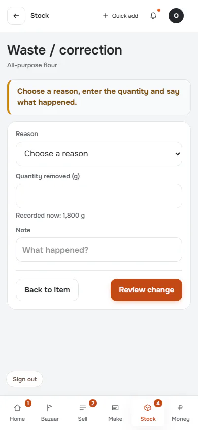
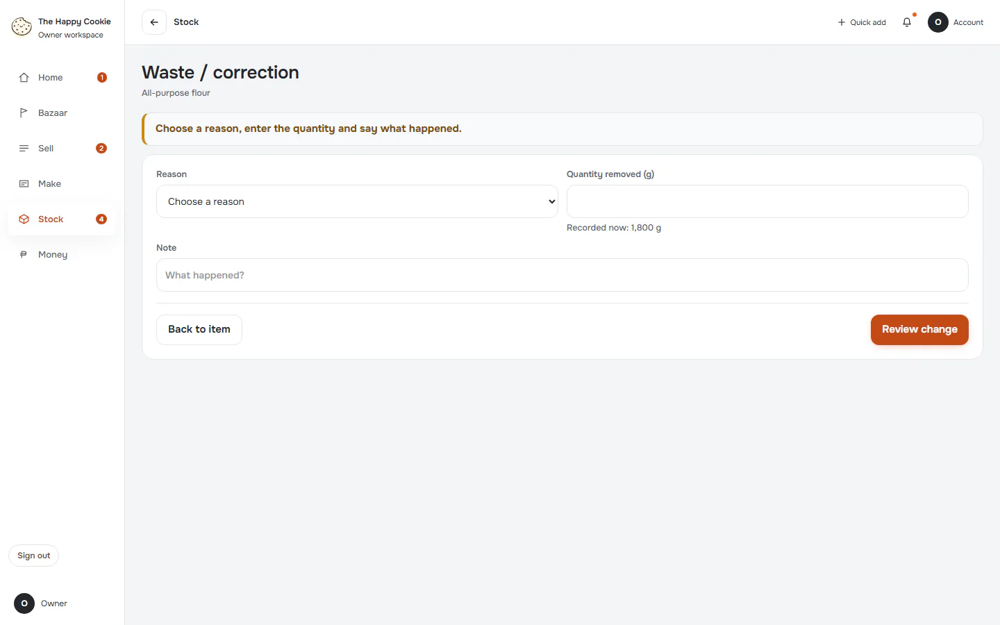
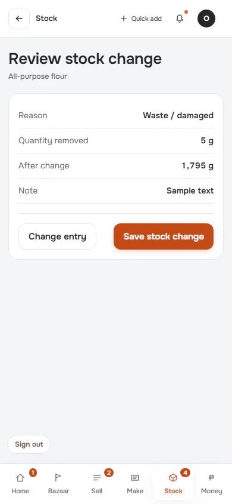
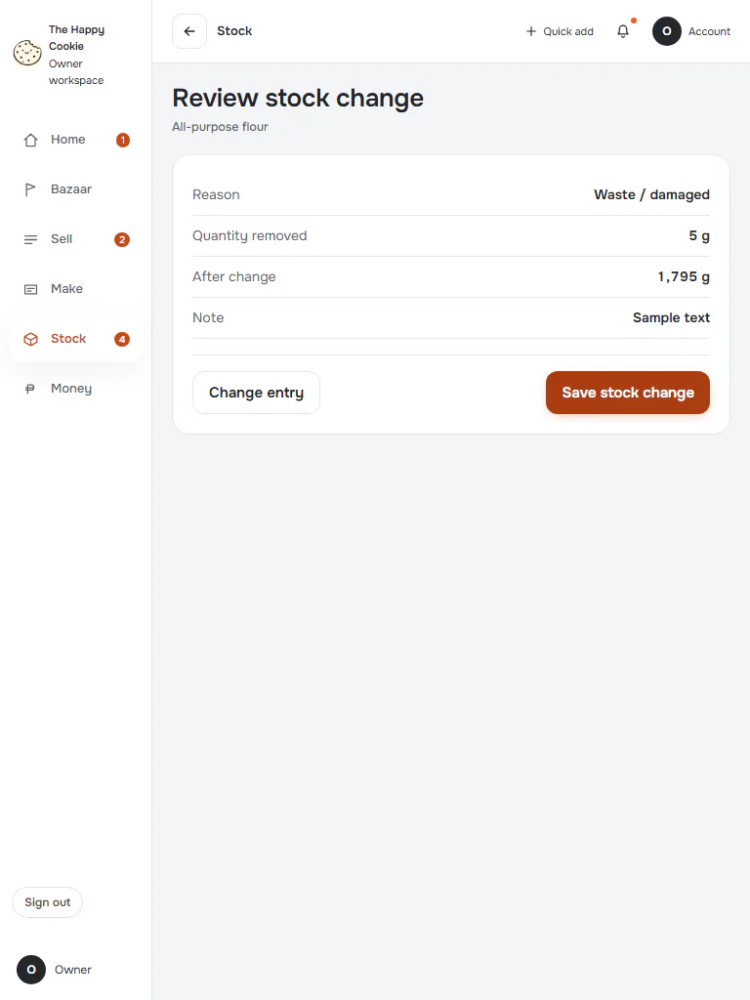
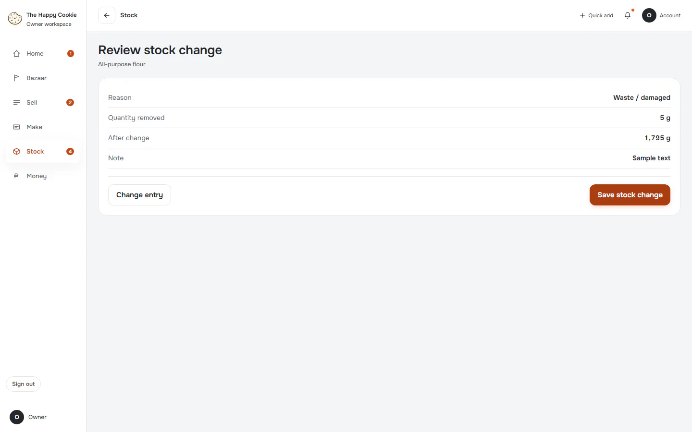

# Waste / correction

**ACTUAL application.** [Back to stock](README.md)

- Manifest id: `stock/adjust`
- Source: `src/components/live/stock/stock-entry-live.tsx`
- Role: owner
- Reference views: adjust, adjust-review

## untouched

Group: interaction. Fixture: `default`. How it was reached: ui-driven.

**p390** 390×844

**t768** 768×1024

**d1440** 1440×900

## invalid

Group: interaction. Fixture: `default`. How it was reached: ui-driven.

**p390** 390×844

**d1440** 1440×900

## review

Group: interaction. Fixture: `default`. How it was reached: ui-driven.

**p390** 390×844

**t768** 768×1024

**d1440** 1440×900

