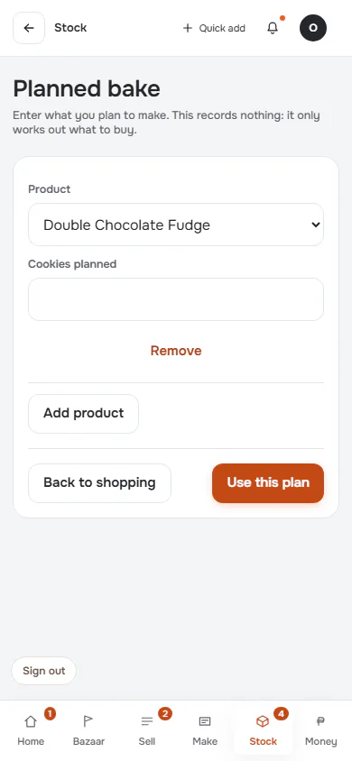
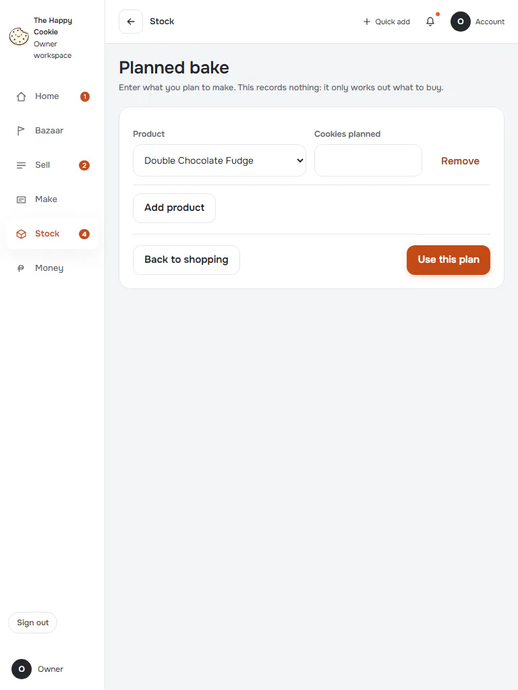
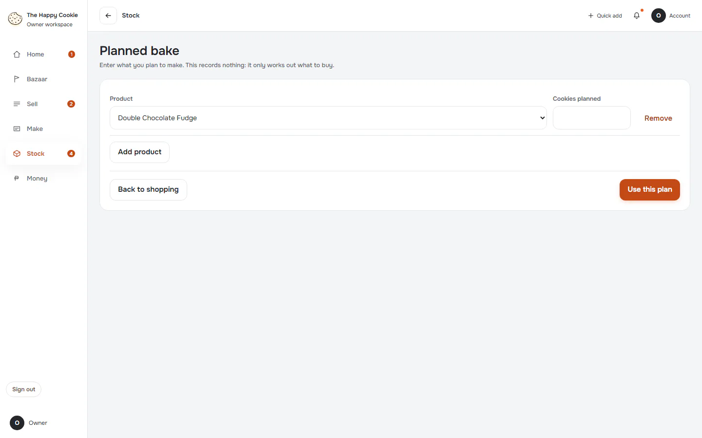
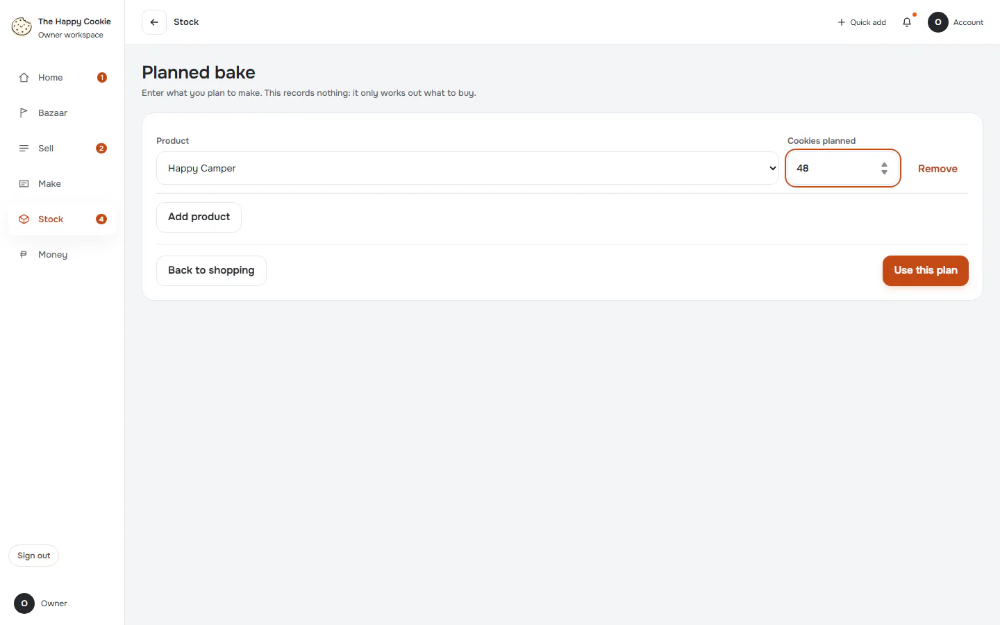
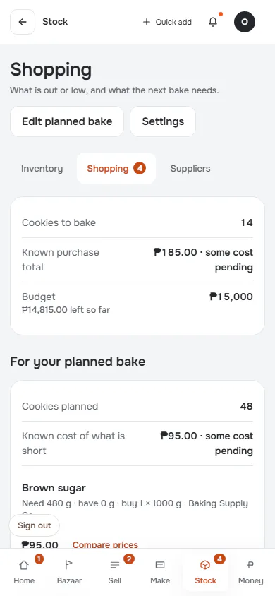
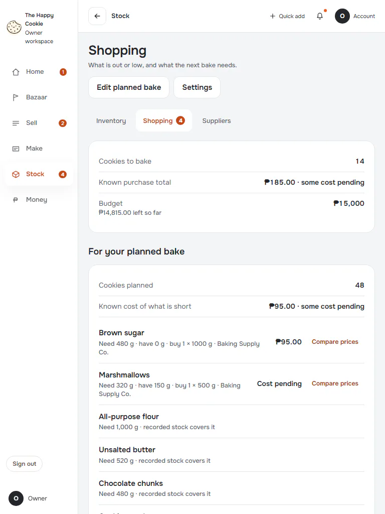
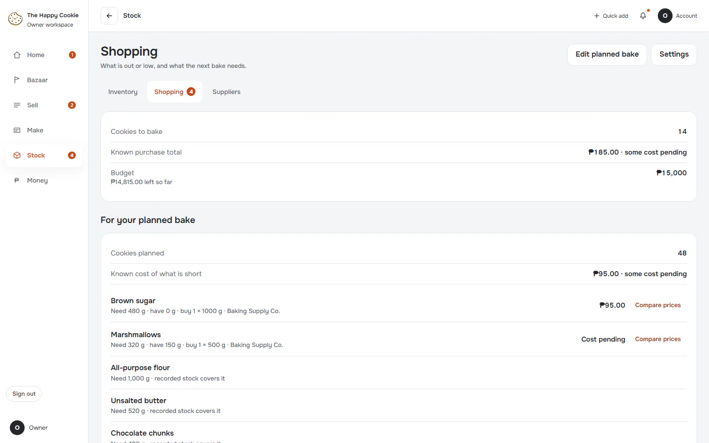

# Planned bake

**ACTUAL application.** [Back to stock](README.md)

- Manifest id: `stock/bake-needs`
- Source: `src/components/live/stock/bake-plan-live.tsx`
- Role: owner
- Reference views: bake-needs

## default

Group: interaction. Fixture: `default`. How it was reached: ui-driven.

**p390** 390×844

**t768** 768×1024

**d1440** 1440×900

## plan-entered

Group: business. Fixture: `default`. How it was reached: ui-driven.

**p390** 390×844

**d1440** 1440×900

## plan-used

Group: business. Fixture: `default`. How it was reached: ui-driven.

**p390** 390×844 · [full page](../../screenshots/stock/bake-needs/plan-used/p390.full.webp)

**t768** 768×1024 · [full page](../../screenshots/stock/bake-needs/plan-used/t768.full.webp)

**d1440** 1440×900 · [full page](../../screenshots/stock/bake-needs/plan-used/d1440.full.webp)

