# Count inventory

**ACTUAL application.** [Back to stock](README.md)

- Manifest id: `stock/count`
- Source: `src/components/live/stock/count-inventory.tsx`
- Role: owner
- Reference views: count, count-review

## untouched

Group: interaction. Fixture: `default`. How it was reached: ui-driven.

**p390** 390×844 · [full page](../../screenshots/stock/count/untouched/p390.full.webp)

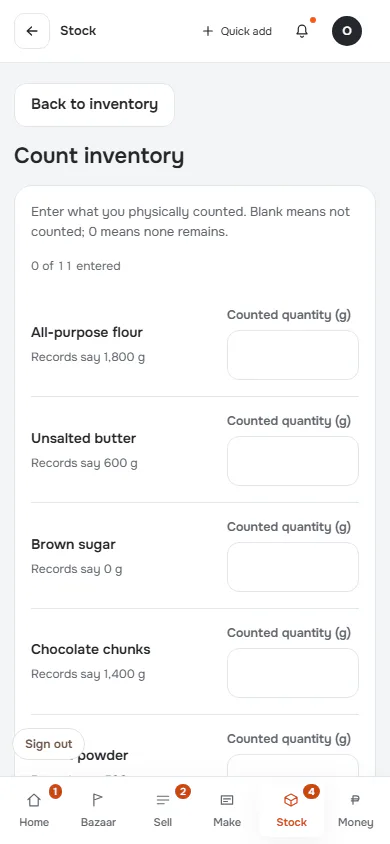

**t768** 768×1024 · [full page](../../screenshots/stock/count/untouched/t768.full.webp)

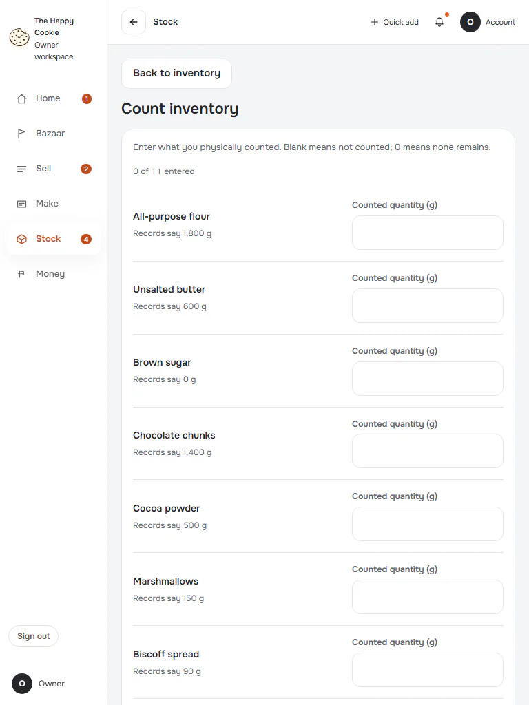

**d1440** 1440×900 · [full page](../../screenshots/stock/count/untouched/d1440.full.webp)

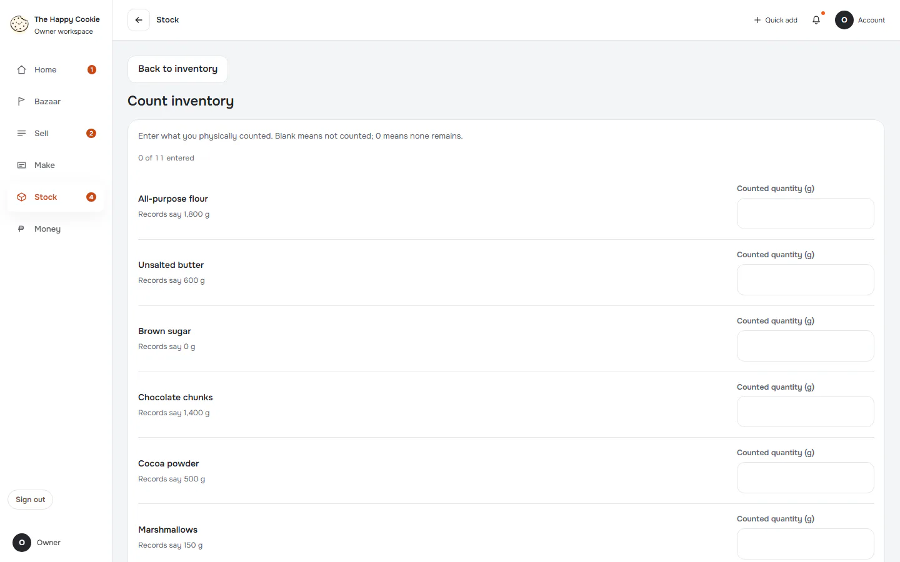

## one-entered

Group: interaction. Fixture: `default`. How it was reached: ui-driven.

**p390** 390×844 · [full page](../../screenshots/stock/count/one-entered/p390.full.webp)

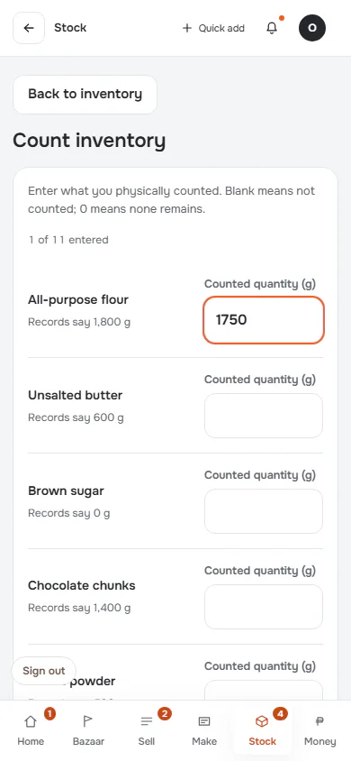

**d1440** 1440×900 · [full page](../../screenshots/stock/count/one-entered/d1440.full.webp)

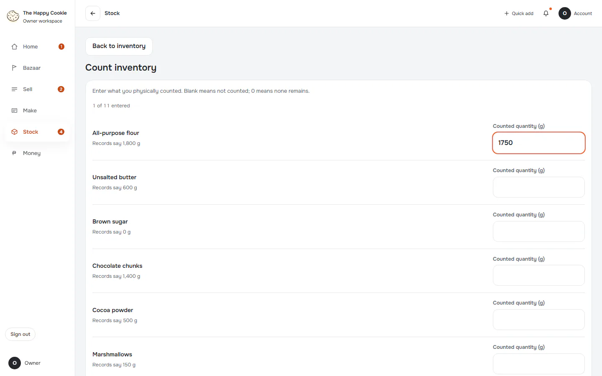

## review

Group: interaction. Fixture: `default`. How it was reached: ui-driven.

**p390** 390×844

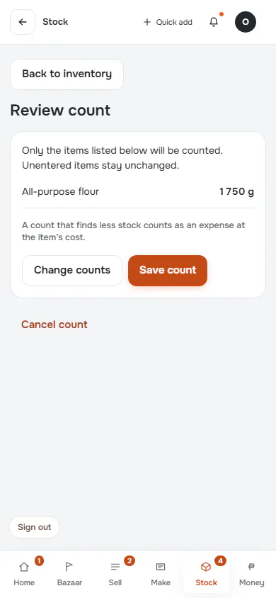

**t768** 768×1024

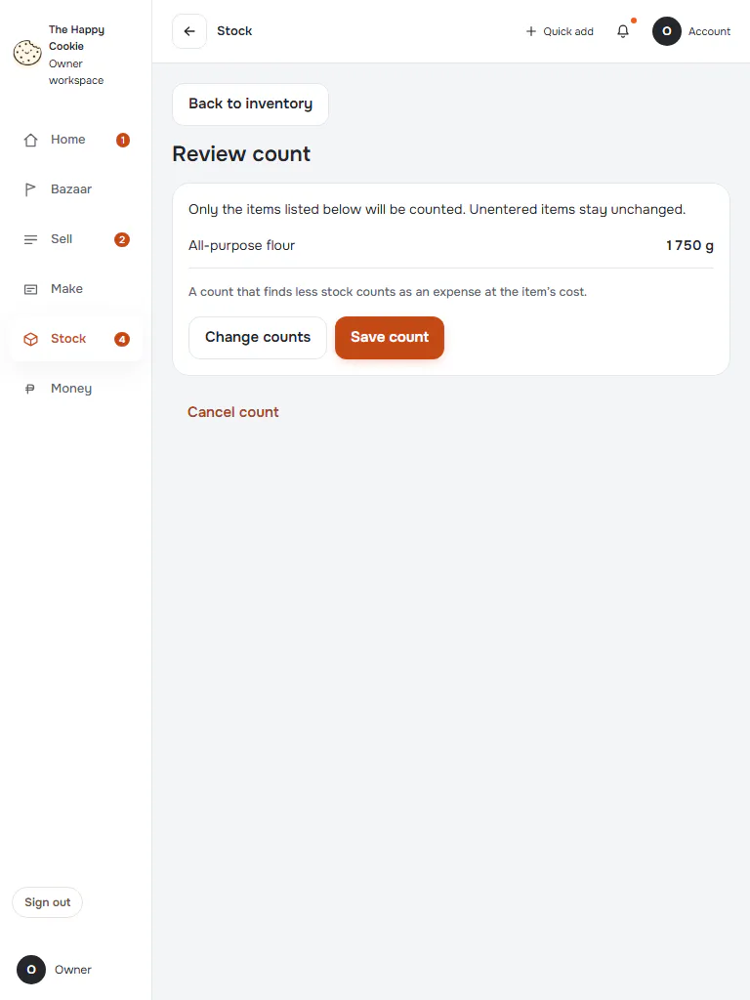

**d1440** 1440×900

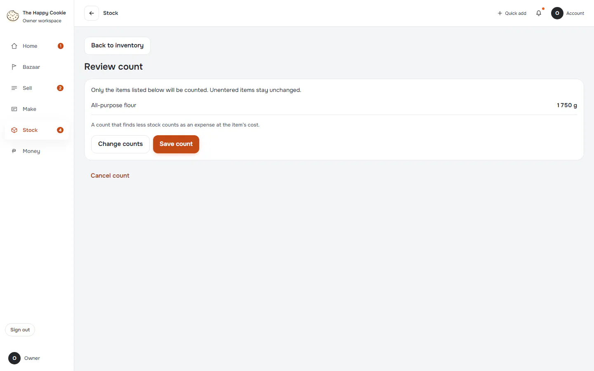

## cancel-prompt

Group: interaction. Fixture: `default`. How it was reached: ui-driven.

**p390** 390×844

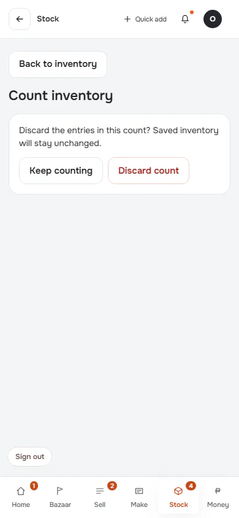

**d1440** 1440×900

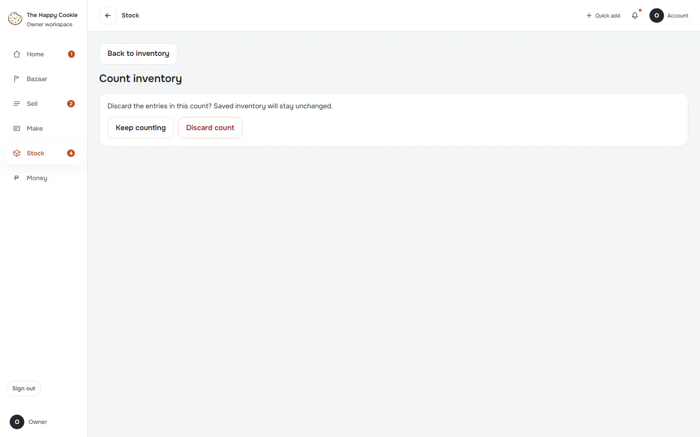

## reload-keeps-draft

Group: failure. Fixture: `default`. How it was reached: ui-driven.

**p390** 390×844 · [full page](../../screenshots/stock/count/reload-keeps-draft/p390.full.webp)

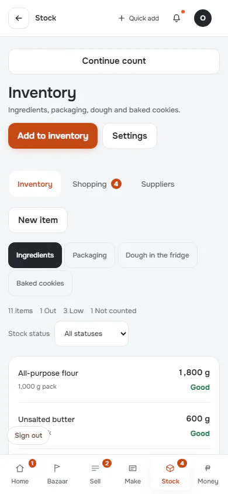

**d1440** 1440×900 · [full page](../../screenshots/stock/count/reload-keeps-draft/d1440.full.webp)

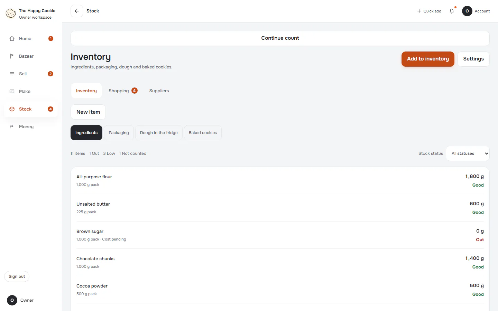

## saved

Group: business. Fixture: `default`. How it was reached: ui-driven.

**p390** 390×844 · [full page](../../screenshots/stock/count/saved/p390.full.webp)

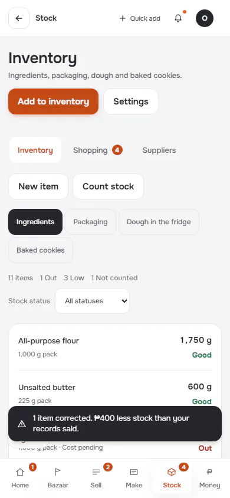

**d1440** 1440×900 · [full page](../../screenshots/stock/count/saved/d1440.full.webp)

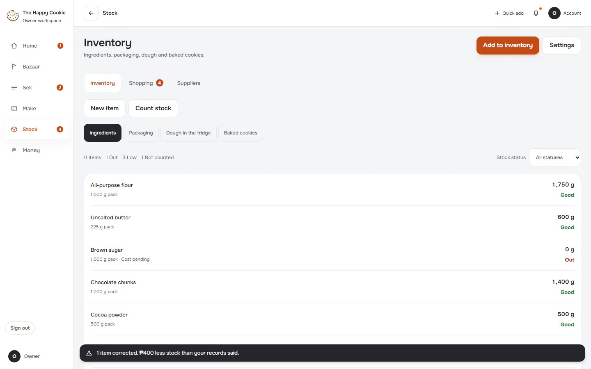
