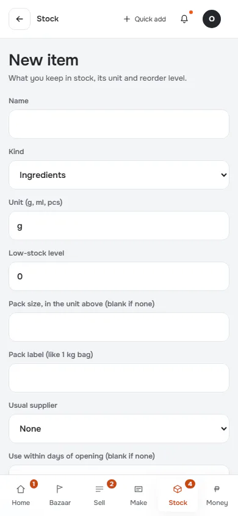
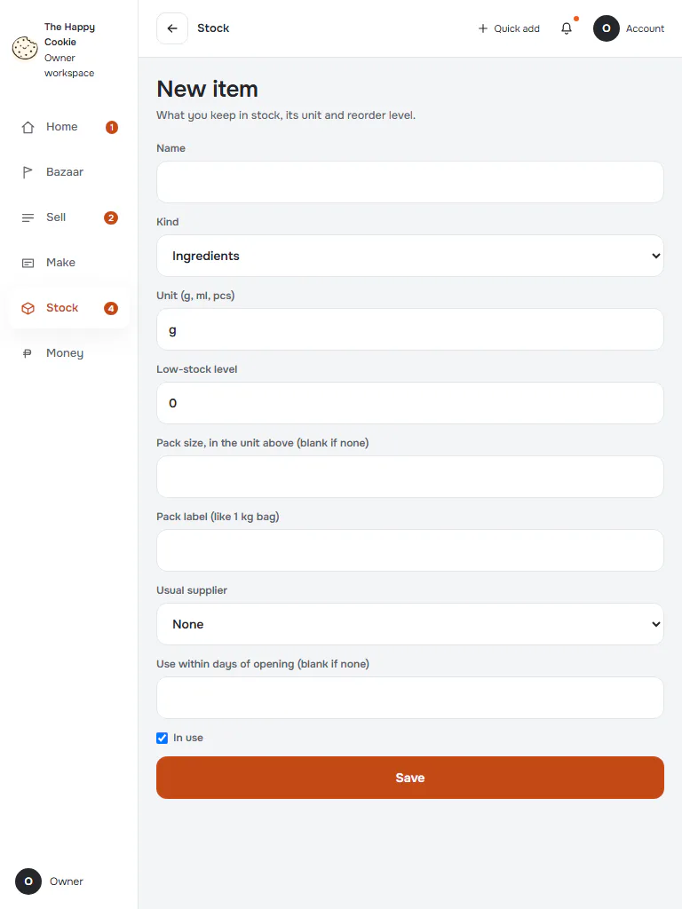
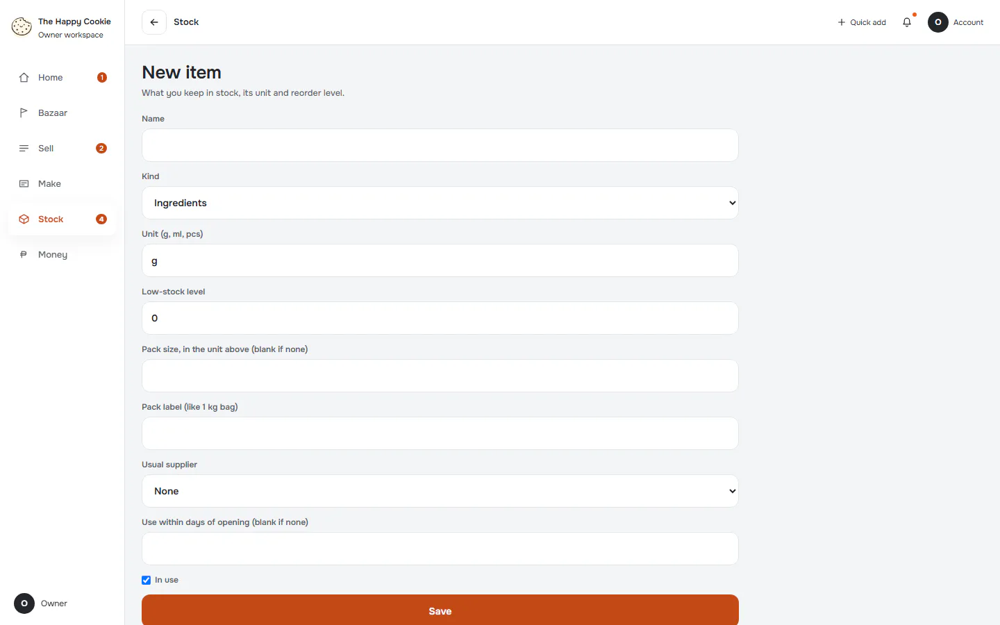
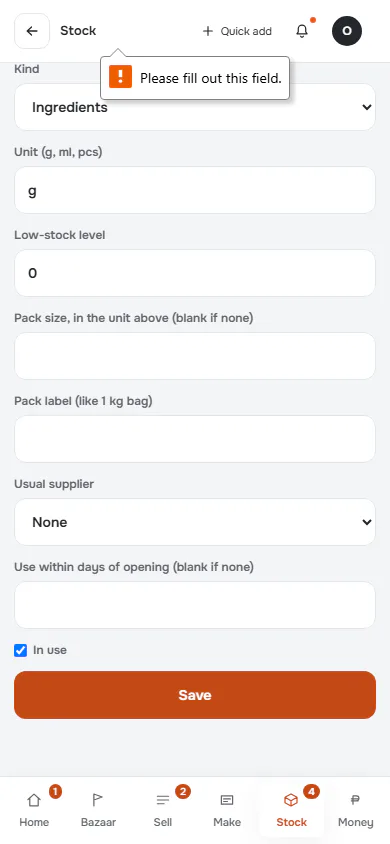
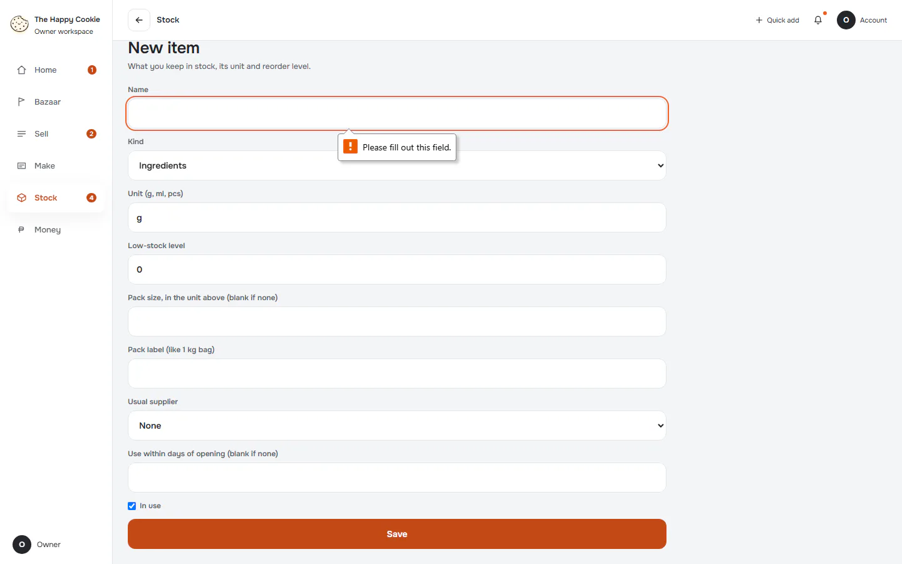
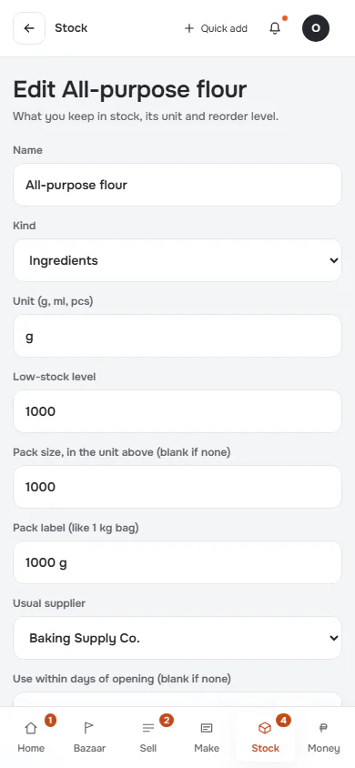
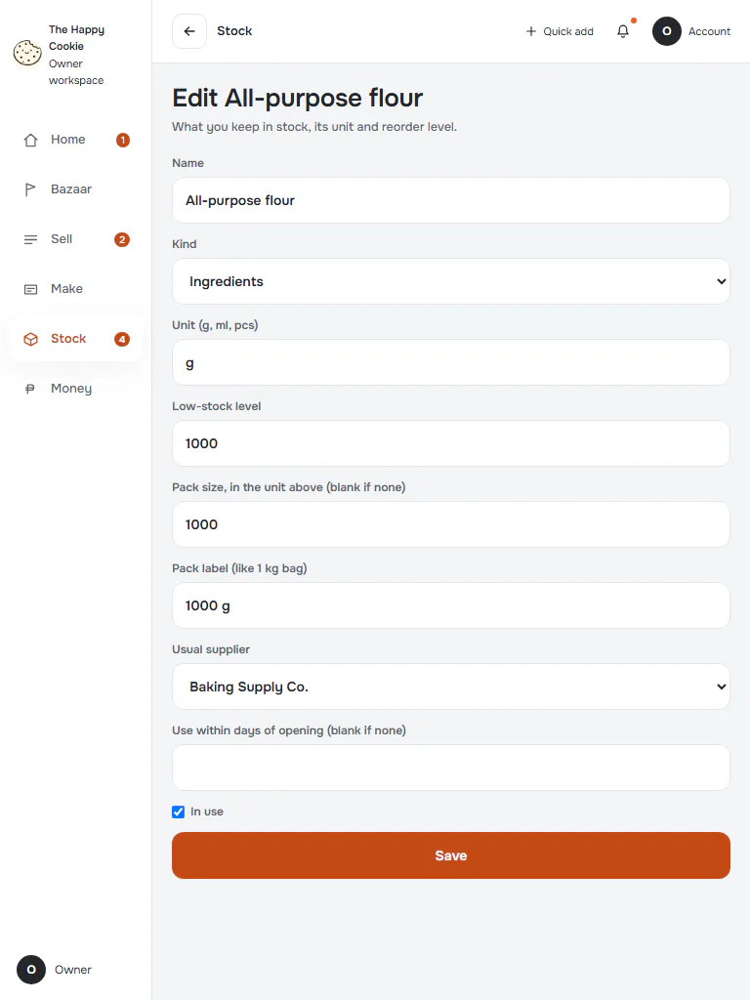
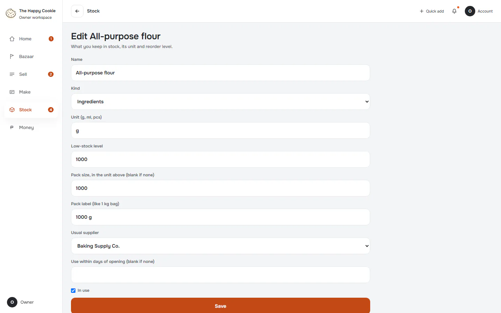
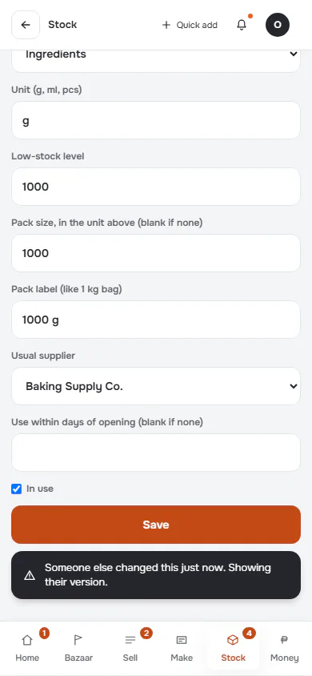
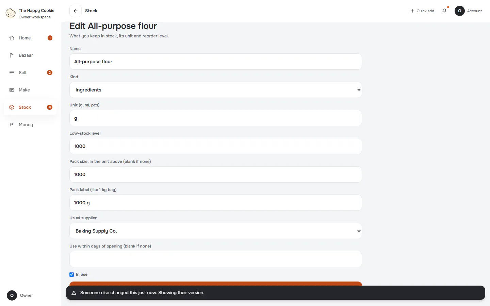

# New item and edit item

**ACTUAL application.** [Back to stock](README.md)

- Manifest id: `stock/item-form`
- Source: `src/components/live/stock-items-form.tsx`
- Role: owner
- Reference views: item-edit, new-item

## new-untouched

Group: interaction. Fixture: `default`. How it was reached: ui-driven.

**p390** 390×844 · [full page](../../screenshots/stock/item-form/new-untouched/p390.full.webp)

**t768** 768×1024

**d1440** 1440×900 · [full page](../../screenshots/stock/item-form/new-untouched/d1440.full.webp)

## new-invalid

Group: interaction. Fixture: `default`. How it was reached: ui-driven.

**p390** 390×844 · [full page](../../screenshots/stock/item-form/new-invalid/p390.full.webp)

**d1440** 1440×900 · [full page](../../screenshots/stock/item-form/new-invalid/d1440.full.webp)

## edit

Group: interaction. Fixture: `default`. How it was reached: ui-driven.

**p390** 390×844 · [full page](../../screenshots/stock/item-form/edit/p390.full.webp)

**t768** 768×1024

**d1440** 1440×900 · [full page](../../screenshots/stock/item-form/edit/d1440.full.webp)

## save-conflict

Group: failure. Fixture: `default`. How it was reached: ui-driven.

**p390** 390×844 · [full page](../../screenshots/stock/item-form/save-conflict/p390.full.webp)

**d1440** 1440×900 · [full page](../../screenshots/stock/item-form/save-conflict/d1440.full.webp)

