# Stock item

**ACTUAL application.** [Back to stock](README.md)

- Manifest id: `stock/item`
- Source: `src/components/live/stock/inventory-live.tsx`
- Role: owner
- Reference views: item

## with-history

Group: data. Fixture: `default`. How it was reached: ui-driven.

**p320** 320×700 · [full page](../../screenshots/stock/item/with-history/p320.full.webp)

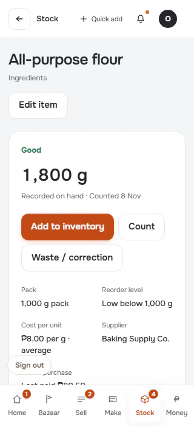

**p390** 390×844 · [full page](../../screenshots/stock/item/with-history/p390.full.webp)

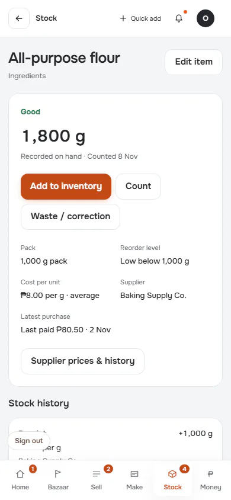

**t768** 768×1024 · [full page](../../screenshots/stock/item/with-history/t768.full.webp)

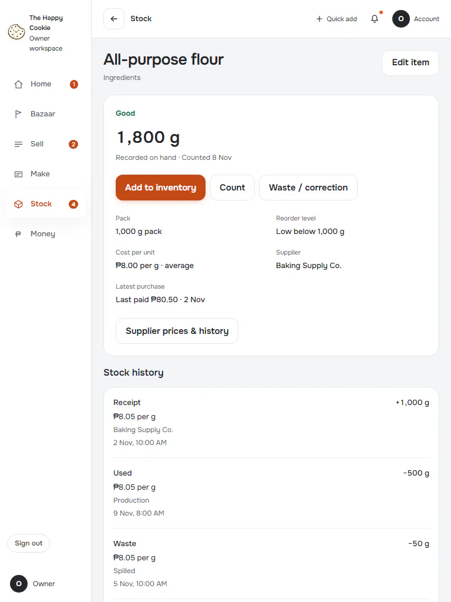

**l1024** 1024×768 · [full page](../../screenshots/stock/item/with-history/l1024.full.webp)

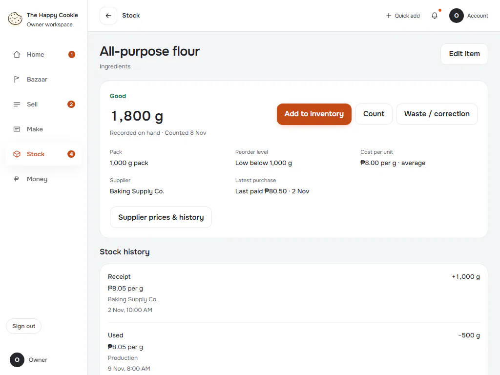

**d1440** 1440×900 · [full page](../../screenshots/stock/item/with-history/d1440.full.webp)

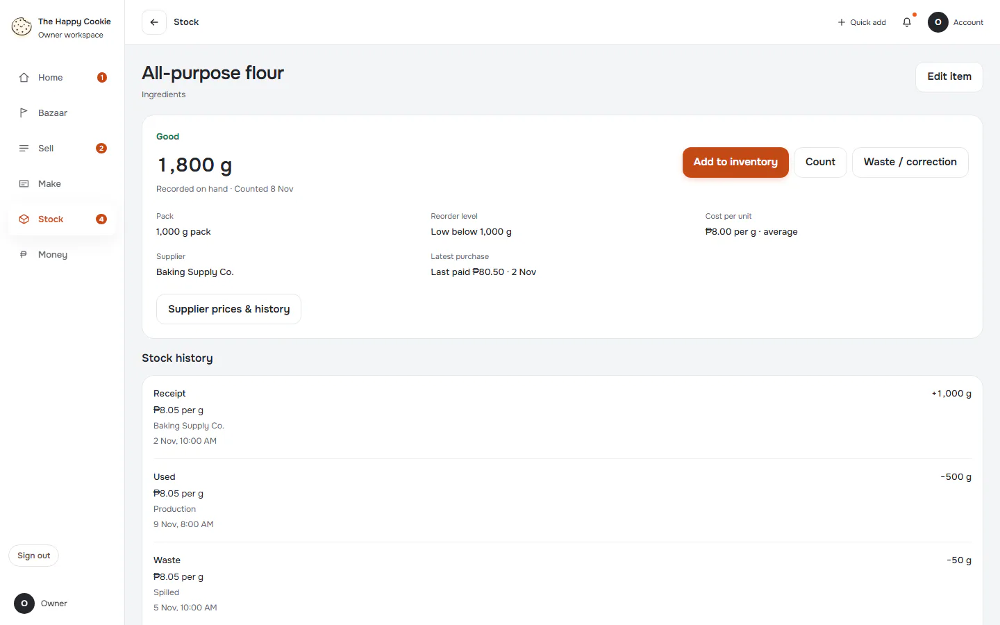

**w1920** 1920×1080 · [full page](../../screenshots/stock/item/with-history/w1920.full.webp)

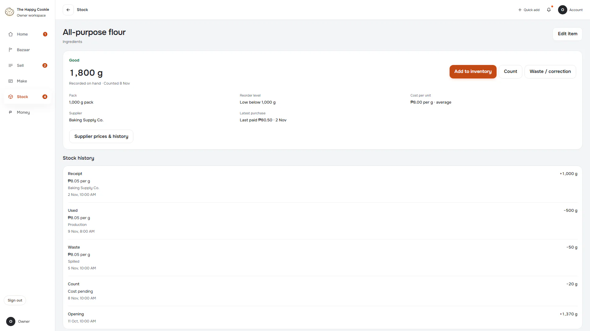

## zero-confirmed

Counted and confirmed zero. Group: business. Fixture: `default`. How it was reached: ui-driven.

**p390** 390×844 · [full page](../../screenshots/stock/item/zero-confirmed/p390.full.webp)

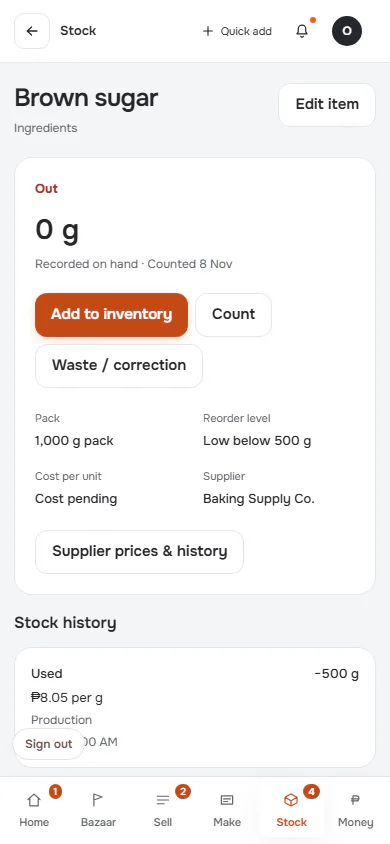

**d1440** 1440×900

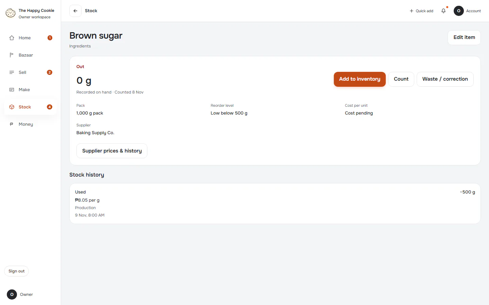

## never-counted

Zero recorded, never counted: must differ from confirmed zero. Group: business. Fixture: `default`. How it was reached: ui-driven.

**p390** 390×844 · [full page](../../screenshots/stock/item/never-counted/p390.full.webp)

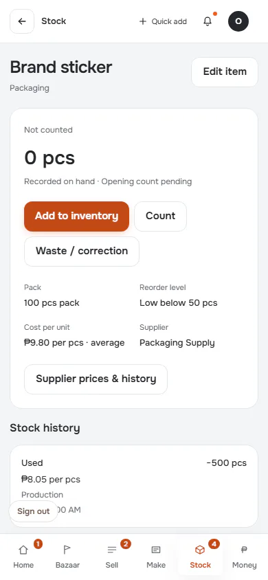

**d1440** 1440×900

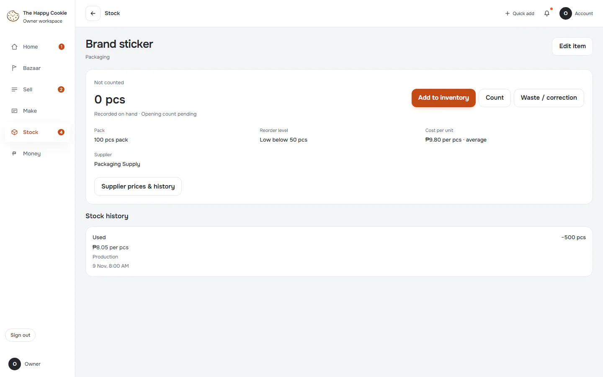

## history-failed

Group: failure. Fixture: `fail:get_item_movements=down`. How it was reached: rpc-fixture.

**p390** 390×844 · [full page](../../screenshots/stock/item/history-failed/p390.full.webp)

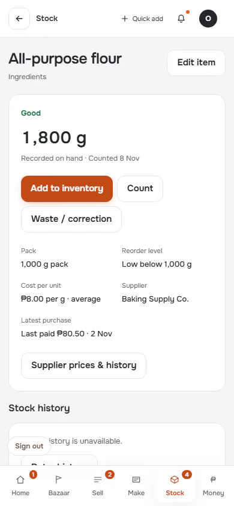

**d1440** 1440×900

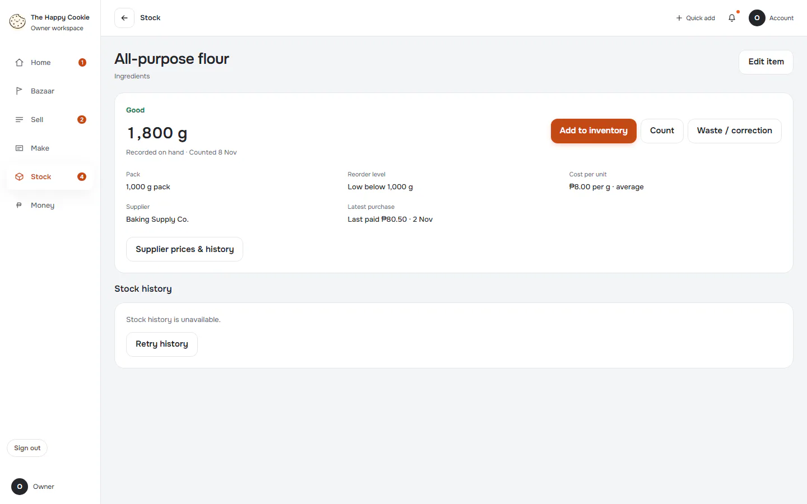
