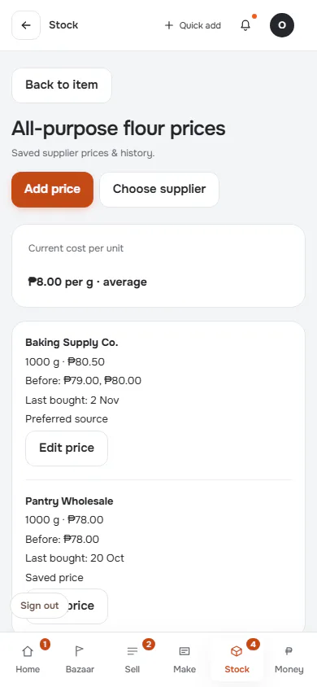
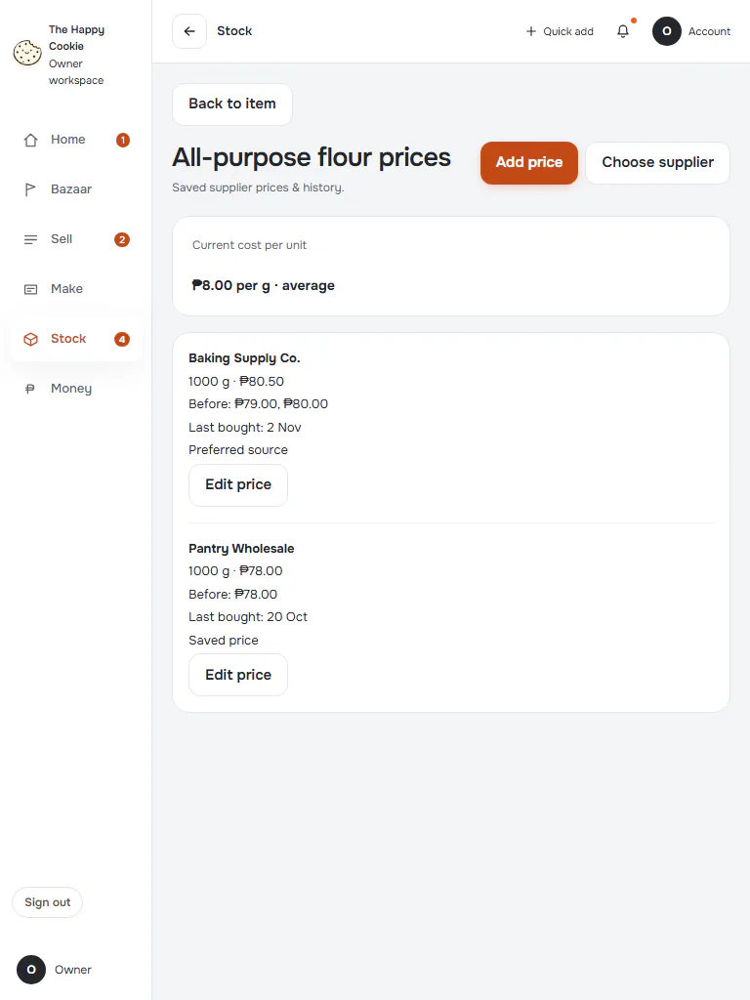
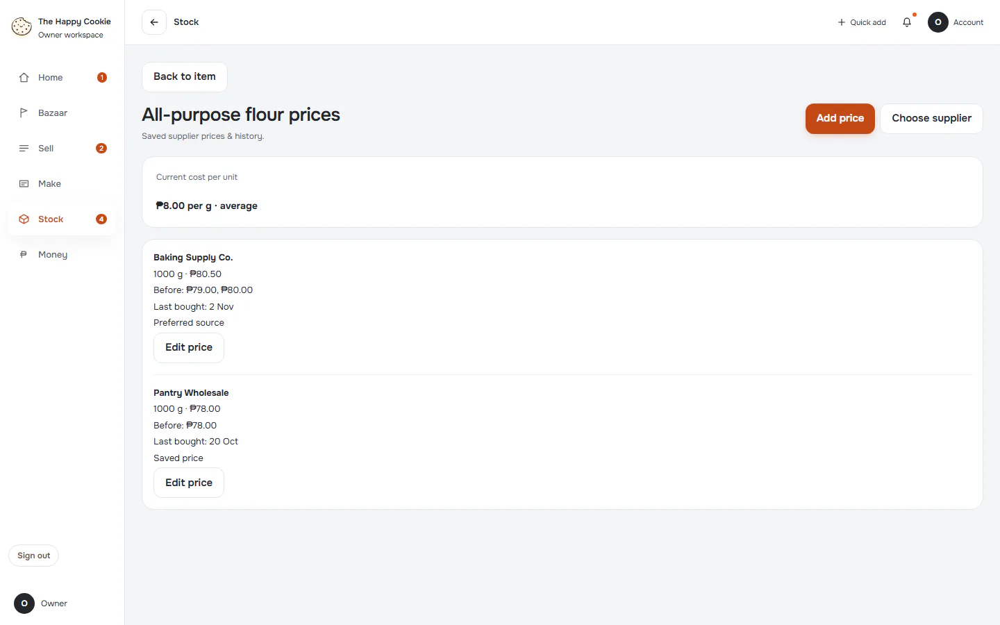
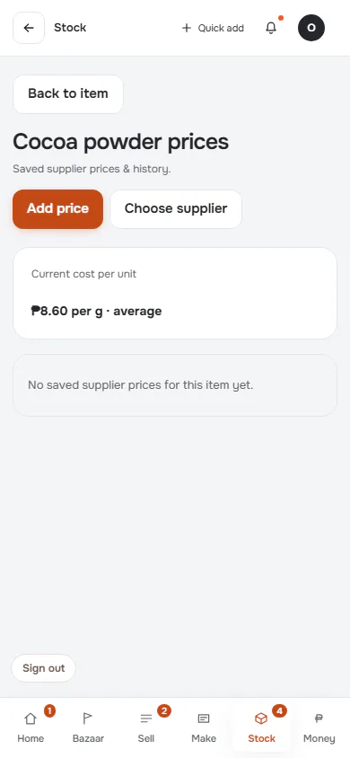
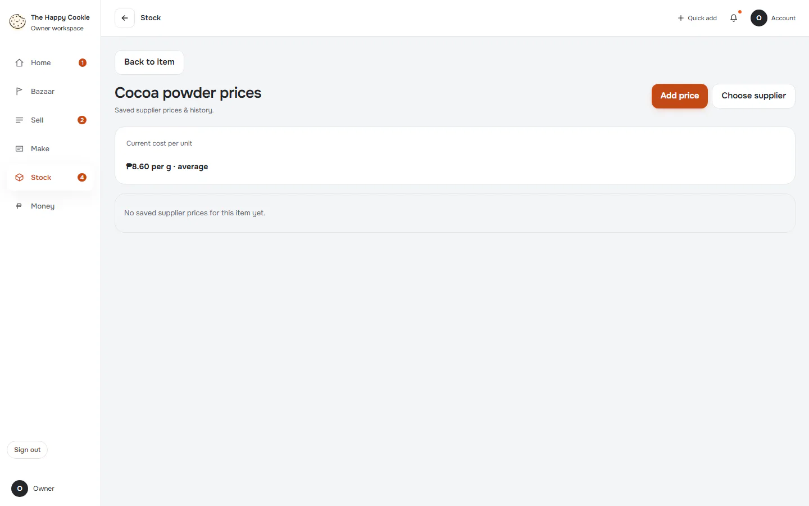

# Supplier prices & history

**ACTUAL application.** [Back to stock](README.md)

- Manifest id: `stock/purchase-prices`
- Source: `src/components/live/stock/item-prices.tsx`
- Role: owner
- Reference views: purchase-prices

## compare

Group: interaction. Fixture: `default`. How it was reached: ui-driven.

**p390** 390×844 · [full page](../../screenshots/stock/purchase-prices/compare/p390.full.webp)

**t768** 768×1024

**d1440** 1440×900

## no-prices

Group: data. Fixture: `default`. How it was reached: ui-driven.

**p390** 390×844

**d1440** 1440×900

