# Add to inventory (receive)

**ACTUAL application.** [Back to stock](README.md)

- Manifest id: `stock/receive`
- Source: `src/components/live/stock/stock-entry-live.tsx`
- Role: owner
- Reference views: receive, receive-review

## untouched

Group: interaction. Fixture: `default`. How it was reached: ui-driven.

**p390** 390×844 · [full page](../../screenshots/stock/receive/untouched/p390.full.webp)

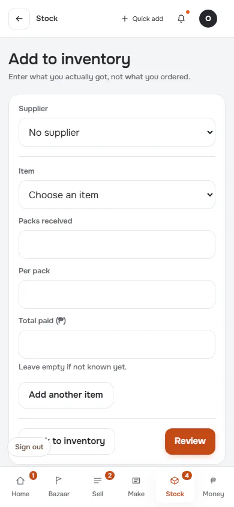

**t768** 768×1024

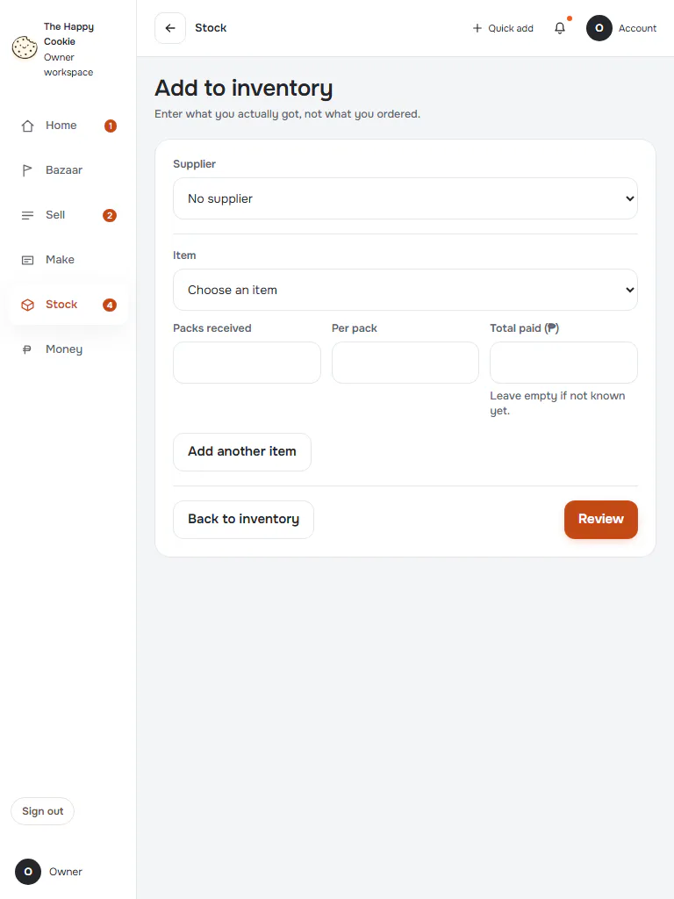

**d1440** 1440×900

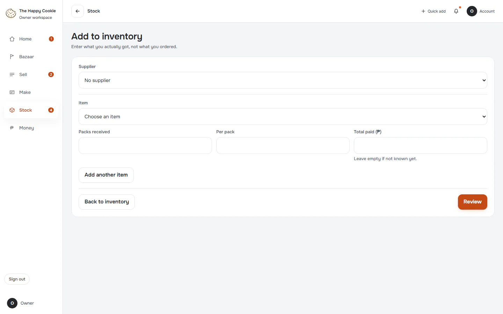

## invalid

Group: interaction. Fixture: `default`. How it was reached: ui-driven.

**p390** 390×844 · [full page](../../screenshots/stock/receive/invalid/p390.full.webp)

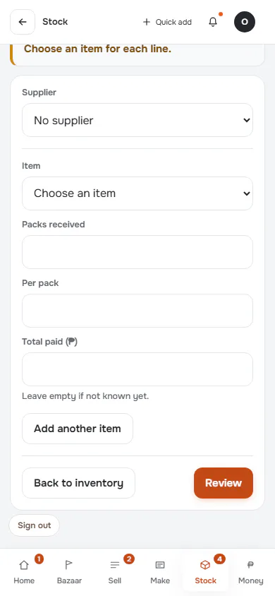

**d1440** 1440×900

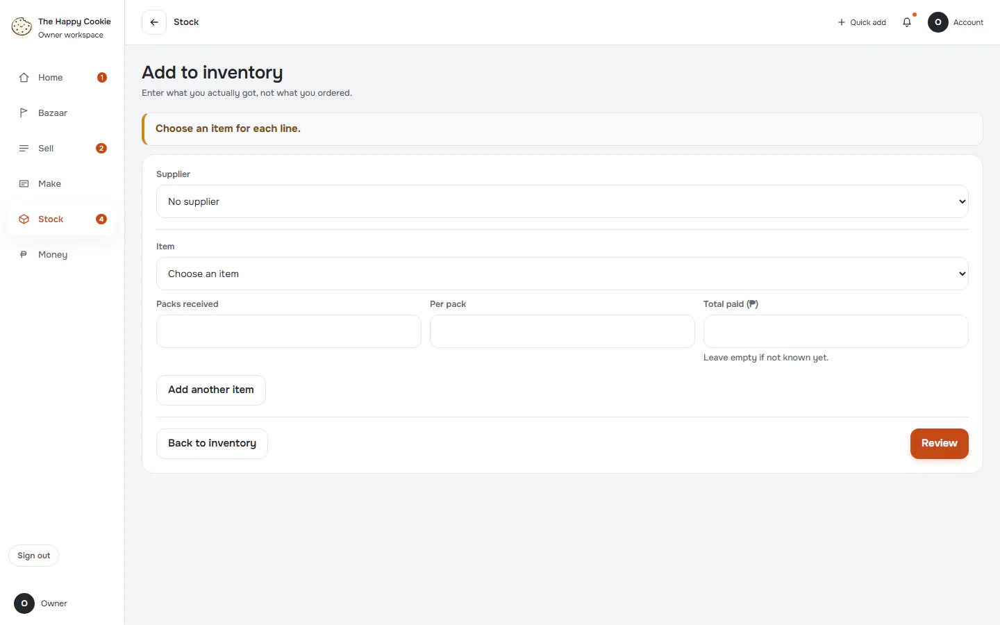

## two-items

Group: interaction. Fixture: `default`. How it was reached: ui-driven.

**p390** 390×844 · [full page](../../screenshots/stock/receive/two-items/p390.full.webp)

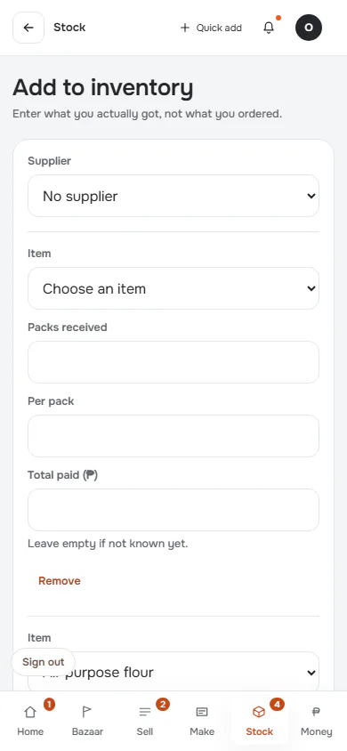

**d1440** 1440×900 · [full page](../../screenshots/stock/receive/two-items/d1440.full.webp)

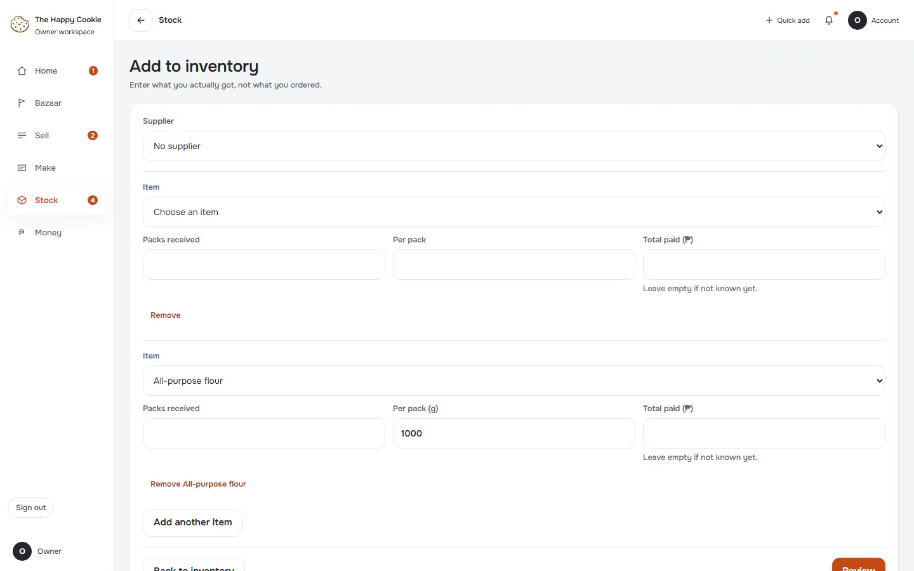

## filled

Group: interaction. Fixture: `default`. How it was reached: ui-driven.

**p390** 390×844 · [full page](../../screenshots/stock/receive/filled/p390.full.webp)

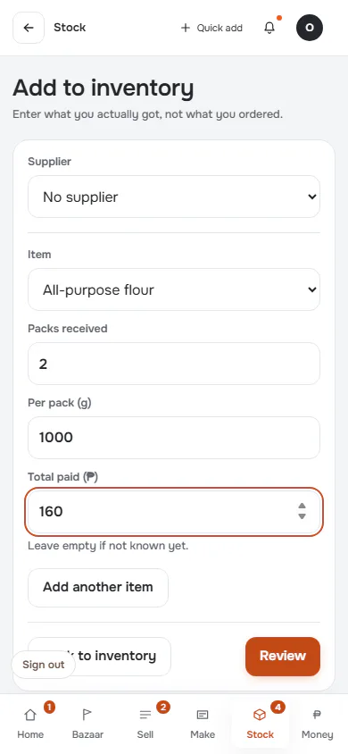

**d1440** 1440×900

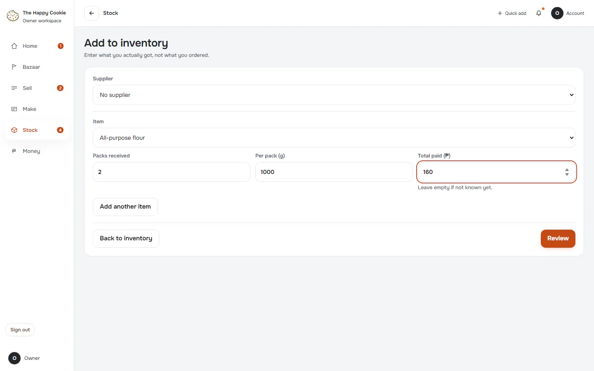

## review

Group: interaction. Fixture: `default`. How it was reached: ui-driven.

**p390** 390×844

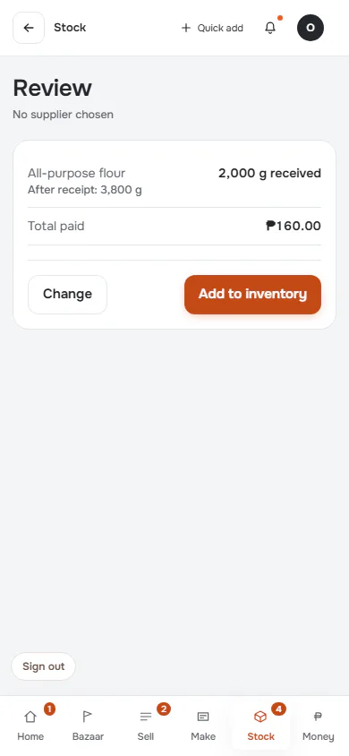

**t768** 768×1024

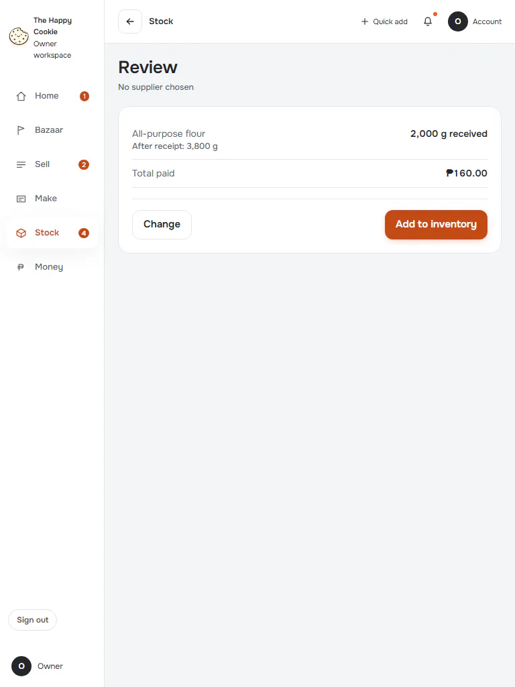

**d1440** 1440×900

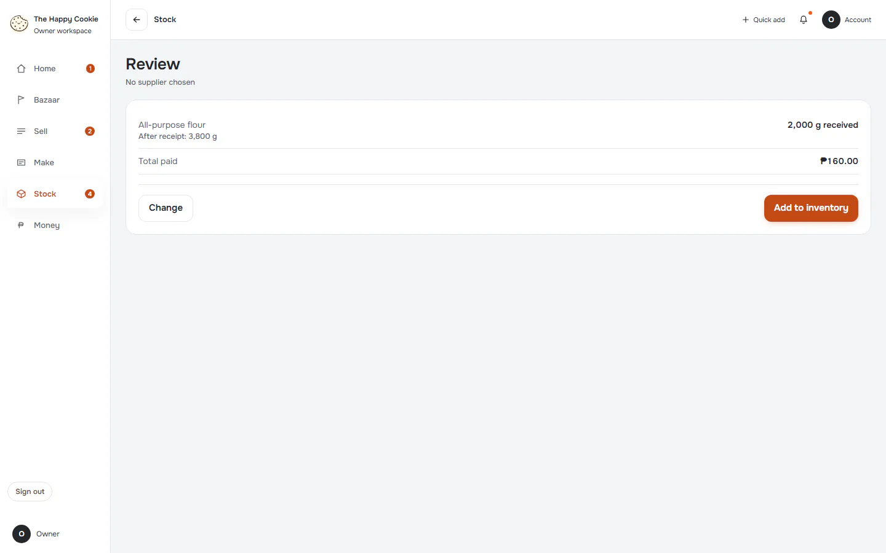

## saved

Group: business. Fixture: `default`. How it was reached: ui-driven.

**p390** 390×844 · [full page](../../screenshots/stock/receive/saved/p390.full.webp)

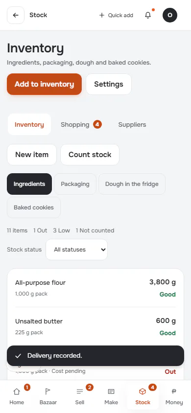

**d1440** 1440×900 · [full page](../../screenshots/stock/receive/saved/d1440.full.webp)

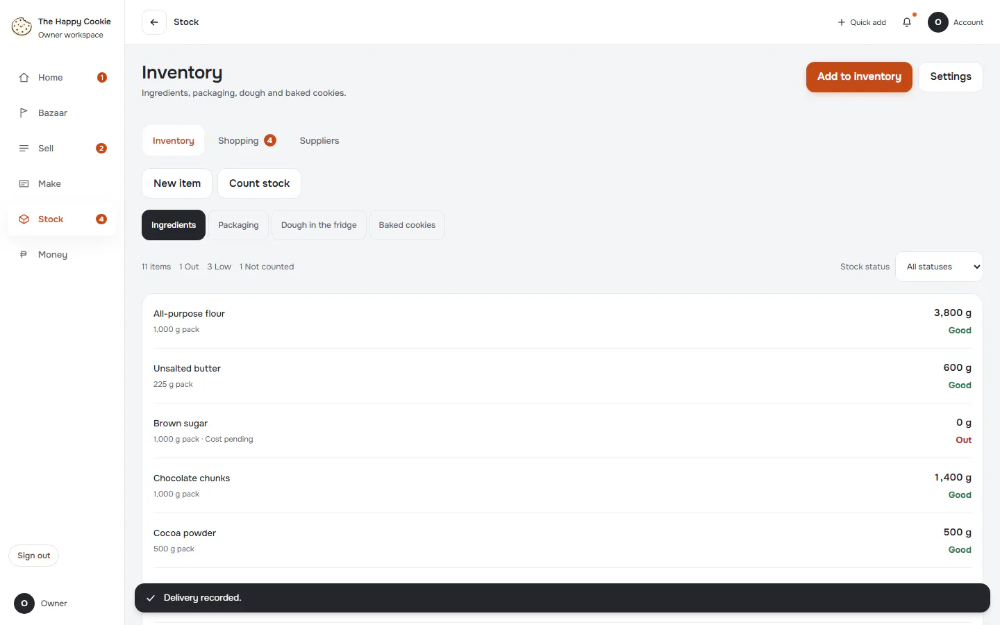

## save-failed

Group: failure. Fixture: `default`. How it was reached: ui-driven.

**p390** 390×844

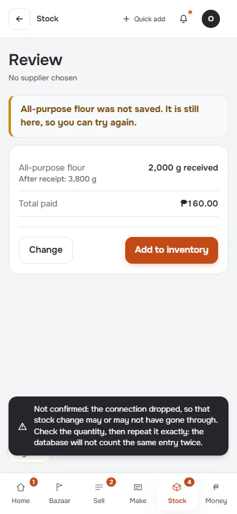

**d1440** 1440×900

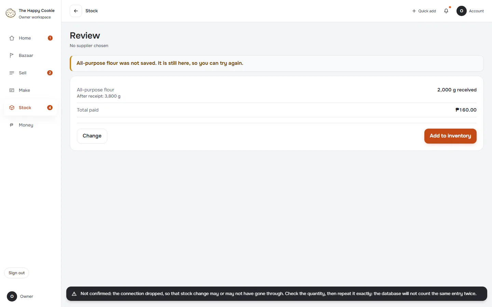
