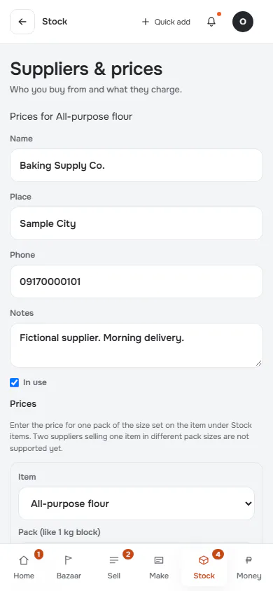
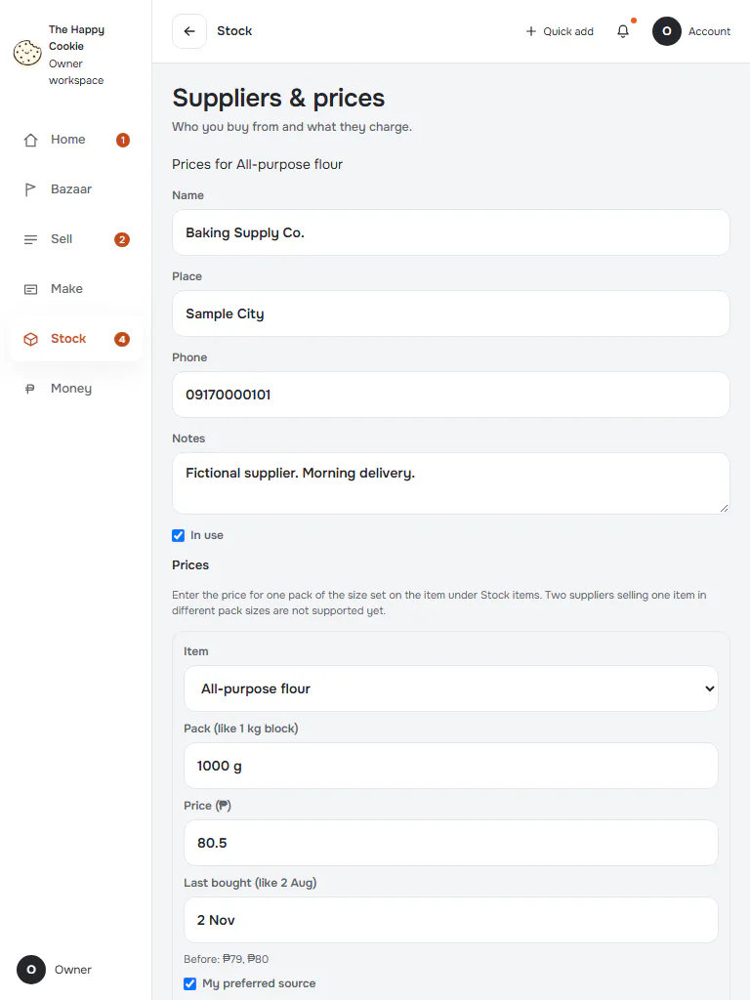
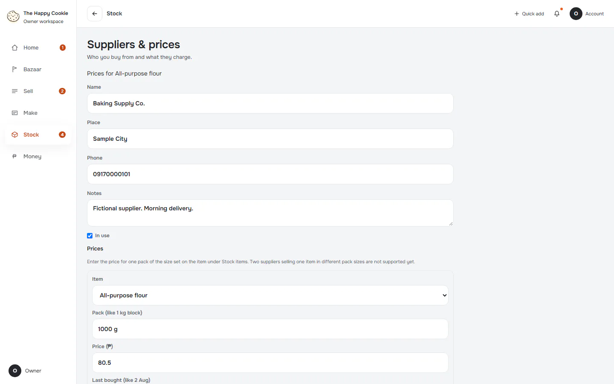
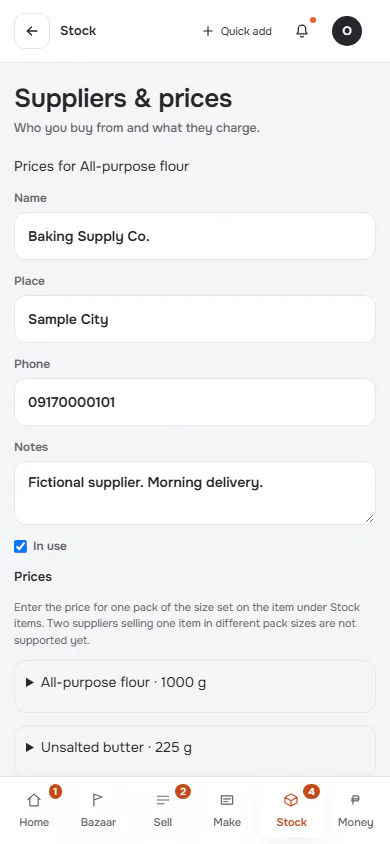
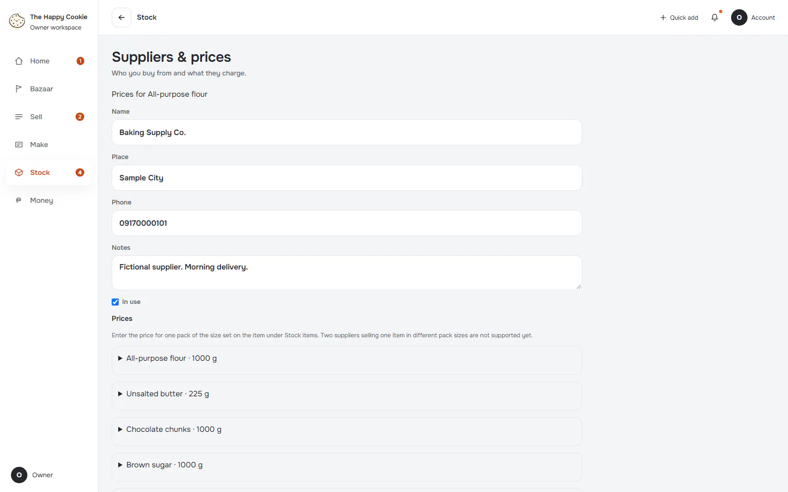
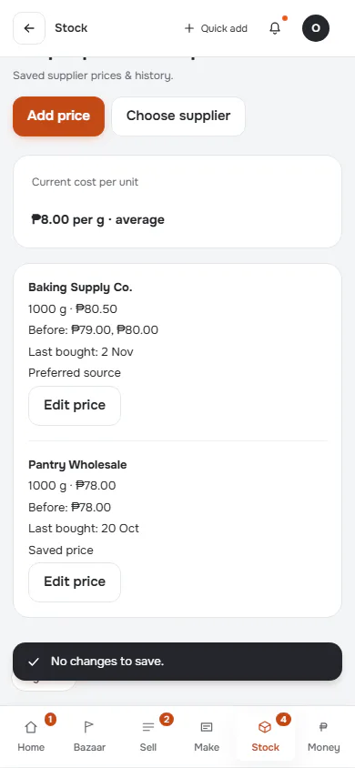
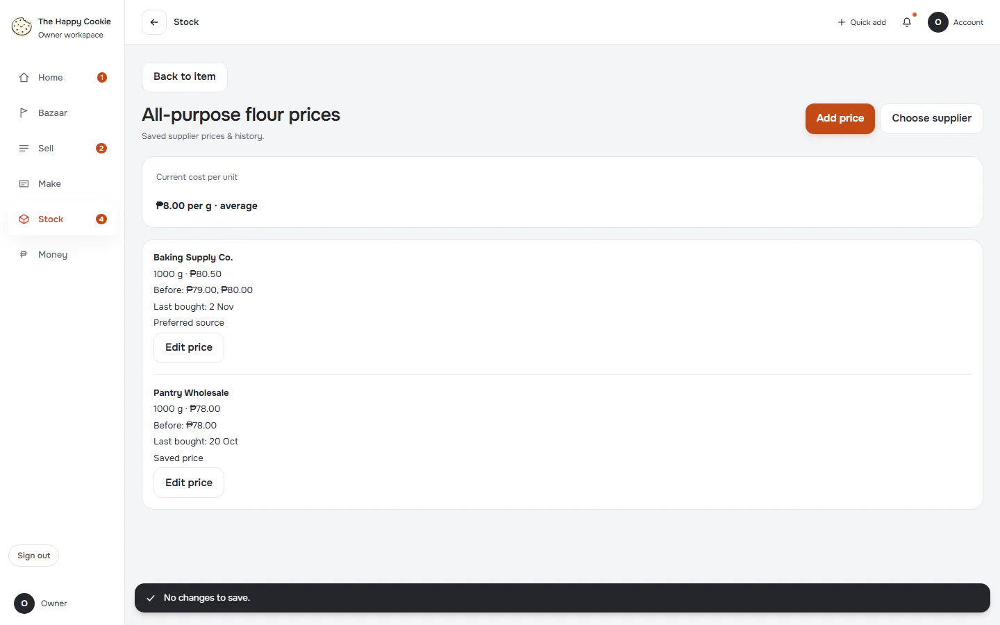

# Edit a supplier price

**ACTUAL application.** [Back to stock](README.md)

- Manifest id: `stock/supplier-price-edit`
- Source: `src/components/live/stock-suppliers-form.tsx`
- Role: owner
- Reference views: supplier-price-edit

## open

Group: interaction. Fixture: `default`. How it was reached: ui-driven.

**p390** 390×844 · [full page](../../screenshots/stock/supplier-price-edit/open/p390.full.webp)

**t768** 768×1024 · [full page](../../screenshots/stock/supplier-price-edit/open/t768.full.webp)

**d1440** 1440×900 · [full page](../../screenshots/stock/supplier-price-edit/open/d1440.full.webp)

## add-price

Group: interaction. Fixture: `default`. How it was reached: ui-driven.

**p390** 390×844 · [full page](../../screenshots/stock/supplier-price-edit/add-price/p390.full.webp)

**d1440** 1440×900 · [full page](../../screenshots/stock/supplier-price-edit/add-price/d1440.full.webp)

## conflict

Group: failure. Fixture: `default`. How it was reached: ui-driven.

**p390** 390×844 · [full page](../../screenshots/stock/supplier-price-edit/conflict/p390.full.webp)

**d1440** 1440×900

