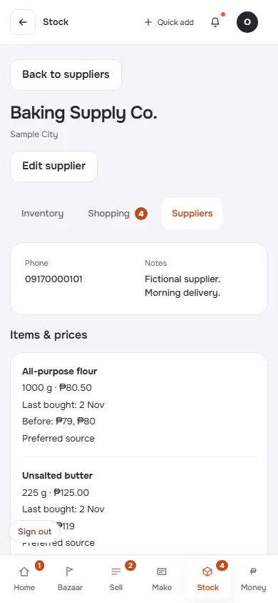
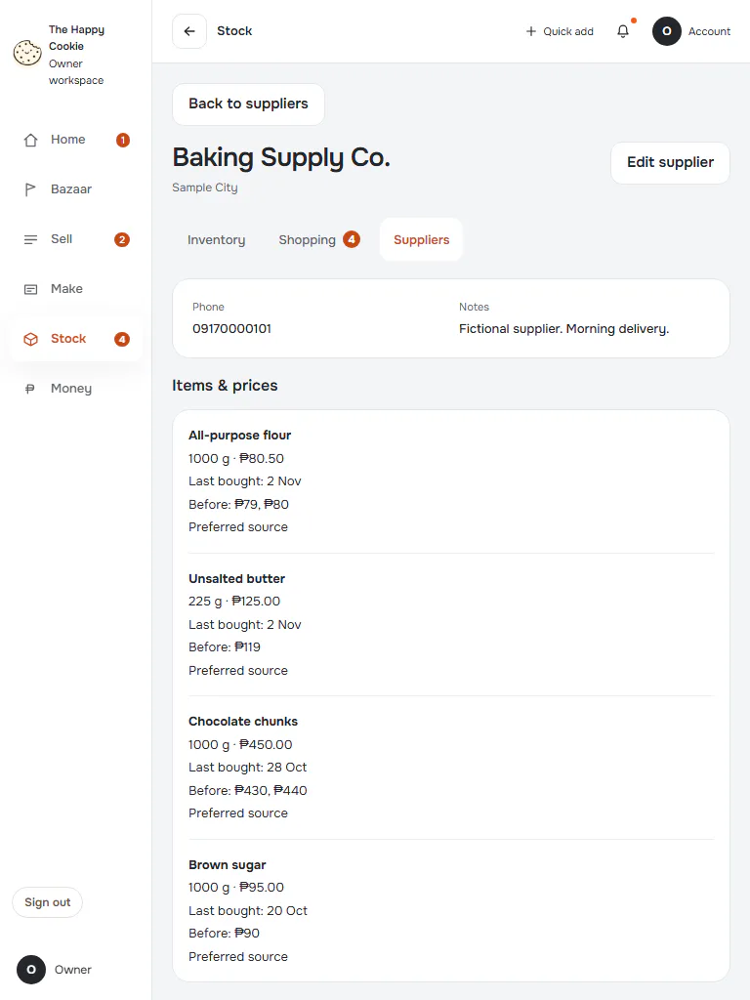
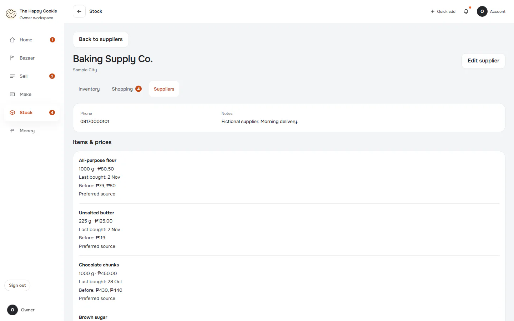

# Supplier

**ACTUAL application.** [Back to stock](README.md)

- Manifest id: `stock/supplier`
- Source: `src/components/live/stock/suppliers-live.tsx`
- Role: owner
- Reference views: supplier

## default

Group: interaction. Fixture: `default`. How it was reached: ui-driven.

**p390** 390×844 · [full page](../../screenshots/stock/supplier/default/p390.full.webp)

**t768** 768×1024

**d1440** 1440×900 · [full page](../../screenshots/stock/supplier/default/d1440.full.webp)

