# Suppliers

**ACTUAL application.** [Back to stock](README.md)

- Manifest id: `stock/suppliers`
- Source: `src/components/live/stock/suppliers-live.tsx`
- Role: owner
- Reference views: suppliers

## populated

Group: data. Fixture: `default`. How it was reached: ui-driven.

**p320** 320×700 · [full page](../../screenshots/stock/suppliers/populated/p320.full.webp)

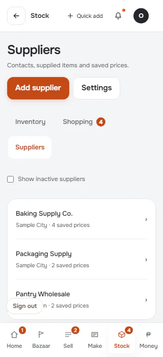

**p390** 390×844

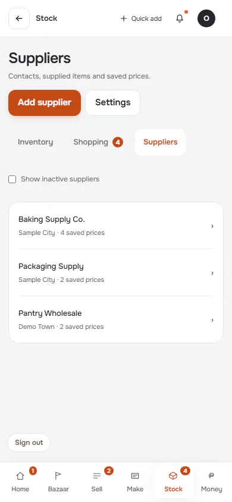

**t768** 768×1024

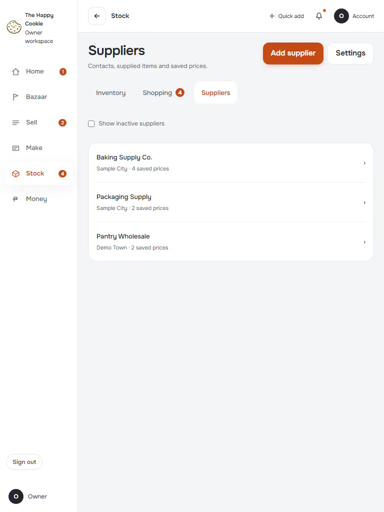

**l1024** 1024×768

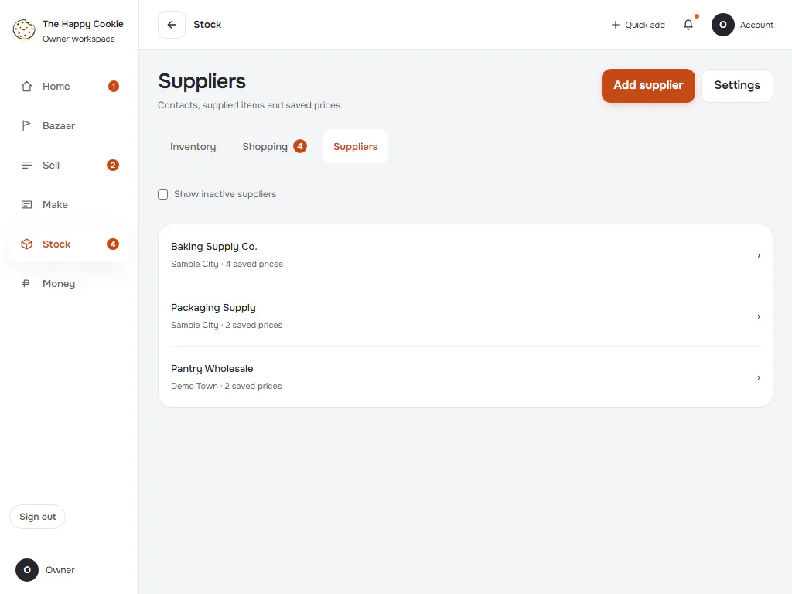

**d1440** 1440×900

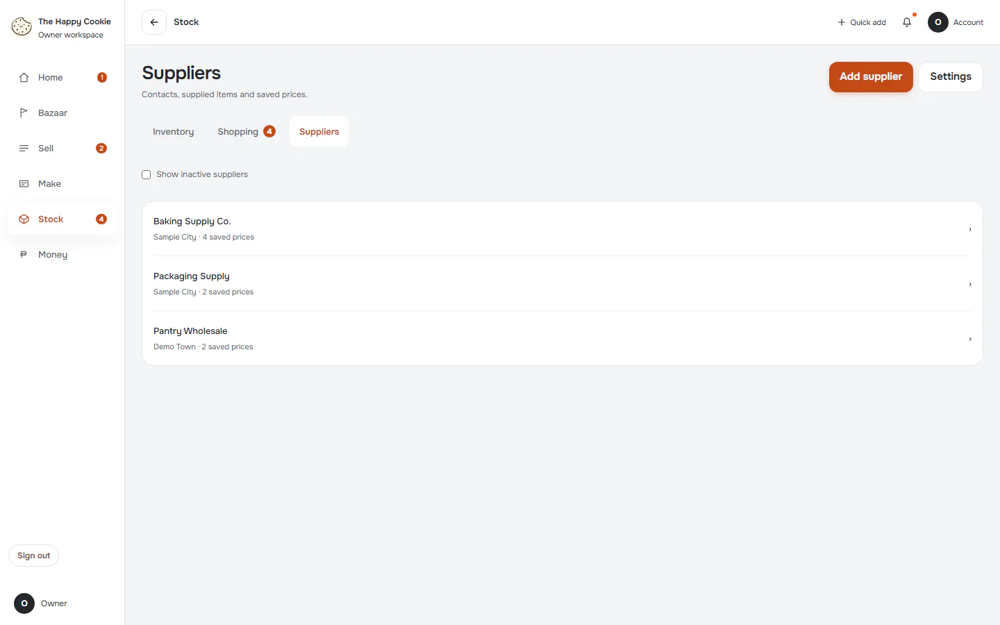

**w1920** 1920×1080

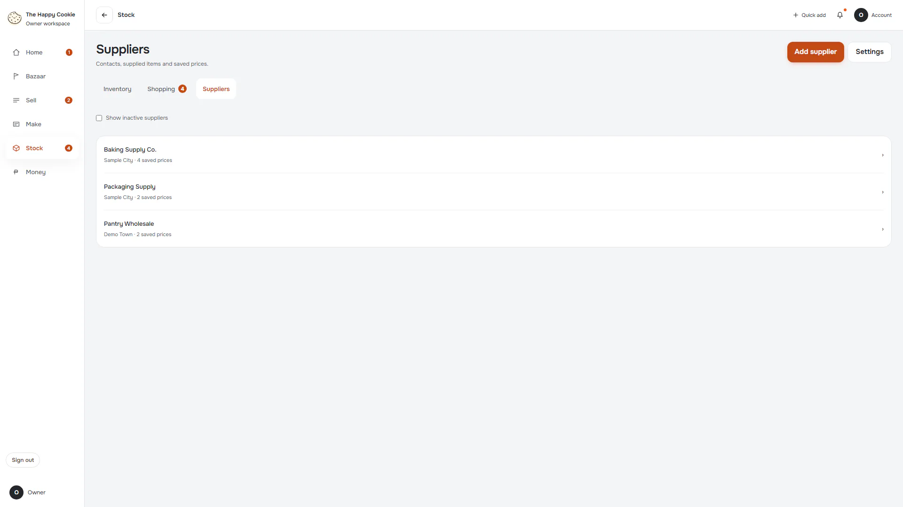

## empty

Simulated server answers with no records. Group: data. Fixture: `data:empty`. How it was reached: rpc-fixture.

**p390** 390×844

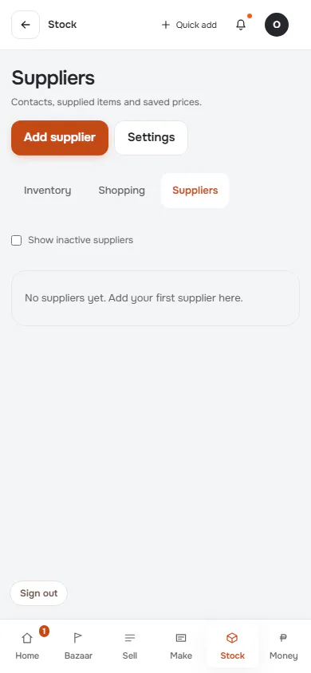

**d1440** 1440×900

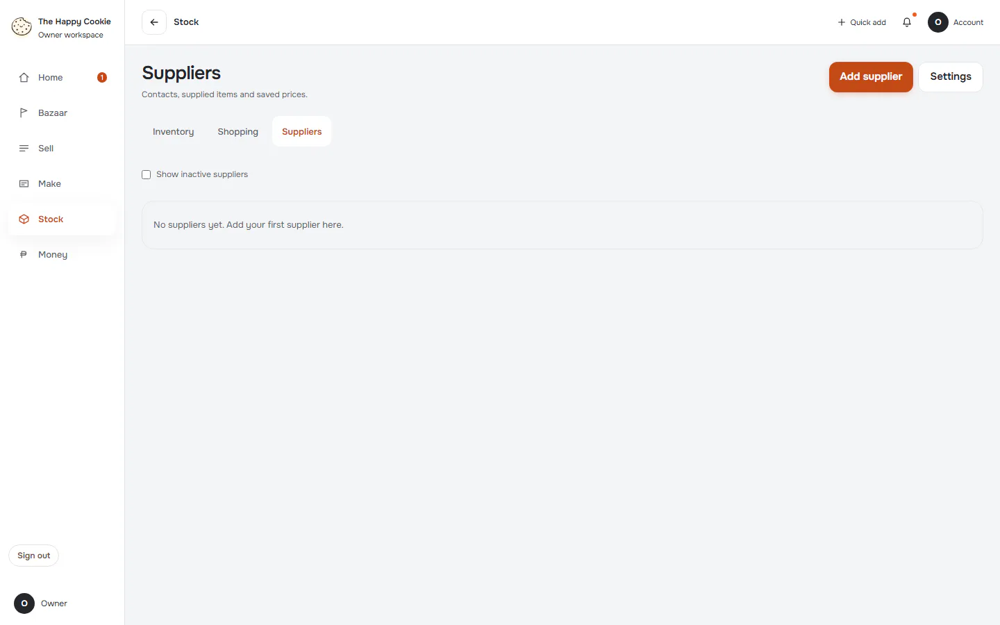

## long-text

Long customer, product and item names. Group: data. Fixture: `data:long`. How it was reached: rpc-fixture.

**p390** 390×844

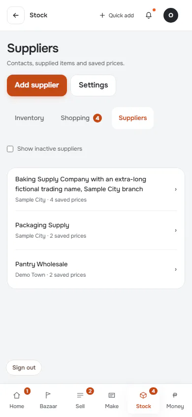

**d1440** 1440×900

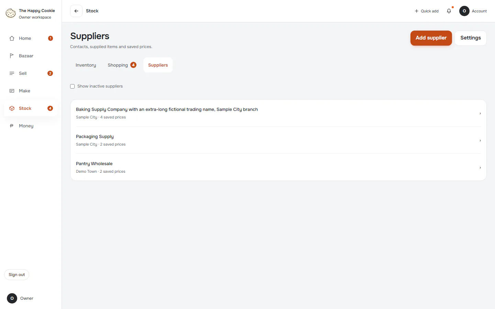

## loading

Reads never answer, so the loading treatment stays on screen. Group: failure. Fixture: `fail:get_stock_catalogue=never`. How it was reached: rpc-fixture.

**p390** 390×844

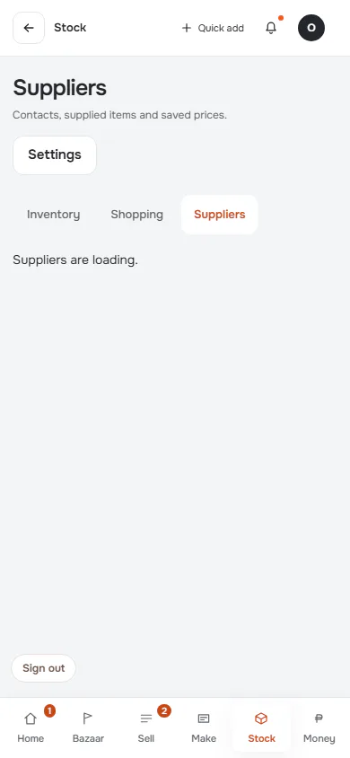

**d1440** 1440×900

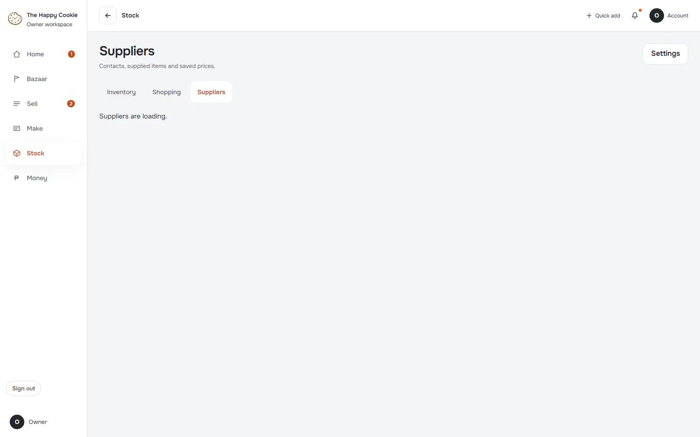

## read-failure

Reads answer with a connection error (08006). Group: failure. Fixture: `fail:get_stock_catalogue=down`. How it was reached: rpc-fixture.

**p390** 390×844 (pixel-identical to `stock/suppliers/loading@p390`)

**d1440** 1440×900 (pixel-identical to `stock/suppliers/loading@d1440`)

## malformed-answer

Reads answer with a shape the parser refuses. Group: failure. Fixture: `fail:get_stock_catalogue=malformed`. How it was reached: rpc-fixture.

**p390** 390×844 (pixel-identical to `stock/suppliers/loading@p390`)

**d1440** 1440×900 (pixel-identical to `stock/suppliers/loading@d1440`)

## offline-after-load

Browser goes offline after a populated load. Group: failure. Fixture: `default`. How it was reached: ui-driven.

**p390** 390×844

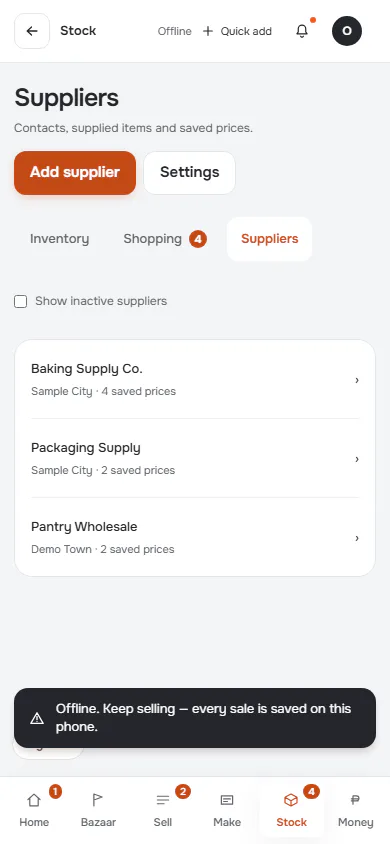

**d1440** 1440×900

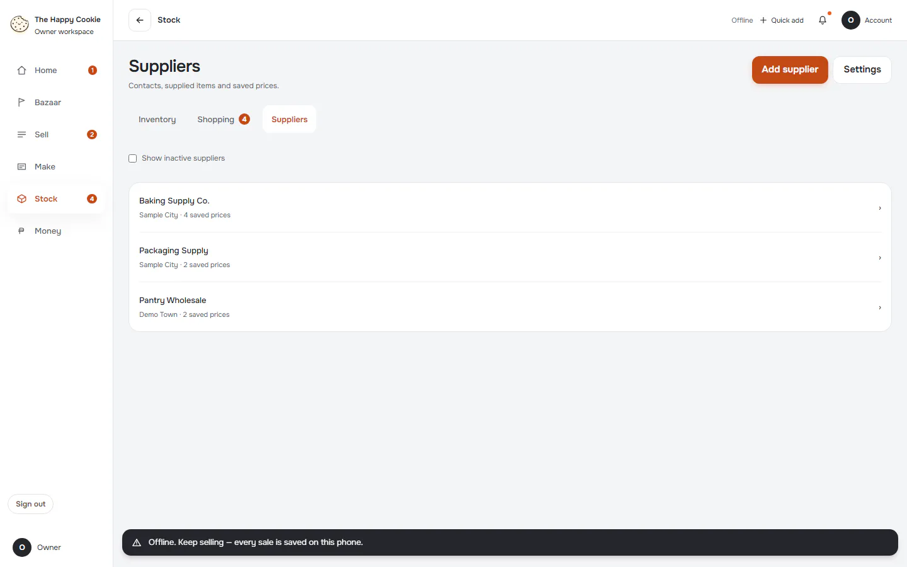

## focus-keyboard

Five Tab presses from page start: what focus looks like. Group: interaction. Fixture: `default`. How it was reached: ui-driven.

**d1440** 1440×900

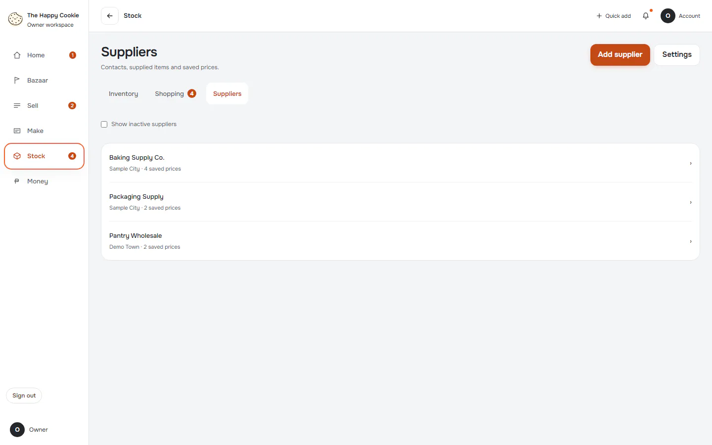

## inactive-shown

Group: interaction. Fixture: `default`. How it was reached: ui-driven.

**p390** 390×844

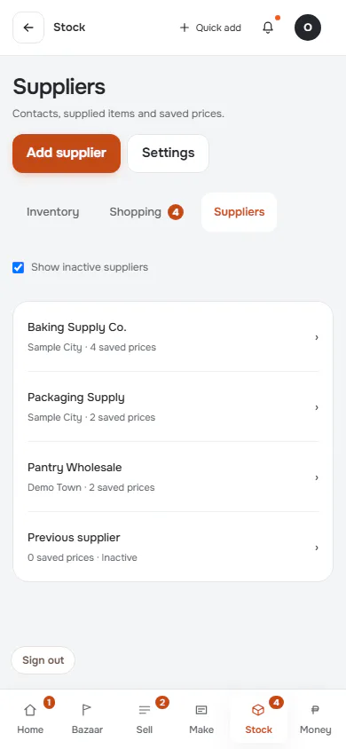

**d1440** 1440×900

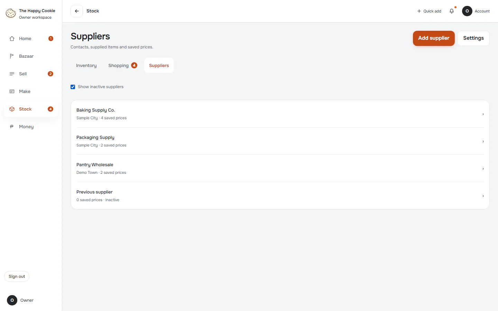
