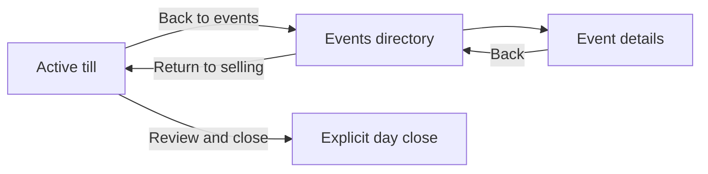
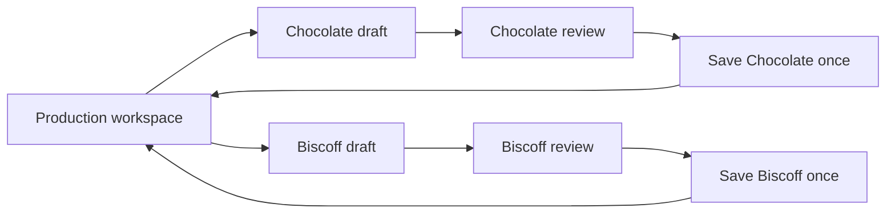

# Active Bazaar navigation and parallel production

Owner additions saved 3 November 2026; audit/plan resumed the same day. This extends the full
actual-application goal. It does not replace the remaining workflows or authorize deployment,
hosted changes, accounting changes, or weaker permissions/offline controls.

## Evidence and limits

### Production transaction contract — 5 November owner correction

This section supersedes the output-scaled preparation and automatic fresh-ingredient
baking described below. Ingredient deduction at completed dough preparation was approved
on the client call. Ethan additionally approved: **Bake consumes only recorded fridge
dough; a shortage retains the bake draft and asks for Prepare dough first.** Physical
dough-count corrections remain a separate unanswered decision. This is a contract,
not evidence that the new workflow is implemented or deployed.

The real work is measure this flavour's ingredients → roll and count balls → record
Prepare dough → refrigerate → bake some balls → record good cookies and rejects →
fulfil orders or transfer baked cookies to a table. A plan performs none of these writes.

- Preparation records two independent facts: recipe amount used (the existing full/half
  choices), and actual whole balls produced. One full recipe yielding 11, 12 or 13 balls
  consumes the same recipe quantities. Changing actual balls never rescales ingredients.
- An owner-only `record_dough_preparation` RPC accepts exactly `id`, `product_id`,
  `recipe_version`, `recipe_amount`, `balls`, `drop_no`, `at`. Full is 1; half is 0.5.
  Balls are 1–10,000. The server validates types/bounds and the current saved recipe;
  a missing/inactive product, empty recipe or stale version is refused before any write.
- Store actual balls as the existing dough record's quantity, plus recipe amount and an
  immutable recipe snapshot containing yield, version, ordered lines, explicit line kind,
  quantities, units and item links. Existing records retain their original values; no
  historical ingredient use is inferred or backfilled from a changed yield.
- Ingredient need is derived from recipe amount through the existing SQL scaling rule,
  rounding and supported units, independent of balls. Packaging is retained in the
  snapshot but is consumed only by the existing packing/sale rules. Each ingredient
  deduction uses the existing stock/cost movement helper, retaining its provenance,
  consumption accounting and shortage rules. Unknown cost stays pending.
- Preserve current shortage behavior: consume available stock without making it negative,
  and retain exact missing quantities on the preparation. Acknowledged preparation and
  ingredient shortfall are separate facts, both visible in the result. Do not claim that
  stock covered all measured ingredients when a shortfall was recorded.
- Lock request → catalogue → recipe → product production → sorted stock items, using the
  existing lock namespaces. Record, movements, shortage and audit entry commit atomically.
  Exact UUID/body replay returns the original result before checking a newer recipe;
  reusing the UUID with another body is refused. A retry never deducts ingredients twice.
- Baking must consume `good + rejects` balls and add only `good` cookies. Rejects may be
  every baked cookie. It must atomically refuse insufficient recorded dough; never mix
  fresh ingredients or deduct preparation ingredients again. Preserve existing baking,
  packing, transfers, correction and books history. Update the backend before enabling
  the new bake flow; do not expose a UI-only promise over the legacy auto-mixing RPC.
  The new `record_bake` RPC accepts exactly `id`, `product_id`, `qty` (all oven output),
  `target`, `rejects`, `recipe_version`, `drop_no`, `at`. It returns the original record ID,
  duplicate flag, dough used and an empty ingredient-shortfall list. `ZD001` is a definite
  refusal for insufficient dough, with available/needed counts in the error detail.
  `ZD002` refuses chronology that cannot support the bake at its timestamp or would
  make a later recorded dough balance negative. An existing exact replay is still answered.
  Exact replay precedes current-recipe checks. Lock namespaces/order match preparation.
  SQL58's existing production-cost read uses stamped preparation ingredient costs divided
  by actual prepared balls, pooled by flavour up to the batch date. Keep that rule and its
  incomplete-cost flag; a bake creates no second ingredient movement or expense.
  New bake rows carry `dough_only=true`; historical rows stay unchanged. Before hosted
  cutover, retire new legacy `record_production` writes while keeping exact recorded-ID
  replays. The additive endpoint alone does not close that server-rule gate. Keep Bazaar
  finalisation/return-to-kitchen contracts separate and verify them before changing that path.
- Keep per-item requests, snapshots, raw inputs, independent work, recipe-change review,
  owner/backend scope and single-tab ownership. No automatic post after reload or signal
  recovery. An acknowledged save with failed refresh says recorded, balances unchecked.

Implementation slices: additive preparation RPC/schema and SQL evidence; live preparation
form/client/recovery; dough-only bake RPC and live review; approved physical count behavior;
connected order/shopping/Bazaar and cost reconciliation. New SQL is local until separately
approved for hosting. Each stock-write slice needs independent review before acceptance.

#### PB-01/PB-02 additive boundary — 7 November

The external review is evidence, not new owner policy. The local connected regression at
`e0670e6` confirms the combined old route uses333.3g instead of250g, ends with7 kitchen
cookies instead of3, creates a second batch and charges667 rather than500 ingredient
centavos. No hosted incident is inferred. Historical Bazaar-only behavior stays unchanged.

The new source is the existing product/drop baked pool. An explicit physical transfer
records a stable request/body, authoritative kitchen debit and source production IDs;
planning alone never transfers stock. Returns credit the same pool without production
or ingredients. Source markers distinguish transferred stock from legacy separately-made
stock. Version1 refuses mixed origins or multiple source drops for one booking/product
without effects; these are capability limits, not an assumed allocation policy.

All spenders use the product lock before checking the same pooled balance. Pack locks
catalogue then sorted products; transfer locks booking, catalogue, product; discard and
correction retain their product lock. No product holder acquires catalogue/booking later.
Exact recorded-ID replays remain unchanged.

Bazaar estimates retain booking-typed, flavour-typed, first-day-recipe precedence. Money
retains its bought/used rules; the Make ingredient use is never repeated. No per-batch
valuation, transfer expense or new stall-production policy is introduced.

SQL74 first extracts the byte-identical legacy stock section into a private helper, with
no transfer API enabled. Then add the journal/guards and activate the connected contract.
Require actual SQL role, concurrency, replay and unchanged historical tests, independent
review, full verification, connected browser and visual review before acceptance.

Required database proof includes full recipe → 11/12/13 balls with identical ingredient
use; half recipe with independently entered balls; exact replay after recipe change;
changed-body refusal; active owner/helper/support/inactive/anonymous boundaries; missing
and incompatible items, partial/unknown costs and shortages; concurrent preparations of
different flavours sharing ingredients; concurrent bakes without overdrawing dough;
rollback on a failed stock write; immutable history and no second ingredient charge.

Audited the current `codex/refined-workflows` source, protected engine as an answer key, existing
tests, and the latest local definition of `record_production` in migration 67. Current starting
HEAD was `91c87ed`; Pressable repair `7c07008` subsequently passed the full pinned gate. No hosted writes occurred.
The client-approved v4, original prototype, real assets and complete shared owner brief remain
design references; their one-at-a-time forms are not a requirement to retain a single draft.
The owner's new requirement supersedes that limitation. Neither addition is complete.

Historical hosted deployment evidence is in the private checkpoint. This audit is not a new
authenticated hosted-screen inspection, a database concurrency execution, or device acceptance.
Existing passing tests protect old behavior; they do not prove the newly requested capabilities.
A CLI headless reproduction at390/1240 confirmed both shortcomings with actual components and
controlled RPC data: a second eligible product resumed the first batch; directory Back retained
the held event/cart but still drew the till. Neither consolidated nor classic till exposed Events.
No stock, sale or other write was posted. Private receipt: saved-requirements-audit-checks.json.

## Latest local checkpoint, 4 November

P3 scoped device recovery is implemented locally and awaiting independent auth/offline review.
The full gate passes 175 files / 2,873 tests + 2 existing TODOs. Eight responsive/motion browser flows
cover reload without posting, exact request replay, tab takeover, storage failure and account/late-reply
isolation. Live build passes 28 pages. Notes remain device drafts; saved stock is explicitly unchecked after
reload. Read [the current Claude handoff](claude-ui-handoff.md) for changed files, visual walkthrough,
review packet and unresolved work. P4 SQL concurrency/device/owner acceptance is still incomplete.

### Historical checkpoint, 3 November — superseded by the newest status above

Latest local draft supersedes the singleton checkpoint below: independent cookie/dough items now
project into the legacy slots, with source/period snapshots, retained raw fields and per-item saves.
Make shows In progress; manual entry offers cookie batches or full/half dough preparation. Eight
real-component synthetic-RPC runs at320/390/768/1240 in both motion modes cover two batches, a mix,
editing B during A's save, independent replies and dough confirmation. Not SQL/device acceptance.
P3 remains unimplemented: memory-only drafts/requests, no actual identity scope, reload or tab lease.
Source-change comparison/adoption now has a local draft: show old/updated amounts and recipe yield,
retain counts/notes/period, explicitly reset ingredient exceptions and return to review. Dough keeps
its prior amount and requires a valid full/half choice if the updated yield makes it incompatible.
Late callbacks, new source reads and pending saves cannot adopt through the old action. Inline live
modal messages retain lifetime/Undo without covering buttons. Eight width/motion browser runs pass,
with synthetic RPC only. Current full gate/build are pending. Unavailable-source resolution and
truthful acknowledged-result/refresh presentation remain incomplete.
Latest owner navigation is implemented locally: plain Bazaar opens Events before till painting;
both tills show compact Back by the name. Eight browser checks cover both layouts/held facts.
All current sensitive layers await review; see private pending-review/multi-production-events-first.
The final researched every-page/flow/state critique follows implementation, per the shared brief.

Earlier checkpoints (read the latest status above first):

B1 is a local, uncommitted draft awaiting independent review. Both tills now expose Events;
legacy held events are supported. Directory and child pages retain the selling state, show a
single return/resume action, and label the own day truthfully. The held event stays pinned even
after its planned dates; the list filter survives child Back. Full owner access is rechecked
at action/render; restricted access closes reviews and forces the till. A redundant one-item
Bazaar section tab is removed. No close, sale, queue or stock RPC was changed.

CLI headless actual-component round trips passed320/390/768/1240 for both tills, with synthetic
RPC data only, unchanged held values and no navigation writes or horizontal overflow. These are
not hosted/device acceptance. Till/Events/selected-event URLs now use RouteSync history without
remounting. Direct directory, event reload and Back/Forward pass390/1240; unavailable/mismatched
events and late reads after gate narrowing are covered. Plan/review subview addresses,
stage-specific return wording, broader external-close checks and independent review remain.
Existing Bazaar storage does not persist the unfinished cart on reload; soft-navigation retention
is verified, cart reload recovery is not. Events return row focus/scroll passes eight real-layout
checks at320/390/768/1240 with reduced motion, keyboard and browser Back; the scoped JSDOM mock
now asserts the requested scroll. P1's independent pure draft pool has source/revision tests;
runtime integration and P2–P4 remain incomplete. Private evidence: gap-refinement/events-*.

User-reported preview failures took priority: reproduced stale development script caching and a
retained-renderer lookup mismatch, repaired the display binding, added a separate network-only dev
worker/local recovery page, and switched the private source launcher to Webpack. Outer-body-only
extension compatibility retains inner hydration checks. Staff routes remain gated; only the new
static worker is exempted. Ethan confirms Chrome opens. Independent offline/auth review still
precedes accepting this local draft; no hosted records were changed. These preview repairs and
B1a/B1b are separate reviewable parts, not one oversized accepted commit. Full pinned gate passes165
files /2762 tests +2existing todo (four workers), and live Webpack build passes28 static pages.
Default-worker run hit the unchanged business-clock source-scan5-second timeout; focused whole-file
checks passed. No test timeout, assertion or lint rule was weakened.

## Findings at the audit baseline

**B1 — active selling hides the directory (high).**
`src/components/live/bazaar/bazaar-live.tsx:35` selects a till whenever `v.event` exists, except
for day review. Resetting the directory controller therefore cannot reveal its list while the
phone retains its event. The consolidated till has Back to Home in its menu, but no Events
action (`till.tsx:48`). The classic toolbar likewise exposes Home, not Events (`till-bar.tsx:31`).

**B2 — changing that condition alone is insufficient (high).**
`OpsRuntime.liveTabs` suppresses Bazaar navigation for a held/restored event; the owner frame
also retains focused mode when the top bar is hidden. `canLeaveTill` requires an owner, signal
and a non-narrowed gate. A new directory subview on the same `bazaar` route must not bypass the
restricted offline gate (`src/components/app/live-gate.tsx:586`). Navigation must preserve the
held day rather than clear it to make the list visible.

**B3 — an own-phone day would be mislabelled (medium).**
`src/store/bazaar-days.ts:866` treats every open day row as selling on another phone, because
the held day was previously hidden behind the till. Exposing Events without adapting this row
would show an incorrect ownership hint and no direct Resume selling action for the held day.
`BazaarDays.back/reset` clears browsing/review state, not the held event; retain that separation.

**P1 — both work slots are singletons (high).**
Protected engine `startBatch` writes `state.batch`; `startDough` writes `state.doughPrep`.
The new live entry and compatibility launch guard resume an existing batch rather than start
another (`OpsRuntime.productionStartView/installProductionOverrides`). This prevents data loss
but cannot satisfy simultaneous work. `ProductionLive` also replaces Start with Continue when
one batch exists. Merely adding product tabs would still reuse that one mutable draft.

**P2 — switching product is currently replacement (high).**
Protected `setBatchFlavour` rebuilds quantities and clears the note, adjustments and rejects.
The general Back action clears `state.batch`. A workspace needs independent items and explicit
per-item discard; changing focus must never rewrite another product's working record.

**P3 — confirmation is not scoped to a working-item identity (high).**
`recordProductionNow` has one `productionBusy` flag and indexes unanswered requests by a
content signature. `confirmBatch/confirmDough` compare only product ID before running legacy
completion bookkeeping. Two distinct batches can share product/quantities/version; an old
answer could then clear or finalize newer work. Use working-item and request IDs, not product
ID or payload equality, to distinguish batches. Preserve acknowledged-save-only stock effects.

**P4 — drafts and unresolved production requests do not survive reload (high).**
The local ownership/retry prerequisite now tags runtime drafts with liveWorkId, keys unanswered
requests and completed receipts by it, clones original request fields, and guards completion against
the exact projection and role epoch. Unknown batch fields/discard and dough quantities are guarded;
Back from the batch retains it. Ten added regressions are in the full166-file /2782-pass gate (+2todo).
Eight responsive/motion browser runs cover exact retry after changed week/version and leave/resume.
Live Webpack build passes28 pages. This remains uncommitted pending review. Pool integration, per-item saving, snapshots from entry,
durable recovery and actual account/business scoping remain incomplete; this is not parallel production.

The live persistence hook saves Bazaar state and count recovery, not production drafts or the
in-memory `pendingProduction` map. The Bazaar persistence whitelist is unrelated to production.
Soft-navigation tests are not reload/recovery proof. Production recovery needs its own scoped,
versioned storage and tab-ownership protocol; do not add it to the Bazaar sale queue.

**P5 — recipe and period can drift during work (high).**
Confirmation reads the current `recipeVer[pid]` and `dropNo`, rather than an immutable snapshot
of each work item. Multiple drafts make that gap more consequential. Preserve selected product,
recipe version/yield/line kinds and production period; explicitly review changed sources.
An unanswered request must retain its original complete payload even if sources change later.

**P6 — shared stock is authoritative on the server (review dependency).**
Migration 67's `record_production` takes a request-ID lock, validates payload replay, then takes
catalogue/recipe/product locks and checks recipe version before writing stock and production.
This suggests the current RPC may support independent concurrent requests without a schema
change; it is not runtime proof. `get_production` summaries are not a substitute for matching
an uncertain save to its request ID. Existing exact-payload/idempotent retry remains the first
recovery route; do not infer success by matching product, quantity or timestamps.

## Target owner experience

### Bazaar

1. Selecting Bazaar/Events opens the directory first. Both tills expose one compact **Back** control
   beside the event name, accessible as Back to events, including older held events without day IDs.
2. Open the Events directory in the ordinary owner workspace without ending the active day.
   Keep its active row pinned and show **Return to selling** with the held event/day name.
3. Browse event details, days and permitted settings; Back returns to the directory and its
   selected filter/scroll. The held day's row says Selling on this device and resumes that till.
4. Return to the same till with the same cart, quantities, prices, drawer, receipts and pending
   sales. Navigation neither flushes as a prerequisite nor removes any unacknowledged sale.
5. Keep day close and event finalization as separate, deliberate actions. Starting another
   selling day on this phone remains disallowed while it holds one; directory access is allowed.

Use one Return to selling control per view: the pinned held-day row can carry it in the directory;
child pages can place it in their header. Avoid stacking a duplicate return banner and new tab rows.

This is the target flow, not a statement that it already works. Read-only browsing still obeys
the current full-session/owner gate. The narrow offline reopen remains selling-only. If signal
or access is lost while browsing, show the real limitation and retain a working return to the
held till; no concealed directory behind the same-route offline check and no permission widening.

### Production

Use one compact **In progress** list in Make's production workspace. Each row has the real
product photo/name, planned quantity, current count/review/saving state and Continue. Start
production remains available while other items exist. Add another product without discarding
or finishing the first. Include dough preparation in the audit/adapter, not only baked batches.
Do not add an ERP-style scheduling board, invented oven timers or automatic baking statuses.

Switching rows preserves each item's quantities, rejects, note, ingredient exceptions, recipe,
period and review step. Confirming A completes only A; B stays editable and visible. A failed
or uncertain A remains clearly identified without losing B. Creating or switching drafts makes
no inventory movement. Planned quantities are not actual stock, reservations or confirmed use.
Use the existing planned/actual and good/reject visuals; show shared recorded stock honestly.
Refresh affected stock/dough after acknowledgement before presenting a complete saved result.

## Implementation slices and ownership

Root remains the sole writer. Keep each slice independently testable and under the repository's
diff limit. No protected screen/engine edits, applied SQL changes or unreviewed money/offline work.

**B1: explicit Bazaar view state and navigation.**
Add a till/directory view selection to the live controller/contract, independent of the held
event and day. Wire Events/Return to selling in `bazaar-live`, `till`, `till-bar` and runtime
view/frame selection. Adapt the held-day row to resume its own day instead of claiming another
phone. Preserve classic fallback and review origin. Check access at action and render time;
session narrowing/role changes must force an authorized selling view.
Browser Back and direct/reloaded addresses must resolve the view/origin through existing navigation
helpers without remounting the runtime, discarding drafts or clearing the held event. Do not change close/sync RPCs.
Changes affecting gate/held-day/offline behavior require independent review before an accepted
commit. If the previously requested reviewer wait still applies, prepare and test this scope
locally; continue independent pure workspace/UI work rather than bypassing that review.

**P1: multiple working-item state, before posting changes.**
Add a typed workspace module beside the engine. Give every dough/bake draft a stable unique
working ID and product/recipe/period snapshot; keep a selected ID for focus. The legacy
`state.batch`/`doughPrep` may be a compatibility projection of the selected item, never the whole
workspace. Cover all launch paths: Start, Quick add, work rows, flavour change, resume and Back.
Promote an existing unconfirmed legacy draft once rather than duplicate it on every render.

**P2: independently guarded review, acknowledgement and result.**
Fresh completion audit: the live markBaking override keeps orders unchanged until packing. Do not
invent a Baking status while adapting legacy completion. Engine draft clearing/navigation must
target the original work item and must not close or navigate another item's editor.
Freeze a request UUID/time/body per working-item submission; identical batches are distinct
requests and retries reuse their own exact request. Replace global UI saving state with per-item
state so working on B remains possible while A saves. Overlapping RPCs may be serialized by
server locks; the owner must not be forced to complete A before preparing B. Preserve all legacy
completion effects (including order-progress bookkeeping) through existing authoritative helpers;
do not copy the stock/cost engine or run completion against whichever item happens to be selected.
Audit named effects before replacing that adapter. Finish each item's result only from its own
acknowledgement and authoritative refresh. Protect late replies after selection/discard/role changes.

Source-change flow: Recipe changed -> Compare recipe amounts/yield -> Use updated recipe explicitly
-> Counts/notes/period retained, ingredient exceptions visibly reset -> Review again -> Confirm.
For dough, an incompatible old amount remains visible; choose full/half before review. A pending or
unanswered request never rebases: Check saved result uses its original identity and payload.
Current SQL67 checks existing request replay before its stale-recipe refusal; no historical-recipe
posting option is invented. UI comparison/adoption does not post production or move inventory.
This deliberately scoped pattern is informed by [Katana's official recipe-update workflow](https://support.katanamrp.com/en/articles/5967060-applying-changes-made-to-product-recipes-on-open-orders)
(checked3November2026): changes to default recipes are applied explicitly to individual open work,
not silently propagated. This is a design reference, not evidence of Happy Cookie backend behavior.

**P3: durable recovery and cross-tab protection.**
Persist drafts and frozen unanswered submissions under the actual user/business identity, with
a schema version and tab lease using existing lock/storage patterns. Do not reuse role labels
as identities. Reload restores multiple drafts; a second tab cannot post the same work under a
new UUID. Uncertain submissions stay immutable and cannot be silently discarded or re-created.
Production is not granted offline posting or cross-device draft editing by this requirement.
Independent review is required for request, persistence, role and shared-stock changes.

**P4: integrated operation and acceptance.**
Exercise the flows against controlled RPC fixtures, then approved local database concurrency
tests. A schema addition is justified only if existing RPC/recovery guarantees prove insufficient.
Any hosted migration/write remains separately authorized; no production record is a disposable test.
Keep notes visibly unconfirmed unless persistence is actually supported (current payload has no note).
Inspect relevant original/client reference pages per slice; keep neutral Happy Cookie design.

## Required checks before declaring either addition implemented

- Active consolidated and classic tills: Events -> directory -> event -> Back -> same till.
  Event/day IDs, cart, prices, stock, drawer and pending sales unchanged; no navigation writes.
- Own held day versus another phone's day have truthful labels/actions; no second day starts
  by browsing. Review Back, failed reads, empty lists and late reads preserve the selected origin.
- Owner/full session versus helper, sign-out, narrow offline reopen, signal loss/reconnect and
  externally closed day. Pending sales remain until explicit server acknowledgement.
- Start Chocolate A and Biscoff B; edit both; switch and reload; no field or step is overwritten.
  Dough drafts and ordinary Back are included. Duplicate identical batches keep different IDs.
- Save A while B is selected/edited; confirm both rapidly; replay A; receive reversed/late replies.
  Each item completes once, keeps its own product/recipe/period and preserves the other's draft.
- Shared-ingredient shortage and chilled-dough use from server facts; no double deductions or
  fabricated availability. A source change requires review without mutating an uncertain request.
- Failure before submit versus lost reply after commit; exact retry; two-tab lease/takeover;
  discard during save, deleted product, stale recipe, changed period and actor/session change.
- Phone320/390, tablet768 and desktop1240; useful focus/scroll return, keyboard/tap controls,
  reduced motion, solid glass fallbacks and no overflow. Then pinned `pnpm verify`, relevant
  live build/headless checks and required independent review; phone/owner acceptance stays separate.

## Narrow research and remaining evidence

[Shopify register-session management](https://help.shopify.com/en/manual/sell-in-person/shopify-pos/cash-register-management/register-sessions-in-shopify-admin)
documents monitoring sessions separately from explicitly closing them. [Square session controls](https://squareup.com/help/us/en/article/8344-start-and-end-a-cash-drawer-session)
likewise make opening/ending deliberate actions. The proposed Events/till switch is a Happy Cookie
design inference from that separation, not a claim those products have Happy Cookie's Bazaar model.

[Odoo's manufacturing/work-order documentation](https://www.odoo.com/documentation/master/applications/inventory_and_mrp/manufacturing/basic_setup/manufacturing_work_orders.html)
describes individual product/quantity work cards. Adapt only that identifiable-item pattern to a
small cookie workspace. Search excerpts were available; Shop Floor full-page fetches timed out,
so no full UI/hands-on review is claimed. No new vendor, subscription or enterprise module is proposed.

Resumed source audit and these published references do not establish hosted/device acceptance.
The existing demo-data/price review holds and full goal remain in force.
