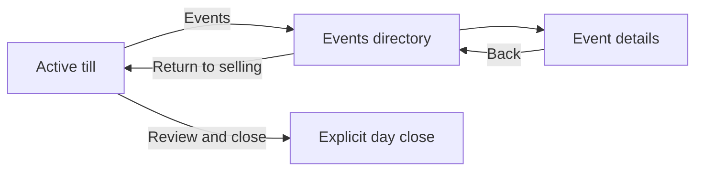
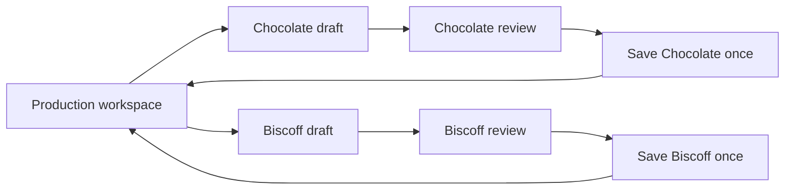

# Active Bazaar navigation and parallel production

Owner additions saved 3 November 2026; audit/plan resumed the same day. This extends the full
actual-application goal. It does not replace the remaining workflows or authorize deployment,
hosted changes, accounting changes, or weaker permissions/offline controls.

## Evidence and limits

Audited the current `codex/refined-workflows` source, protected engine as an answer key, existing
tests, and the latest local definition of `record_production` in migration 67. Current starting
HEAD was `91c87ed`; Pressable repair `7c07008` subsequently passed the full pinned gate. No hosted writes occurred.
The client-approved v4, original prototype, real assets and complete shared owner brief remain
design references; their one-at-a-time forms are not a requirement to retain a single draft.
The owner's new requirement supersedes that limitation. Neither new workflow is implemented yet.

Historical hosted deployment evidence is in the private checkpoint. This audit is not a new
authenticated hosted-screen inspection, a database concurrency execution, or device acceptance.
Existing passing tests protect old behavior; they do not prove the newly requested capabilities.
A CLI headless reproduction at390/1240 confirmed both shortcomings with actual components and
controlled RPC data: a second eligible product resumed the first batch; directory Back retained
the held event/cart but still drew the till. Neither consolidated nor classic till exposed Events.
No stock, sale or other write was posted. Private receipt: saved-requirements-audit-checks.json.

## Findings in the current implementation

**B1 — active selling hides the directory (high).**
`src/components/live/bazaar/bazaar-live.tsx:35` selects a till whenever `v.event` exists, except
for day review. Resetting the directory controller therefore cannot reveal its list while the
phone retains its event. The consolidated till has Back to Home in its menu, but no Events
action (`till.tsx:48`). The classic toolbar likewise exposes Home, not Events (`till-bar.tsx:31`).

**B2 — changing that condition alone is insufficient (high).**
`OpsRuntime.liveTabs` suppresses Bazaar navigation for a held/restored event; the owner frame
also retains focused mode when the top bar is hidden. `canLeaveTill` requires an owner, signal
and a non-narrowed gate. A new directory subview on the same `bazaar` route must not bypass the
restricted offline gate (`src/components/app/live-gate.tsx:586`). Navigation must preserve the
held day rather than clear it to make the list visible.

**B3 — an own-phone day would be mislabelled (medium).**
`src/store/bazaar-days.ts:866` treats every open day row as selling on another phone, because
the held day was previously hidden behind the till. Exposing Events without adapting this row
would show an incorrect ownership hint and no direct Resume selling action for the held day.
`BazaarDays.back/reset` clears browsing/review state, not the held event; retain that separation.

**P1 — both work slots are singletons (high).**
Protected engine `startBatch` writes `state.batch`; `startDough` writes `state.doughPrep`.
The new live entry and compatibility launch guard resume an existing batch rather than start
another (`OpsRuntime.productionStartView/installProductionOverrides`). This prevents data loss
but cannot satisfy simultaneous work. `ProductionLive` also replaces Start with Continue when
one batch exists. Merely adding product tabs would still reuse that one mutable draft.

**P2 — switching product is currently replacement (high).**
Protected `setBatchFlavour` rebuilds quantities and clears the note, adjustments and rejects.
The general Back action clears `state.batch`. A workspace needs independent items and explicit
per-item discard; changing focus must never rewrite another product's working record.

**P3 — confirmation is not scoped to a working-item identity (high).**
`recordProductionNow` has one `productionBusy` flag and indexes unanswered requests by a
content signature. `confirmBatch/confirmDough` compare only product ID before running legacy
completion bookkeeping. Two distinct batches can share product/quantities/version; an old
answer could then clear or finalize newer work. Use working-item and request IDs, not product
ID or payload equality, to distinguish batches. Preserve acknowledged-save-only stock effects.

**P4 — drafts and unresolved production requests do not survive reload (high).**
The live persistence hook saves Bazaar state and count recovery, not production drafts or the
in-memory `pendingProduction` map. The Bazaar persistence whitelist is unrelated to production.
Soft-navigation tests are not reload/recovery proof. Production recovery needs its own scoped,
versioned storage and tab-ownership protocol; do not add it to the Bazaar sale queue.

**P5 — recipe and period can drift during work (high).**
Confirmation reads the current `recipeVer[pid]` and `dropNo`, rather than an immutable snapshot
of each work item. Multiple drafts make that gap more consequential. Preserve selected product,
recipe version/yield/line kinds and production period; explicitly review changed sources.
An unanswered request must retain its original complete payload even if sources change later.

**P6 — shared stock is authoritative on the server (review dependency).**
Migration 67's `record_production` takes a request-ID lock, validates payload replay, then takes
catalogue/recipe/product locks and checks recipe version before writing stock and production.
This suggests the current RPC may support independent concurrent requests without a schema
change; it is not runtime proof. `get_production` summaries are not a substitute for matching
an uncertain save to its request ID. Existing exact-payload/idempotent retry remains the first
recovery route; do not infer success by matching product, quantity or timestamps.

## Target owner experience

### Bazaar

1. Put a visible **Events** button in both consolidated and classic tills for the permitted owner,
   including an older held event without a day ID. Do not depend solely on day-specific till metadata.
2. Open the Events directory in the ordinary owner workspace without ending the active day.
   Keep its active row pinned and show **Return to selling** with the held event/day name.
3. Browse event details, days and permitted settings; Back returns to the directory and its
   selected filter/scroll. The held day's row says Selling on this device and resumes that till.
4. Return to the same till with the same cart, quantities, prices, drawer, receipts and pending
   sales. Navigation neither flushes as a prerequisite nor removes any unacknowledged sale.
5. Keep day close and event finalization as separate, deliberate actions. Starting another
   selling day on this phone remains disallowed while it holds one; directory access is allowed.

Use one Return to selling control per view: the pinned held-day row can carry it in the directory;
child pages can place it in their header. Avoid stacking a duplicate return banner and new tab rows.

This is the target flow, not a statement that it already works. Read-only browsing still obeys
the current full-session/owner gate. The narrow offline reopen remains selling-only. If signal
or access is lost while browsing, show the real limitation and retain a working return to the
held till; no concealed directory behind the same-route offline check and no permission widening.

### Production

Use one compact **In progress** list in Make's production workspace. Each row has the real
product photo/name, planned quantity, current count/review/saving state and Continue. Start
production remains available while other items exist. Add another product without discarding
or finishing the first. Include dough preparation in the audit/adapter, not only baked batches.
Do not add an ERP-style scheduling board, invented oven timers or automatic baking statuses.

Switching rows preserves each item's quantities, rejects, note, ingredient exceptions, recipe,
period and review step. Confirming A completes only A; B stays editable and visible. A failed
or uncertain A remains clearly identified without losing B. Creating or switching drafts makes
no inventory movement. Planned quantities are not actual stock, reservations or confirmed use.
Use the existing planned/actual and good/reject visuals; show shared recorded stock honestly.
Refresh affected stock/dough after acknowledgement before presenting a complete saved result.

## Implementation slices and ownership

Root remains the sole writer. Keep each slice independently testable and under the repository's
diff limit. No protected screen/engine edits, applied SQL changes or unreviewed money/offline work.

**B1: explicit Bazaar view state and navigation.**
Add a till/directory view selection to the live controller/contract, independent of the held
event and day. Wire Events/Return to selling in `bazaar-live`, `till`, `till-bar` and runtime
view/frame selection. Adapt the held-day row to resume its own day instead of claiming another
phone. Preserve classic fallback and review origin. Check access at action and render time;
session narrowing/role changes must force an authorized selling view.
Browser Back and direct/reloaded addresses must resolve the view/origin through existing navigation
helpers without remounting the runtime, discarding drafts or clearing the held event. Do not change close/sync RPCs.
Changes affecting gate/held-day/offline behavior require independent review before an accepted
commit. If the previously requested reviewer wait still applies, prepare and test this scope
locally; continue independent pure workspace/UI work rather than bypassing that review.

**P1: multiple working-item state, before posting changes.**
Add a typed workspace module beside the engine. Give every dough/bake draft a stable unique
working ID and product/recipe/period snapshot; keep a selected ID for focus. The legacy
`state.batch`/`doughPrep` may be a compatibility projection of the selected item, never the whole
workspace. Cover all launch paths: Start, Quick add, work rows, flavour change, resume and Back.
Promote an existing unconfirmed legacy draft once rather than duplicate it on every render.

**P2: independently guarded review, acknowledgement and result.**
Freeze a request UUID/time/body per working-item submission; identical batches are distinct
requests and retries reuse their own exact request. Replace global UI saving state with per-item
state so working on B remains possible while A saves. Overlapping RPCs may be serialized by
server locks; the owner must not be forced to complete A before preparing B. Preserve all legacy
completion effects (including order-progress bookkeeping) through existing authoritative helpers;
do not copy the stock/cost engine or run completion against whichever item happens to be selected.
Audit named effects before replacing that adapter. Finish each item's result only from its own
acknowledgement and authoritative refresh. Protect late replies after selection/discard/role changes.

**P3: durable recovery and cross-tab protection.**
Persist drafts and frozen unanswered submissions under the actual user/business identity, with
a schema version and tab lease using existing lock/storage patterns. Do not reuse role labels
as identities. Reload restores multiple drafts; a second tab cannot post the same work under a
new UUID. Uncertain submissions stay immutable and cannot be silently discarded or re-created.
Production is not granted offline posting or cross-device draft editing by this requirement.
Independent review is required for request, persistence, role and shared-stock changes.

**P4: integrated operation and acceptance.**
Exercise the flows against controlled RPC fixtures, then approved local database concurrency
tests. A schema addition is justified only if existing RPC/recovery guarantees prove insufficient.
Any hosted migration/write remains separately authorized; no production record is a disposable test.
Keep notes visibly unconfirmed unless persistence is actually supported (current payload has no note).
Inspect relevant original/client reference pages per slice; keep neutral Happy Cookie design.

## Required checks before declaring either addition implemented

- Active consolidated and classic tills: Events -> directory -> event -> Back -> same till.
  Event/day IDs, cart, prices, stock, drawer and pending sales unchanged; no navigation writes.
- Own held day versus another phone's day have truthful labels/actions; no second day starts
  by browsing. Review Back, failed reads, empty lists and late reads preserve the selected origin.
- Owner/full session versus helper, sign-out, narrow offline reopen, signal loss/reconnect and
  externally closed day. Pending sales remain until explicit server acknowledgement.
- Start Chocolate A and Biscoff B; edit both; switch and reload; no field or step is overwritten.
  Dough drafts and ordinary Back are included. Duplicate identical batches keep different IDs.
- Save A while B is selected/edited; confirm both rapidly; replay A; receive reversed/late replies.
  Each item completes once, keeps its own product/recipe/period and preserves the other's draft.
- Shared-ingredient shortage and chilled-dough use from server facts; no double deductions or
  fabricated availability. A source change requires review without mutating an uncertain request.
- Failure before submit versus lost reply after commit; exact retry; two-tab lease/takeover;
  discard during save, deleted product, stale recipe, changed period and actor/session change.
- Phone320/390, tablet768 and desktop1240; useful focus/scroll return, keyboard/tap controls,
  reduced motion, solid glass fallbacks and no overflow. Then pinned `pnpm verify`, relevant
  live build/headless checks and required independent review; phone/owner acceptance stays separate.

## Narrow research and remaining evidence

[Shopify register-session management](https://help.shopify.com/en/manual/sell-in-person/shopify-pos/cash-register-management/register-sessions-in-shopify-admin)
documents monitoring sessions separately from explicitly closing them. [Square session controls](https://squareup.com/help/us/en/article/8344-start-and-end-a-cash-drawer-session)
likewise make opening/ending deliberate actions. The proposed Events/till switch is a Happy Cookie
design inference from that separation, not a claim those products have Happy Cookie's Bazaar model.

[Odoo's manufacturing/work-order documentation](https://www.odoo.com/documentation/master/applications/inventory_and_mrp/manufacturing/basic_setup/manufacturing_work_orders.html)
describes individual product/quantity work cards. Adapt only that identifiable-item pattern to a
small cookie workspace. Search excerpts were available; Shop Floor full-page fetches timed out,
so no full UI/hands-on review is claimed. No new vendor, subscription or enterprise module is proposed.

Resumed source audit and these published references do not establish hosted/device acceptance.
The existing demo-data/price review holds and full goal remain in force.
