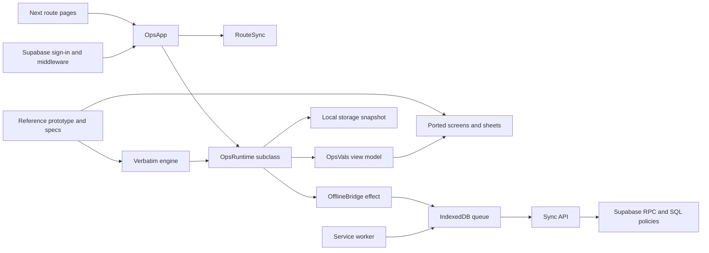

# Audit evidence and provenance

Baseline date: 2026-09-07. Root: `happy-cookie-ops`. The request authorizes exhaustive audit and planning, not application implementation. Attached PDF recommendations are reference material; they do not override the user's scope, free constraint or UI/UX lock.

## Inventory and interconnection

[repository-manifest.json](evidence/repository-manifest.json) enumerates the 347 original files with sizes and SHA-256 hashes. The inventory includes dotfiles, agent hooks, CI, all source, SQL migrations/seed, tests, documentation, the reference prototype/specifications, 91 reference screenshots and 13 public images. Dependencies, generated `.next`, this audit and external runtime files are outside that original inventory. The supplied tree had neither `.git` nor a dependency lockfile nor installed dependencies.

The review traversed the complete original file inventory. Text was reviewed by responsibility: startup/configuration and old plans; source-port and view-model relationships; runtime and business engine; eight SQL migrations and generated seed; identity, APIs, offline queue/service worker; tests, CI and agent hooks. Generated fingerprints/seed and binary assets were inspected as generated/reference artifacts rather than treated as independent hand-written business logic. No claim is made that static reading proves every runtime branch. The source-level detail lives in reports 01–03; browser inspection and executable checks below establish separate evidence.



The key missing connection is between most engine commands and authoritative database transactions. The existence of a database table or API contract in prose does not establish that the UI invokes it.

## Executable checks

To avoid modifying source dependencies, the original files were copied to an isolated temporary directory; the location is recorded in [scratch-location.txt](evidence/scratch-location.txt). Installation used `pnpm install --ignore-scripts`. That means lifecycle hooks were not used to assert setup success. The installation log records resolved versions; a lockfile generated in the scratch directory is not an original lockfile.

Next development startup automatically adjusted the scratch TypeScript JSX/include configuration and appended framework agent guidance. Those changes affected only the temporary copy. The audit helpers were stopped and both files restored to their original hashes before the September 8 final `pnpm verify`; the same 108 diagnostics remained. Final validation compares every original file in the test copy with the baseline inventory.

| Check | Actual result | Evidence |
|---|---|---|
| Original `pnpm verify` without dependencies | Port and engine pass, typecheck cannot find compiler | [Original verify](evidence/pnpm-verify-original.txt) |
| Installed-copy `pnpm verify` | Port and engine pass; typecheck fails with 108 diagnostics; later stages do not run in this command | [Installed verify](evidence/pnpm-verify-installed.txt) |
| Final installed-copy `pnpm verify`, September 8 | Exit 2; same 108 TypeScript diagnostics; chained lint/unit not reached | [Final verify](evidence/pnpm-verify-final.txt) |
| Independent lint | Fails loading ESLint configuration with circular JSON conversion | [Lint](evidence/pnpm-lint.txt) |
| Independent unit suite | 9 files pass, 1 fails; 70 tests pass, 1 fails | [Unit output](evidence/pnpm-unit.txt) |
| Production build | Fails type checking; configuration/deprecation warnings also present | [Build](evidence/pnpm-build-original.txt) |
| Browser audit | 104 hydrated direct visits + 104 engine-driven captures | [Summary](evidence/ui-summary.json), [direct](evidence/ui-results.json), [driven](evidence/ui-driven-results.json) |
| Full official E2E/visual release gate | Not established: production build fails; Docker-rendered baseline gate unavailable | [Test design audit](01-feature-and-state-audit.md) |
| Supabase reset/RLS/concurrency tests | Not run: Docker daemon unavailable; no hosted project provisioned or reset | [SQL audit](02-data-engine-and-offline-audit.md) |
| Native iPhone/macOS Safari installation, eviction and hardware tests | Not run on physical Apple hardware | [Required device tests](08-validation-and-operations.md) |

Verbatim successful gate lines:

```text
Port integrity OK — 54 files match the baseline.
Engine contract OK — 49 exports, 21 settings keys, 19 tables documented, provenance claims verified against the prototype.
```

These outputs are narrow evidence. The first fingerprints selected text and style counts; it does not prove identical CSS values, complete behavior or accessibility. The second checks exported contracts and documented provenance; it does not execute migrations, enforce security or prove engine correctness. Full failure output is preserved in the linked logs; the application does **not** satisfy the repository's definition of “it works.”

## Browser method and visual observations

Used command-line Playwright only, respecting the Windows GPU guard. Chromium and WebKit were installed in the audit environment. Profiles: Chromium at 390×844, 834×1112 and 1440×900, WebKit at 390×844. `NEXT_PUBLIC_HARNESS=0`, no configured live backend, reduced motion, Asia/Manila timezone. Service workers were blocked for these visual captures, so they cannot demonstrate offline readiness.

An initial run against `127.0.0.1` loaded server-rendered content while Next development-origin restrictions blocked application chunks. Those artifacts are retained as `ui-shell-initial.json`; they are **discarded as interactive route evidence**. The corrected run used `localhost` and waited for the engine's exposed development instance, proving hydration before inspection.

All 104 direct visits returned 200 with no captured page errors or broken images. However, 96 had a pathname different from the requested route after hydration (24 per profile; only Home and sign-in matched). Body content typically returned to Home. This is a route/bootstrap failure, not 104 passing screens.

The second pass deliberately called the existing engine's navigation and device selectors to inspect the port's layouts. These 104 captures display the actual screen families, but retain the route synchronization mismatch and do not prove user-driven deep linking. The harness code, raw DOM text and screenshots expose exactly what was done. Empty `/batch` without a selected batch, `/order` without selection on mobile, and `/stocktake` are gaps requiring existing-state initialization or explicit unavailable states.

Viewed the reference contact sheets and the resulting mobile, tablet, desktop and WebKit contact sheets, plus full-size examples. The design has a cream/brown/orange palette, fixed phone canvas, mobile dock, wider tablet navigation and a desktop split order view. `HARNESS=0` still leaves the prototype header, flow controls, connectivity toggle and customer preview controls. The default mobile canvas does not automatically select the already-designed wider layout; on a narrow WebKit viewport the fixed shell clips portions of customer content. Removing review chrome and adapting the existing designed layouts requires a narrowly approved shell exception if it cannot be accomplished through runtime values. This audit changes none of it.

Visual evidence indexes:

- [Reference mobile](evidence/reference-mobile-contact.png), [tablet](evidence/reference-tablet-contact.png), [desktop](evidence/reference-desktop-contact.png), [states](evidence/reference-states-contact.png).
- [Live mobile](evidence/ui-driven-chromium-phone-contact.png), [tablet](evidence/ui-driven-chromium-tablet-contact.png), [desktop](evidence/ui-driven-chromium-desktop-contact.png), [WebKit](evidence/ui-driven-webkit-phone-contact.png).
- [Desktop orders full size](evidence/ui-driven/chromium-desktop/03-orders.png), [WebKit shop full size](evidence/ui-driven/webkit-phone/19-shop.png).

Contact sheets are navigation aids, not pixel-diff proof. The existing repository requires Docker for accepted visual baselines; these audit images do not replace them. Keyboard, VoiceOver, safe-area behavior, installed app storage and all state combinations remain required release checks.

## PDF and external evidence

The supplied manual has 123 pages. Full extracted text is in [erp-manual-extracted.txt](evidence/erp-manual-extracted.txt). All sections, including the functional families, industry boundaries, deployment overlays and source map, were considered. [05](05-manual-crosswalk.md) records adoption/exclusion rather than importing an enterprise ERP feature list into a small bakery app. PDF text extraction may flatten diagrams and tables; page references permit visual/source reinspection when implementing a particular control.

Official vendor, standards and regulator pages were independently consulted; [10](10-decisions-and-sources.md) separates verified service facts from architectural judgments and account-specific unknowns. Prices, quotas, models, laws and provider terms must be rechecked before setup/release. No live security certification, legal determination, hosted performance result or paid-account entitlement was inferred from documentation.

## Corrections to earlier project claims

| Earlier claim | Evidence-based correction |
|---|---|
| Ready for production / deploy immediately | Build, authorization, durable workflows and operations are incomplete |
| Vercel Hobby is the free business host | Commercial use is excluded by its published fair-use rule |
| Disabling harness removes all review UI | Header, flow/state controls and preview exits remain |
| RLS is already the security boundary | Policies permit unwanted writes; privileged functions need explicit revocation and role checks |
| Offline sale is written before anything else | Mirroring is a React effect after engine state mutation, and IDB helper resolves before transaction completion |
| Sync accepted means all displayed sales safe | Runtime marks all rows synced after an empty/skipped result without matching acknowledgments |
| Find order requires two factors | Actual screen has one field; engine searches several low-entropy identifiers |
| Recipe UI is read-only / tax setting unused | Recipes are editable; `taxRate` is used in P&L calculations |
| Screen failure preserves header and dock | Boundary currently wraps the whole AppFrame |
| Historical real records require migration | User corrected this: fixtures only; clean live bootstrap |

Never silently overwrite a new contradictory finding to preserve this plan. Add evidence, amend the affected decision/task and preserve the prior conclusion as superseded.

Final planning consistency checks and source-preservation evidence are in [12 Plan validation](12-plan-validation.md), with a per-original-file responsibility index in [repository-coverage.csv](evidence/repository-coverage.csv).
