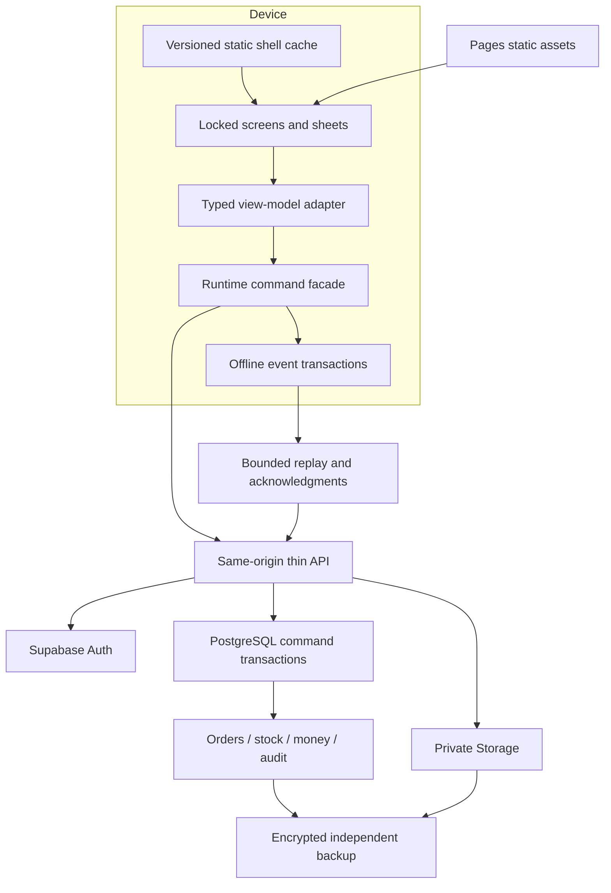

# Target architecture, tools and free operating envelope

Status: selected planning design, subject to the MP-04 deployment/CPU proof. This document specifies what to build; it does not describe capabilities already deployed. Preserve the existing Next/React port and put server authority behind its runtime/view-model boundary.

## Stack decision

| Layer | Selection | Reason and implementation boundary |
|---|---|---|
| Language / runtime | TypeScript strict; a currently supported Node LTS pinned identically in local, CI and Docker; pnpm pinned with committed lockfile | Repair the declared Node minimum and verify support against selected Next/test versions in MP-01; no floating production resolution |
| UI | Existing Next.js 16 App Router, React 19, Tailwind 4 and inline port styles | Reuse approved screens and sheets; do not replatform to a different design system |
| Frontend delivery | Next static export to Cloudflare Pages, provider `pages.dev` hostname + HTTPS | Existing site is primarily a client application; no per-request Next SSR needed for staff tools |
| HTTP boundary | Thin same-origin Cloudflare Pages Functions under `/api/v1/*` | Web-standard Request/Response, shared Zod contracts, session cookies and narrow RPC calls; no full Next server in a 10ms CPU budget |
| Database / identity | Supabase Free PostgreSQL and Auth, one production and one staging project | Transactional SQL, constraints, RLS and generated types; local Supabase for disposable tests |
| Files | Supabase private Storage for payment proof/receipts; public approved assets remain static | Short-lived signed access; quota and retention policy; separate metadata and object backup |
| Offline | Native IndexedDB wrapper repaired for transaction semantics; versioned service worker; one event writer | Keep dependency surface small; introduce a library only if it demonstrably improves tested migration/transaction reliability |
| Validation | Shared Zod request/response schemas; PostgreSQL constraints and command validation | TypeScript types alone cannot validate hostile requests or corrupted saved state |
| Tests | Vitest, Testing Library, Playwright Chromium/WebKit, local Supabase/SQL tests, axe-core, k6 | Reuse useful tests but replace weak smoke assertions; load tests only against explicitly named local/staging targets |
| CI/source | Git + private GitHub Free, Actions Linux, Dependabot, dependency audit, secret scanning tool run locally/CI | Short retention for heavy artifacts; no paid security entitlement assumed |
| Monitoring | Structured redacted logs, small health endpoint, SQL/job evidence, local operator dashboard | Existing Sentry is optional after scrub/allowance proof; no telemetry dependency required for selling |
| Backups | Supabase CLI/pg_dump + object manifest/download, encryption with age or equivalent open-source tooling; existing independent storage | Restore tested locally; automate later as an operations task, separate from the AI runner |
| Agent system | Local Python standard library + SQLite FTS5, Git, installed Codex/Claude CLIs | No vector DB, paid API, always-on cloud machine or external agent framework needed |

Pin exact versions during MP-01, not from an untested “latest” list in this plan. The audit copy resolved Next 16.3.1/React 19.2.0, TypeScript 5.9.3 and Playwright 1.63.0; the repository's visual Docker image expected a different Playwright version. These are observed facts, not endorsement of that combination. Check current advisories, supported Node range, license and peer compatibility, then commit one reproducible lock and matching browser image. Re-run only affected checks after routine updates; major framework/security changes receive full release checks.

## Free-service facts and constraints

Verified from official documentation on 2026-09-07; account availability and terms must be checked again during setup. Quotas are account/provider limits, not business capacity guarantees.

| Service | Relevant free allowance / limitation | Operational decision |
|---|---|---|
| Cloudflare Pages | 500 builds/month, 1 concurrent build, 20,000 files, 25 MiB per asset | Deploy successful release commits, not every agent checkpoint; use provider hostname |
| Workers / Pages Functions | 100,000 dynamic requests/day and 10ms CPU/request; static asset requests free/unlimited under documented pricing | Functions do bounded validation and RPC I/O. Benchmark CPU at realistic payload sizes; split sync into bounded batches |
| Supabase Free | 500 MB database, 1 GB file storage, 5 GB uncached + 5 GB cached egress, 50,000 MAU, two active projects; inactivity pausing; no included automatic backups/PITR | Keep business data small, objects compressed, backups independent; local disposable DBs avoid a third hosted project |
| GitHub Free | 2,000 included Actions minutes/month, 500 MB artifact storage for private repo plan; additional use can bill if allowed | Spending-stop budget, Linux runners, cancel obsolete CI, 7-day artifacts, local heavy tests |
| Supabase default email | Restricted to project team recipients, low rate and best-effort delivery; unsuitable for normal production email | Zero-email staff provisioning/recovery baseline; custom SMTP is an optional separately verified integration |
| Brevo candidate | 300 email sends/day on Free; sender/domain/authentication and activation requirements remain | Candidate only if an existing authenticated domain and successful free-account tests are available; no promised free deliverability |

Sources: [Pages limits](https://developers.cloudflare.com/pages/platform/limits/), [Workers pricing](https://developers.cloudflare.com/workers/platform/pricing/), [Supabase pricing](https://supabase.com/pricing), [GitHub included usage](https://docs.github.com/en/billing/reference/product-usage-included), [Supabase SMTP](https://supabase.com/docs/guides/auth/auth-smtp), [Brevo Free](https://help.brevo.com/hc/en-us/articles/208580669-FAQs-What-are-the-limits-of-the-Free-plan), [Brevo SMTP prerequisites](https://help.brevo.com/hc/en-us/articles/115000188150-Troubleshooting-Issues-with-Brevo-SMTP).

Vercel Hobby is excluded: the app serves a business, and the published Hobby fair-use rule restricts it to personal non-commercial use. Do not deploy there on the theory that low traffic makes commercial use free. [Vercel fair use](https://vercel.com/docs/limits/fair-use-guidelines)

## Architecture and authority



One business, one production database. Avoid premature multi-tenancy. New deployments for another business use the same versioned code and a separate database/project profile. The reuse template must not imply that adding a `tenant_id` column alone creates isolation. A pooled service requires its own tenancy, cache, object, queue, identity, support and billing design plus isolation tests.

Keep a modular monolith: identity; catalog/configuration; ordering/payments; procurement/inventory; production; event sales; reporting; operations. Modules share one transactional database but expose explicit commands and projections. They do not write each other's tables ad hoc. No Kafka, Redis, Kubernetes, microservices, GraphQL, paid search or embedding pipeline is needed for the launch workload.

Future code placement:

```text
src/domain/{catalog,orders,inventory,production,events,reporting}/
src/contracts/                 # Zod wire schemas and safe error codes
src/adapters/                  # server projection <-> existing OpsVals/engine shape
src/store/ops-runtime.tsx      # override approved actions; orchestrate durable commands
src/lib/offline/               # local command store, allocation, replay, reconciliation
functions/api/v1/              # Cloudflare entry points; no business arithmetic here
supabase/migrations/           # controlled schema changes after baseline decision
tests/{unit,integration,e2e,fixtures,load}/
ops/                          # later setup/backup/restore tooling, no embedded secrets
```

This is a proposed layout, not a claim those directories exist. Keep existing helpers such as `money.ts`, `rate-limit.ts`, `scrub.ts` and capacity rules where useful; repair and reuse them rather than introducing duplicate logic.

## MP-04 hosting proof, before committing domain APIs

Next static export does not host dynamic API routes, request cookies, middleware/proxy, server actions or arbitrary dynamic rendering. Move those responsibilities to Functions; prove every static route and refresh path. Remove obsolete Next-only runtime assumptions deliberately. Emit host headers through Pages configuration and Function responses, not `next.config` promises that export cannot enforce. Sentry's Next tunnel is not automatically preserved. [Next static export](https://nextjs.org/docs/app/guides/static-exports), [Cloudflare static Next guide](https://developers.cloudflare.com/pages/framework-guides/nextjs/deploy-a-static-nextjs-site/)

The spike must produce: static build; all direct routes; same-origin login/session refresh/logout; minimal public catalog and staff RPC; safe headers; private response non-caching; one signed image access; expected 401/403/409/429/503 responses; 50-sale replay under the CPU cap; deployment size and quota report. Use a preview deployment with synthetic data once deployment is authorized during implementation. Local emulator success alone does not prove hosted CPU limits.

Acceptance: representative API CPU p99 <=8ms in a measured run, with no request exceeding the 10ms free cap; explain variance and repeat on quota-sensitive payloads. End-to-end latency is measured separately because network waiting is not CPU. If the spike fails, first reduce parsing/batch work and put computation in one SQL transaction. Do not auto-upgrade. Record an ADR comparing full Next/OpenNext on Workers Free versus a lighter static build preserving the same React port. A framework change or spend increase is a user decision. Current Cloudflare Next guidance changing over time is a reason to pin and test, not to follow a new framework recommendation blindly.

## Authentication and API implementation

Use same-origin secure HttpOnly session cookies at the BFF; no service key or refresh token in the engine/localStorage. The BFF exchanges credentials with Supabase Auth, validates sessions, refreshes safely with single-flight handling and returns the minimum active profile projection. Browser code calls the BFF. Database staff RPCs receive the authenticated user's JWT and check active profile/capability at execution time. Role changes take effect on the next command; a stale UI cannot authorize a write.

Public checkout/lookup use narrowly named server-side operations. Anonymous table writes are revoked. If a public operation requires a service credential, keep it server-only, accept only the fixed command shape, and never expose a generic table/RPC proxy. Its function validates every field and rate/size limit independently. Staff paths must not casually use the service role and bypass RLS. Configure default privileges and revoke PUBLIC EXECUTE for every privileged function.

Mutations require an allowed Origin, same-origin Fetch Metadata where available, a session-bound CSRF token for cookie-authenticated writes, and a supported content type. CORS is not an authorization mechanism. Cookies use Secure, HttpOnly, SameSite and appropriate path/lifetime. Login uses generic errors, throttling and a validated internal return path. Passwords/tokens are never logged. Recovery/provisioning is an owner-authenticated operational command with identity verification and a confidential handover, with fresh session revocation/audit; it is not a publicly guessable password-reset endpoint.

Staff self-signup is disabled. Default free baseline: owner and helper accounts are provisioned through a documented restricted operation; password-reset recovery is owner assisted; provider account recovery codes are stored offline. No customer account is required. If the locked people screen implies a complete invitation UI that does not exist, record a DP decision and supply the manual procedure until an approved UI exists. Optional SMTP must pass real delivery, expiry, single-use and no-extra-spend tests before any feature claims depend on it.

## Performance and growth plan

Initial sizing assumption, to validate with owner: <=5 staff accounts, one bazaar writer, <=1,000 orders/month, <=10,000 sale lines/month, <=50 concurrent shop sessions, <=20 concurrent final-unit attempts in test. These are engineering test inputs, not observed business traffic. File retention, not user count, is likely to exhaust Free first.

Plan an indicative envelope: 1,000 orders ×50 KB aggregate database footprint ≈50 MB/month before indexes, ledger, audit and bloat. At that rate a 500 MB database cannot retain years of detailed history without archiving/optimization. A 250 KB proof ×1,000/month is 250 MB/month; a 1 GB object tier needs enforced retention and offsite export. Measure actual `pg_total_relation_size`, objects and egress after representative seeding; replace estimates before launch. Do not delete mandatory financial history merely to remain free.

Budgets: alert at 60% and 75%; at 85% stop optional imports/large attachments and review capacity; at 95% pause new online intake if safe capacity cannot be maintained, preserve existing transactions and display an approved unavailable state. Never auto-upgrade or open alternate accounts to evade quotas. Archive by purpose/retention, retain searchable metadata and verified restore links, or accept a bounded service interruption. Scaling beyond the free envelope requires another explicitly chosen constraint.

Query design: `(drop_id, state, created_at, id)` order index; unique command/client ID + payload hash; `(event_id, device_id, sequence)` replay index; `(item_id, location_id, occurred_at, id)` movements; `(occurred_at, source_id)` ledger; unique active device allocation; relevant foreign keys indexed. Use cursor pagination (50 default, 100 max), no full-book bootstrap. Batch one projection per screen/domain, avoid N+1 queries, and inspect `EXPLAIN (ANALYZE, BUFFERS)` on synthetic production-scale data. Add maintained rollups only after measuring query cost; never duplicate financial truth in editable totals.

Cache public catalog for <=30s with version/ETag; capacity and accepted price are rechecked transactionally regardless of cache. Staff/private/status responses use `no-store`. Poll active work views with bounded intervals and backoff, paused when hidden; use Realtime only if a measured need justifies its separate quota and authorization surface. Public status should not poll indefinitely in a background tab. No full database broadcast to every device.

Targets for controlled acceptance tests: warm local screen response <=100ms p95; offline commit <=200ms p95 on target iPhone; mutation response <=1.5s p95 at planned load; public LCP <=2.5s, INP <=200ms and CLS <=0.1 at the defined device/network profile. These are targets, not audit measurements. Measure cold and warm loads separately; no production framework size claim until bundle analysis exists. Split staff and public entry payloads, lazy-load unused screen groups where parity permits, optimize source images without changing visible appearance, and keep historical arrays off the main thread.

## Apple/browser support contract

Baseline proposal: iOS/iPadOS 17+ Safari or installed Home Screen app; macOS Safari 17+ ordinary browser, with Add to Dock where supported; current Chrome/Edge desktop as secondary. Before release, record exact available devices/OS versions, test the oldest supported and current version, and adjust the public support matrix to evidence. Windows WebKit emulation is useful but not a real iPhone certification.

Required: standalone manifest, correct icons/apple-touch icon, HTTPS, safe-area handling, viewport/keyboard focus, portrait/landscape, pinch zoom, VoiceOver, file picker/camera image formats, reload, browser Back/Forward, installed-app update, storage quota rejection and offline reopen. Preserve existing intended layouts and interactions; visual exceptions require DP records. Do not depend on hover, automatic downloads, clipboard without gesture, exact timers while suspended, background sync or a permanently open browser.

Safari storage persistence/quotas depend on browser policy and user/device conditions. Call `navigator.storage.estimate()` and request persistence where supported, but treat granted persistence as risk reduction, never a backup or eviction guarantee. Web Push is optional and only enabled after installed-app/user-permission tests; it is not the order-delivery or offline-sync mechanism. [WebKit storage policy](https://webkit.org/blog/14403/updates-to-storage-policy/), [WebKit iOS Web Push](https://webkit.org/blog/13878/web-push-for-web-apps-on-ios-and-ipados/), [MDN Background Sync](https://developer.mozilla.org/en-US/docs/Web/API/Background_Synchronization_API)

An app cannot guarantee recovery of unsynced sales after the user deletes site data or loses a phone. The launch process therefore includes pre-event preparation, periodic sync/export when feasible, and a paper receipt/tally fallback. Offline stock is reserved to the designated device until reconciliation, even if the device's session or lease expires.
