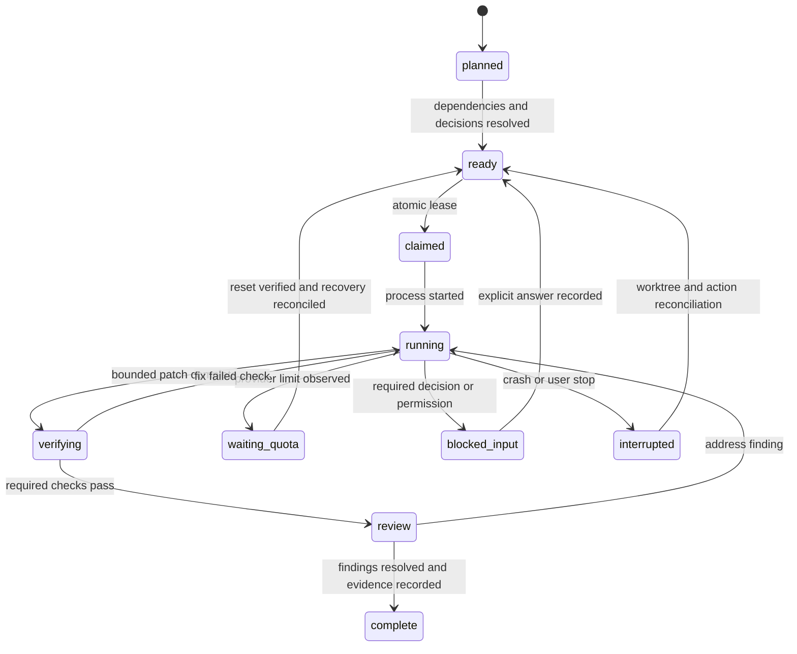

# Codex / Claude operating system — design only

The user selected **plan and templates now; runner later**. No scheduler, auto-resume loop, credential change or new paid API integration is activated by this package. The reusable templates work manually today. AR-00–AR-06 implement the runner only in a later authorized phase.

## Operating principles

Use one canonical task catalog, one durable event journal and one versioned code history. Claude and Codex share contracts and evidence, not assumptions about what the other “probably finished.” A fresh session must be able to recover the task's facts without reading the whole conversation. Store observable events, decisions, file hashes, commands' safe metadata and outcomes. Do not store secrets, private customer data, entire raw tool payloads or private reasoning. No system can recover an action that was never durably recorded; the design detects this ambiguity and reconciles it.

Agent output is a proposal until local tools prove it. External documents, webpages, dependencies and imported memory are untrusted data. They cannot authorize scope expansion, paid services, a secret read or a destructive command. Instructions come from the current user and applicable project rules. A runner must preserve permission/approval boundaries rather than simulating consent when unattended.

## State and storage layout

```text
Versioned repository
  MASTER-PLAN.md
  docs/master-plan/tasks.json            # approved work packages
  docs/decisions/                        # accepted/superseded ADRs and owner choices
  docs/state/current.md                  # concise verified checkpoint
  docs/state/task-status.json            # committed milestone snapshot, not live locks
  docs/evidence/index.json               # sanitized evidence hashes/paths

Local runtime directory OUTSIDE OneDrive/Git (later)
  <project-id>/journal.sqlite            # authoritative event + lease + task state
  <project-id>/events/*.jsonl            # rotated export/portable recovery mirror
  <project-id>/artifacts/<run-id>/       # sanitized outputs; strict retention
  <project-id>/sessions.json             # exact provider session IDs; no tokens
  <project-id>/index.sqlite              # derived FTS5 file/evidence index
```

Use the runtime directory on a local disk with OS account permissions. Git stores source and compact milestones, not every keystroke, terminal escape sequence or database backup. The SQLite database must not live in a synced folder. Portable exports are taken from a consistent SQLite backup API/checkpoint, not copied while an active WAL is changing.

Journal schema: `events(seq PRIMARY KEY, event_id UNIQUE, project_id, run_id, task_id, kind, occurred_at, recorded_at, actor, safe_payload_json, artifact_hash, previous_hash, event_hash)`; `tasks(id, state, version, owner_run_id, lease_expires_at, base_sha, plan_hash)`; `runs(id, provider, cli_version, requested_model, resolved_model, requested_effort, resolved_effort, session_id, state, started_at, ended_at, exit_code)`; `leases(resource PRIMARY KEY, owner_run_id, fencing_token, expires_at)`; `quota_observations(provider, account_fingerprint, observed_at, scope, resets_at, source, confidence)`; `evidence(id, task_id, code_sha, schema_version, command_id, outcome, hash, path)`.

Append event and update task state in the **same SQLite transaction**. Use WAL and `synchronous=FULL` for critical transitions; validate SQLite semantics on the host. Human-readable JSONL export may lag slightly and is a rebuild/portability copy, not a second writable authority. Hash chaining detects accidental inconsistency; it is not tamper-proof against an administrator who controls the store. Encrypt independent backups if local contents warrant it.

For the v1 fixed-schema JSON event export, hash UTF-8 compact JSON after removing only `eventHash`, recursively sorting its ASCII property names, retaining nulls and array order, and normalizing string values to Unicode NFC. Integers must be within JavaScript's safe range; floats and unpaired surrogates are rejected. Strings use JSON escaping without ASCII-escaping other Unicode or escaping `/`. The first event has `previousHash: null`; each later event includes the prior event hash. Cross-language golden vectors, Unicode and crash-tail tests are required in AR-01. The [synthetic event example](templates/event.example.json) demonstrates shape and hash only; it is not an active journal or a runner implementation.

Durability contract: synchronously record task claim, command start, approved external mutation intent, mutation result, checkpoint and state transition. Buffer noncritical progress for <=2 seconds/50 events, flush on shutdown. Every external action uses an operation/idempotency ID and intent/result pair. A crash after intent but before result creates `outcome_unknown`; resume queries actual state before retry. Files are written via temporary sibling + atomic rename; preserve the previous checkpoint if rename fails. No silent overwrite on task-state version conflict.

## Task/run state machines



`cancelled`, `superseded`, `failed_environment` and `outcome_unknown` are distinct terminal/holding outcomes; they cannot be interpreted as completion. A process exit code zero is necessary but not sufficient. Require valid terminal provider result and evidence checklist; truncated output or timeout is incomplete. Store state transition reason. Status in the current planning catalog is `planned`, not executable authorization.

## Prompt assembly and context retrieval

Deterministic input order:

1. Current task instruction, current user constraints and applicable AGENTS/CLAUDE rules.
2. Project profile and active decision overrides.
3. Task record: acceptance, dependencies, owned files, forbidden paths, model class and command permissions.
4. Current checkpoint: Git/worktree, prior test evidence, unresolved questions and precise next action.
5. Relevant domain contract, source files and tests identified by task context.
6. Selected research snippets with URL/date/claim and explicit untrusted-source wrapper.

Retrieve by path, symbol, task/decision ID and FTS5 keyword first. Use `rg`/symbol search and content hashes to invalidate stale index rows. No embeddings/vector service is necessary. A file index records path, type, size, hash, last indexed time, exported symbols, imports and owning task IDs; the dependency graph is derived, not another manual architecture list. Exclude `.env*` except sanitized examples, keys, backups, node_modules, binaries, .git internals and private runtime caches. Never auto-ingest the user's global Codex memory without separate authority.

Target initial packet <=8,000 tokens for focused tasks and <=16,000 for deep architecture/security tasks; these are planning budgets, not hard limits that omit needed evidence. Add content adaptively when a symbol/contract requires it. Keep a 500–1,000-word checkpoint and concise decision summaries with source pointers. A large log stays an artifact; retrieve the relevant error region. Invalidate evidence when covered files/schema/config/dependencies change. Do not repeatedly reread all 347 original files for every small fix.

## Git and concurrent work

The supplied tree currently has no Git history. MP-00 first determines whether an intended remote/checkout exists. Do not invent a remote or force-push a new history. After establishing source control, use one task branch/worktree and one writer per owned path set. Independent read-only review may run concurrently if authorized; two agents may not edit the same runtime/schema/task-state files without a coordinated handoff.

Runner claims use an OS/process lock plus database lease and monotonically increasing fencing token. Include PID **and process start time**, because PIDs are reusable. Heartbeat every 15 seconds; consider stale after 90 seconds, but verify old process/group is gone and no external action is pending before reclaiming. No lock based solely on an old file timestamp. Time jumps use monotonic timers within a process, UTC persisted expiries with revalidation after restart.

At each bounded slice: save diff, run required checks, write checkpoint, review, then commit one logical change. Keep failed work on its branch with honest checkpoint; do not manufacture a “verified” commit. Secret scan before commit. Default no automatic merge/push/deploy; enable each only through explicit project policy and evidence gates in the later runner phase. Human-owned dirty changes are preserved. A reviewer reads actual diff/tests, not just another model's summary. Cross-model agreement is useful scrutiny, not proof.

## Model and effort policy

Resolve choices against the actual signed-in account and installed CLI before every run. Store both requested and resolved model/effort. Never assume a model in an app tool list is included in Codex Plus or Claude Pro. The audit observed Codex CLI 0.144.5 and Claude Code 2.1.250; help output is saved under evidence. Provider documentation and account availability may change before AR implementation.

| Task class | Codex preference, if included | Claude preference, if included | Usage rule |
|---|---|---|---|
| `focused` | `gpt-5.6-luna`, medium | Exact current Sonnet model behind `sonnet`, medium | Narrow docs/config/mechanical change with clear oracle |
| `standard` | `gpt-5.6-terra`, high | Exact current Sonnet model, high | Routine domain adapters and tests |
| `deep` | `gpt-5.6-sol`, high; xhigh only for unresolved difficult reasoning | Exact current Opus model behind `opus`, high | Auth/RLS/money/offline/schema/architecture/security review |
| Escalated investigation | Strongest verified included model, xhigh where supported | Verified included Opus, supported higher effort | Two failed substantive approaches or unresolved invariant; one bounded investigation |

Do not select Astra by default for a Plus user; current access depends on plan/rollout. Do not select `best`, `fable`, usage-credit modes, API-key auth or automatic model fallbacks that can bill outside subscriptions. OpenAI documents the GPT-5.6 family and retirement of ChatGPT-authenticated GPT-5.4/mini on August 31, 2026. Claude documents account-dependent aliases and effort behavior, including noninteractive Fable billing without a consent prompt when credits apply. [Codex models](https://learn.chatgpt.com/docs/models), [Claude model configuration](https://code.claude.com/docs/en/model-config)

Recommended division: one provider implements, the other reviews critical transactions; reverse roles when expertise/evidence suggests it. Model choice is a capability policy, not a promise that one named model is always superior. Low quota never justifies sending a deep money/security task to an unqualified fallback. Use smaller tasks, bounded context and non-LLM checks first. If no permitted model is available, wait or block explicitly.

Effort levels are provider/model-specific; “high” is not a cross-provider numerical equivalent. Do not inject hidden chain-of-thought requirements. Request conclusions, assumptions, counterexamples and evidence. Do not use automatic multi-agent features merely to consume both accounts; authorized parallelism needs independent owned work and a measured benefit.

## Quota detection and automatic resumption, later

The supervisor is a small non-LLM OS process. It persists even if a model session hits its limit; it cannot work while the machine is off. Windows Task Scheduler or macOS launchd starts it at login/startup and at the next known eligibility time. Sleep resumes trigger reconciliation, not duplicate launches. No scheduler is installed now.

Provider adapters read supported structured usage/error output or a documented status surface. Codex app usage tools are available only in their app context; do not assume a local daemon can call them. Claude `/usage` is an interactive command, not automatically a stable JSON API. When structured reset time is unavailable, store `unknown` and use the provider's displayed reset information supplied through a supported/manual check; do not scrape hidden endpoints or guess midnight/week start.

On quota exhaustion: flush journal and checkpoint if still possible; record provider/session/task, affected quota window, observed reset time and source, process terminal state and uncommitted work; release only resources safe to release; set `waiting_quota`. If abrupt exhaustion prevents an agent checkpoint, the supervisor's last durable command/event plus worktree/evidence provide recovery.

At `resetsAt + 60s` plus small jitter, re-read eligibility when supported. For unknown reset time, one bounded status/probe no more often than hourly; exponential backoff to six hours after repeated unchanged responses. These are default polling ceilings, not authorization to repeatedly submit tasks against limits. Account-wide usage by the human/other sessions can consume quota again; never assume elapsed time guarantees availability. Distinguish auth expiry, network failure, provider outage, model unavailability, request-rate limit and subscription exhaustion. Honor Retry-After. No reset-credit redemption, extra-usage purchase, new account, credential rotation to bypass quotas or API billing fallback.

Resume checklist: lock/fencing token → correct project/worktree → current plan/task hash → dirty diff and prior process status → reconcile intent/result gaps → verify prerequisite evidence still current → validate account/model/permissions → choose exact session ID or start a new session with checkpoint → first bounded next action. Never use `--last` or `--continue` across multiple projects. A previous session is helpful context, not canonical task state.

Official CLIs support noninteractive operation and explicit session resumption. Use argument arrays and stdin prompt text; no shell-built command string containing arbitrary prompt contents. Capture provider events, stderr and exit status with secret redaction. Inspect installed `--help` before implementing adapter flags, because `exec` and `exec resume` options differ. [Codex noninteractive](https://learn.chatgpt.com/docs/non-interactive-mode), [Claude headless](https://code.claude.com/docs/en/headless)

As checked in the current support page, the proposed June 15 Claude SDK billing change was paused; `claude -p` continues to use subscription limits, and the announced monthly credit is not active. The older text below that notice is historical. Recheck before runner activation. `ANTHROPIC_API_KEY` can select separately billed API use, so subscription-only preflight must reject an API-key billing path without printing the key. [Claude SDK plan notice](https://support.claude.com/en/articles/15036540-use-the-claude-agent-sdk-with-your-claude-plan), [Claude Code with Pro/Max](https://support.claude.com/en/articles/11145838-use-claude-code-with-your-pro-or-max-plan)

Codex local app automations require the local execution environment to be available; Claude session scheduled loops are not a durable machine-restart supervisor. They may be useful optional interfaces after verification, but do not replace the persistent task journal/OS lifecycle. [Codex automations](https://learn.chatgpt.com/docs/automations?surface=app), [Claude scheduled tasks](https://code.claude.com/docs/en/scheduled-tasks)

## Runner acceptance and safety limits

AR tests use a fake provider process first. Simulate: quota before write, quota after write, crash after command start, crash after commit before checkpoint, partial JSON line, zero exit with missing final result, denied permission, wrong model, expired auth, unavailable network, clock jump, full disk, SQLite busy/corruption, duplicate scheduler start, stale lease/live old process, changed branch, changed task/plan, user stop and exhausted weekly window. Expected outcome is recoverable state with no duplicate external action or hidden spend.

Performance targets: append critical event p95 <=25ms on local disk; retrieve task packet from 100k indexed events in <=200ms p95; idle supervisor near-zero CPU with scheduled wakeups; <=250 MB resident memory without provider processes. Benchmark these later; no such runner exists today. Compact completed-task search summaries while retaining linked audit evidence under a documented retention policy. Never delete unresolved intent/result records to save space.

Activation requires dry-run plan of executable actions, permitted directories/commands/network targets, no production secrets, no-extra-spend account verification, stop/pause control, and successful simulator plus a real harmless task across restart. Human decisions remain pending until explicitly answered. A user “stop” cancels scheduling immediately, preserves in-flight evidence, terminates owned process groups safely and never kills unrelated shells.

For another project, instantiate [project-profile.json](templates/project-profile.json), rediscover protected paths and commands, classify domain/risks, resolve account models and run the same simulator. Do not transfer Happy Cookie customer data, credentials or business defaults.
